<p align="center"></p>

# Lazycow Studio

**撮ったのはあなた。編集は Lazycow。**

[English](README.md) · 日本語

撮ったまま編集していない写真や動画を、リールや旅の動画にします。あなたは **Approve** を押すだけです。

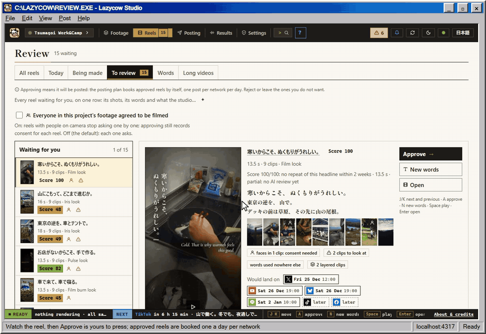

*確認して、Approve、予約。画面はすべて、群馬の嬬恋牧場Work&Campのリールを作っている私たちのスタジオです（映っている人は全員了承済み）。▶ **[40秒のデモ動画](docs/media/lazycow-demo.mp4)**：その素材、作成中のリール、人による確認、投稿の週表、結果、ワークフローまで。*

Lazycow Studio は、写真と動画の中から合うカットを探し、無料の音楽のビートに合わせて縦型の短いリールを作ります。地図とチャプター付きの長い YouTube 動画も、数本のパートに分けて作ります。そのあと、投稿の予約までします。すべて、あなたのPCの中で動きます。

作者は **[kensaurus](https://kensaur.us)** です。Apache-2.0 の無料のオープンソースです。

- **素材はPCの中に置いたまま。** タグ付けと検索は、あなたのPCのプロセッサーで行います。スタジオはファイルを読むだけです。SNSをつなぐか、有料のAIツールのキーを入れない限り、PCの外には何も出ません。
- **投稿は、すべて人が承認します。** **Approve** を押すまで、予約も投稿もされません。AIエージェントは下書きを作り、承認済みのリールを投稿できます。承認はできません。
- **AIエージェントから操作できます。** MCP サーバー、HTTP API（[OpenAPI](docs/openapi.yaml)）、npm パッケージがあります。Claude Desktop、Cursor、VS Code はボタン1つで、Claude Code は1行でつながります。

**こんな方に:** 小さなホテル、ゲストハウス、カフェ、お店の方。あるいはクリエイター。撮った素材はフォルダにあるのに、編集する時間がない方に向けて作りました。コードは書けなくても使えます。ダウンロードして、展開して、ダブルクリックするだけです。

YouTube、Facebook、Bluesky には直接投稿します。X、TikTok、LinkedIn、Google マップ、LINE は、あなたの Chrome で各サービスの予約画面に入力します。

## しくみ

スタジオは3つの部分でできています。画面と HTTP API を出す Node サーバー（`server/review.mjs`。[サーバーモード](docs/self-host.md)にしない限り、`127.0.0.1:4317` だけで待ち受けます）、素材の整理・タグ付け・カット選びをする Python（`python -m studio …`）、書き出しをする Remotion と ffmpeg です。タグ付けと検索は OpenCLIP があなたのPCのプロセッサーで行うので、基本の流れにはキーも LLM もいりません。クラウドのAIは、キーを入れたときだけ動きます（OpenRouter のレビュー係と言葉の提案、fal.ai のスローモーション・音楽・音声など）。文章づくりと画像の読み取りは、自分のモデルでも動かせます。OpenAI 互換のサーバーなら、ローカル（Ollama、LM Studio、vLLM、llama.cpp）でもクラウドでも使えます（設定 › キーとAI ›「自分のAIモデル」、または `.env` の `STUDIO_LLM_BASE_URL`）。MCP でつなぐ AI エージェントのほうは、どのモデルでも使えます。

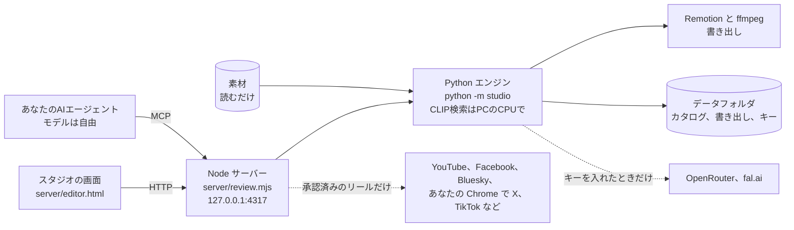

詳しくは [docs/architecture.md](docs/architecture.md)（英語）へ。[リールができるまで](docs/architecture.md#the-reel-pipeline)、[使っているAIモデルの一覧](docs/architecture.md#ai-and-ml-models)、[すべてPCの中で動かす](docs/architecture.md#run-it-fully-local)、[自分のLLMを使う](docs/architecture.md#use-your-own-llm)、[PCの外に出るもの](docs/architecture.md#what-leaves-your-computer)があります。

**撮影のコツ:** スタジオは各ファイルを3枚の静止画で見分け、1本のリールに1つのファイルから1〜4秒のカットを1つしか使いません。だから長回しより、短いカットをたくさん撮るほうが向いています。詳しくは[撮影ガイド](docs/filming-guide.ja.md)へ。カットの長さ、構図、設定、チェックリストをまとめています。

## はじめ方は3通り

### 1. ダブルクリックで始める（おすすめ）

ターミナルも、Node や Python の事前インストールもいりません。

1. [最新のリリース](https://github.com/kensaurus/lazycow-studio/releases/latest)から **Lazycow-Studio-&lt;バージョン&gt;.zip** をダウンロードし、置いておく場所に展開します。
2. まず **README.TXT** を開いてください。1997年ふうの説明書で、最後に日本語の手順もあります。
3. **Start Lazycow** をダブルクリックします（Mac は初回だけ **Start Lazycow.command** を右クリック › 開く）。「WindowsによってPCが保護されました」と出たら、「詳細情報」›「実行」を選びます。新しいファイルだという意味で、危険なファイルという意味ではありません。中身はすべて [`scripts/bootstrap/windows.ps1`](scripts/bootstrap/windows.ps1) で読めます。
4. 青いセットアップ画面が、スタジオの作業データの保存先と、素材の場所を聞きます。そのあと Node、Python、ffmpeg の固定版をダウンロードします。どれも SHA-256 を確認してからユーザーフォルダに置くので、管理者権限はいりません。10〜30分、約1.3 GB です。
5. スタジオが開き、Lazy Kenji が案内します。次からは、デスクトップの **Lazycow Studio** をダブルクリックしてください。

対応しているのは Windows 10/11（64ビット）と、Apple シリコンの Mac（macOS 14 以降）です。途中で止まったら、もう一度 **Start Lazycow** をダブルクリックしてください。続きから再開します。何が起きたかは `setup.log` に残ります。

### 2. ターミナルから: `npx lazycow install`

Node 20 以降が入っていれば、1行でインストールできます。

```
npx lazycow install
```

このバージョンのリリース zip を GitHub からダウンロードし、パッケージに組み込まれた SHA-256 と照合してから、`~/Lazycow Studio` に展開します。そのあとは、ダブルクリックと同じセットアップが始まります。別のフォルダに入れるときは `--dir <空のフォルダ>` を付けます。

コードから動かしたい開発者は、`git clone` のあと `npm ci`、`npm run setup`、`npm run review` の順に実行し、**http://127.0.0.1:4317** を開いてください。必要なものと詳しい手順は [README.md の Quick start](README.md#quick-start) にあります。

**Docker で動かす:** clone したフォルダの `.env` に24文字以上の API トークンを書いてから（ないと起動しません）、`docker compose up -d` を実行すると、スタジオがコンテナで動きます（イメージは `ghcr.io/kensaurus/lazycow-studio`）。素材フォルダ、ポート、更新のしかたは [docs/self-host.md](docs/self-host.md)（英語）へ。

### 3. AIエージェントをつなぐ

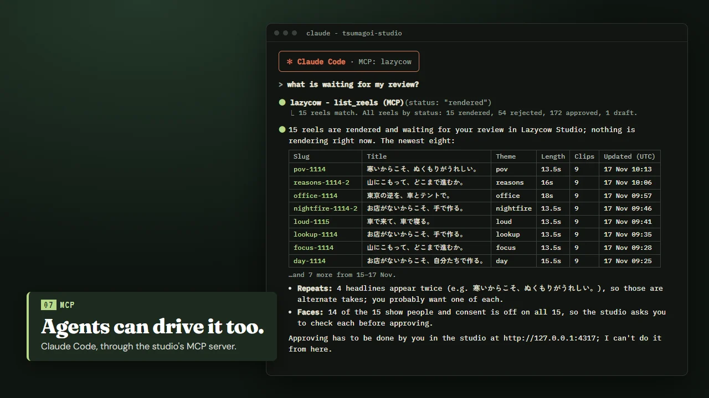

先にスタジオを起動しておきます。そのあと、ボタン1つで追加できます。Claude Code なら1行です。

[](https://github.com/kensaurus/lazycow-studio/releases/latest/download/lazycow.mcpb)
[](https://cursor.com/install-mcp?name=lazycow&config=eyJjb21tYW5kIjoibnB4IiwiYXJncyI6WyIteSIsImxhenljb3ciLCJtY3AiXX0%3D)
[](https://vscode.dev/redirect?url=vscode%3Amcp%2Finstall%3F%257B%2522name%2522%253A%2522lazycow%2522%252C%2522command%2522%253A%2522npx%2522%252C%2522args%2522%253A%255B%2522-y%2522%252C%2522lazycow%2522%252C%2522mcp%2522%255D%257D)

```
claude mcp add lazycow -- npx -y lazycow mcp
```

- **Claude Desktop:** ダウンロードした `lazycow.mcpb` を開くと、拡張機能として入ります。スタジオをダブルクリックのセットアップで入れたなら、設定は空のままで大丈夫です。ポートとトークンはスタジオの `.env` から読みます。そうでなければ、スタジオのフォルダを選んでください。
- **Cursor、VS Code、Claude Code** などの MCP クライアントは `npx -y lazycow mcp` を動かします（`{ "mcpServers": { "lazycow": { "command": "npx", "args": ["-y", "lazycow", "mcp"] } } }`）。PATH の通った Node 20 以降が必要です。ダブルクリックで入れた場合、スタジオ専用の Node は PATH に入りません。そのときは、スタジオの **Settings › Keys & AI › Use with Claude or Cursor** に出る行を使ってください。あなたの環境のパスが入った状態で表示されます。
- **MCP を使わないなら:** 同じスタジオを HTTP でも動かせます。[OpenAPI 3.1](docs/openapi.yaml)、または `npx lazycow api GET /api/overview`。

エージェントにできるのは、スタジオの状態を見る、リールを作る、投稿を計画する、承認済みのリールを投稿する、といったことです。承認するツールはありません。ツールの一覧は [docs/mcp.md](docs/mcp.md)（英語）にあります。

## 最初の流れ

画面の名前は、アプリの表示どおり英語で書いています。

1. 上のバーの **System**: すべての行が緑か黄色なら準備完了です。赤い行には、足りないものが書かれています。
2. **Footage › Add a folder**: 素材のフォルダを選びます。タグ付けは自動で始まります。
3. **Settings › Keys & AI › This project**: 名前、リンク、ハッシュタグ、使ってはいけない言葉を入れます。
4. **Reels › Make reels › New theme**: 見出しと、本当のことを書いた2〜3行、それぞれの行に合うカットの種類を書きます。
5. **Make reels** を押し、できたリールを1本ずつ **Review** します。見て、長さを整え、カットを入れ替えてから、**Approve** か **Reject** を押します。
6. **Settings › Accounts** で各SNSを一度だけつなぎます。**Posting › Plan posts** が、承認済みのリールを1つのSNSに1日1本ずつ予約します。

くわしい手順は [User guide](docs/user-guide.md)（英語）にあります。

## 各ページを動きで見る

作者自身のスタジオ（群馬の嬬恋牧場Work&Camp用。映っている人は全員了承済み）で録画しました。どのGIFもページを開き、スクロールし、再生するだけで、承認・予約・適用は押していません。

| | |
|:--|:--|
| 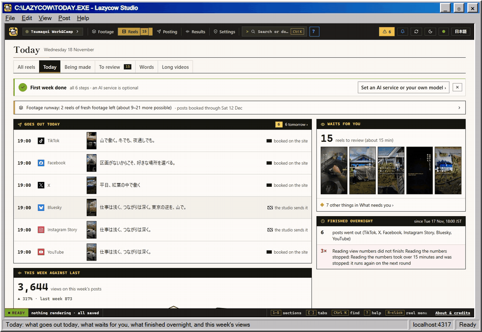 **今日。** 今日出る投稿とその出し方、あなたを待っているもの、夜のあいだに終わったこと、今週と先週の再生数、素材の残り。 | 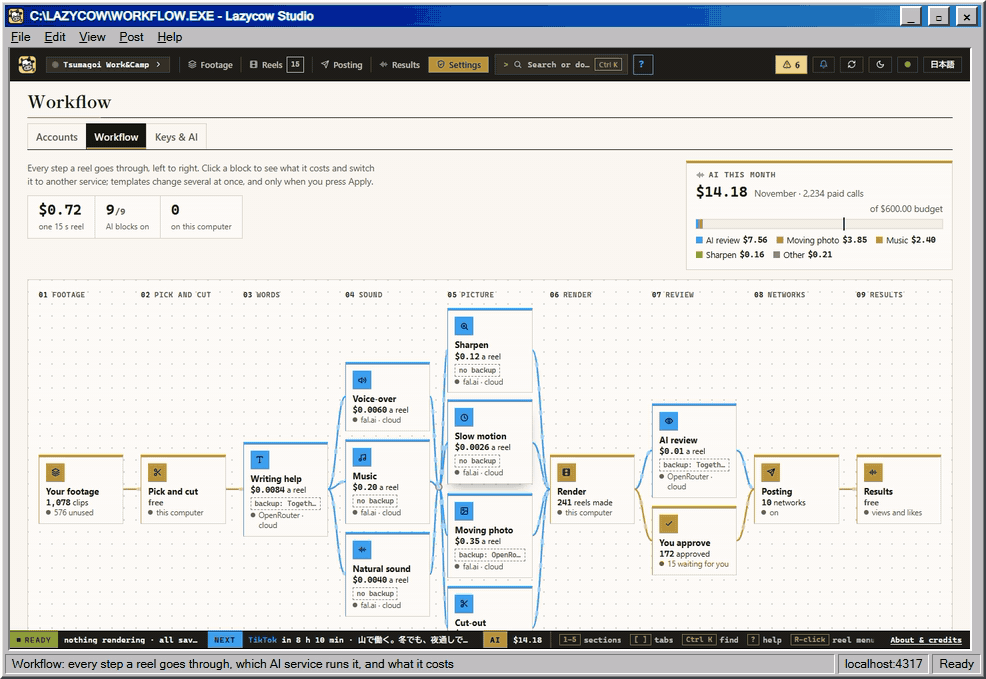 **ワークフロー。** リールが通る工程をブロックで表示。どのAIサービスが動くか、手元かクラウドか、1本あたりの費用。ブロックを押せばサービスを切り替えられます。「無料・手元だけ」「プロ仕上げ」などのテンプレートは、適用する前に変わる所と費用を見せます。 |
| 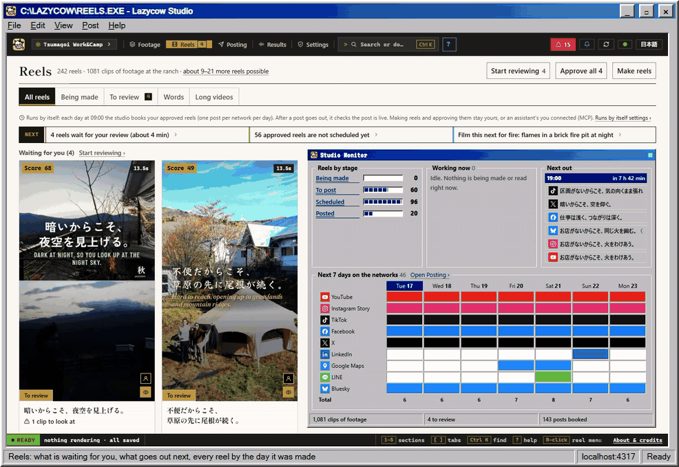 **リール。** スタジオ モニターに、段階ごとの本数・次に出る投稿・状態で色分けした7日間の表。リールの上でマウスを動かすと中身をざっと見られます。その下に、作った日ごとの全リール。 | 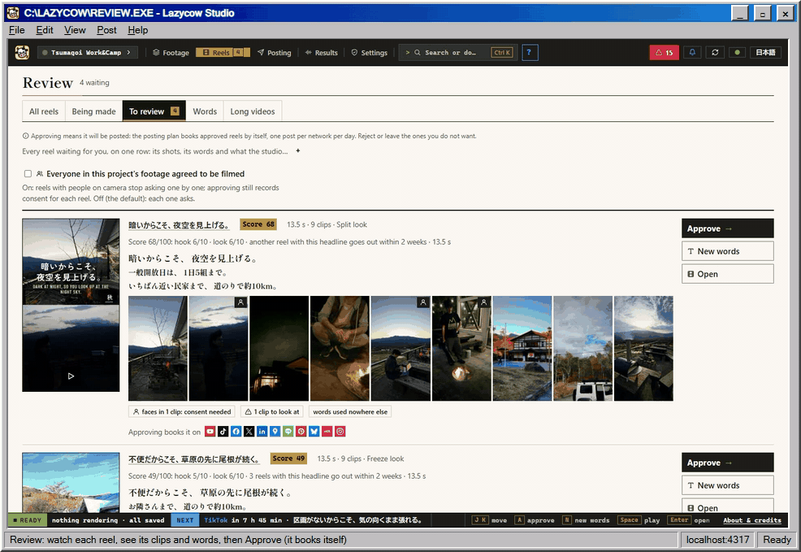 **確認。** クリップと言葉を見ながら1本ずつ再生。承認するとどのSNSの何日に入るかも表示。 |
| 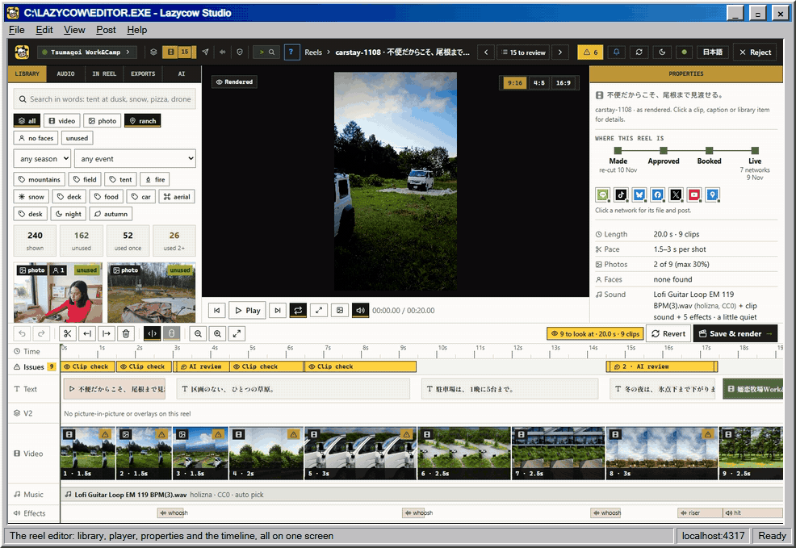 **リール編集。** 素材・プレーヤー・設定・タイムラインを1画面で。問題の列が各問題の位置を示し、押すとそこへ飛びます。 | 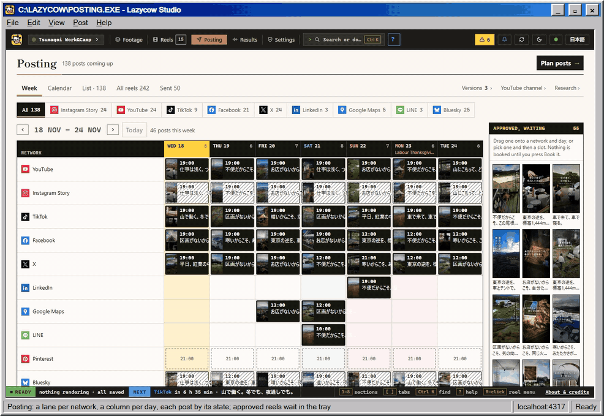 **投稿。** SNSごとの列と日ごとの欄に、状態別の投稿。スタジオが送る投稿はドラッグで別の日へ。承認済みのリールをトレイから枠に落とし、「予約する」を押したときだけ予約されます。 |
| 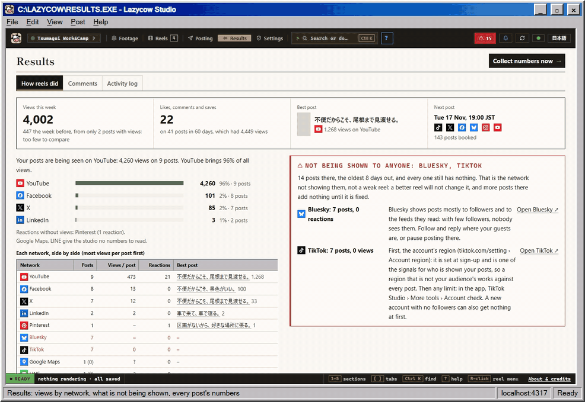 **結果。** SNS別の再生数、誰にも表示されていないSNS、投稿ごとの予想の幅と実際の再生、あなた自身の数字から見た投稿に向いた時間。 | 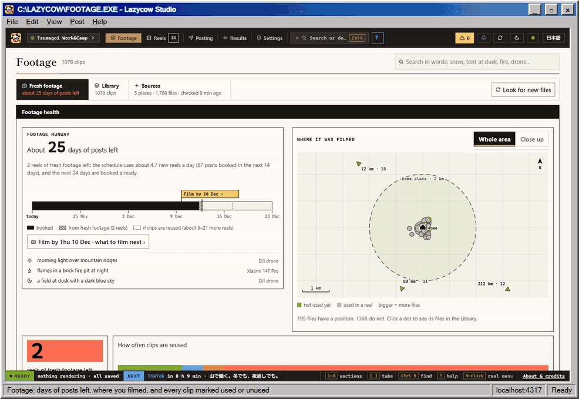 **素材。** 素材があと何日分の投稿になるかと撮影の目安日、撮った場所の地図、まだ使っていないクリップ。 |
| 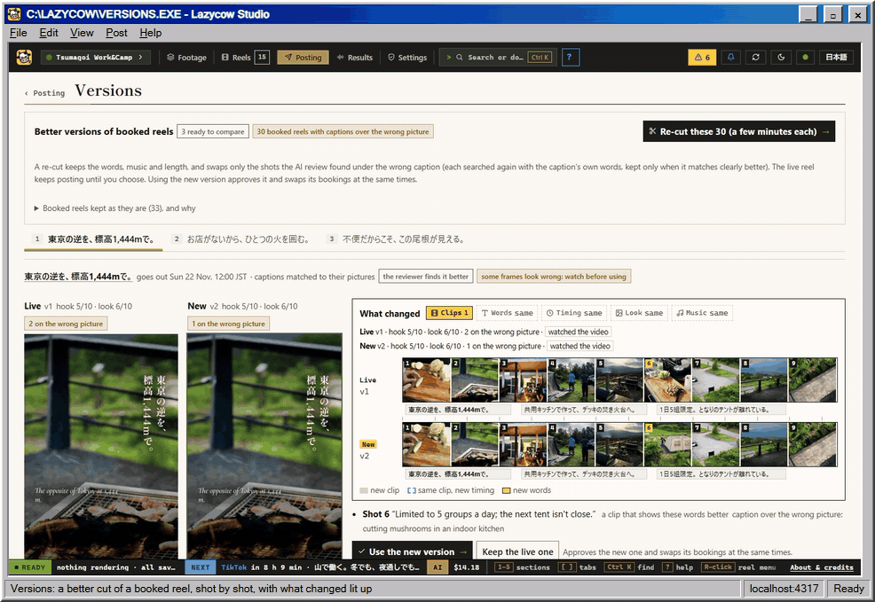 **バージョン。** 予約済みリールのより良い版ができたら、ショットごとに並べて違いを表示。 | 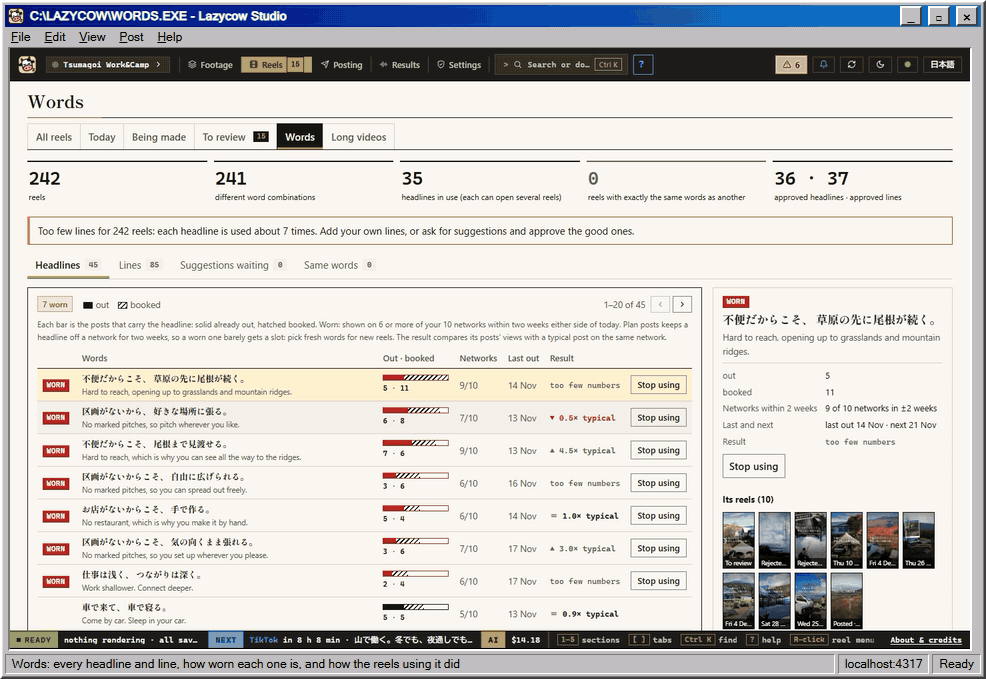 **言葉。** 見出しと文ごとに、どれだけ使い込んだかと、それを使ったリールの成績。新しいリールは新鮮な言葉を選べます。 |
| 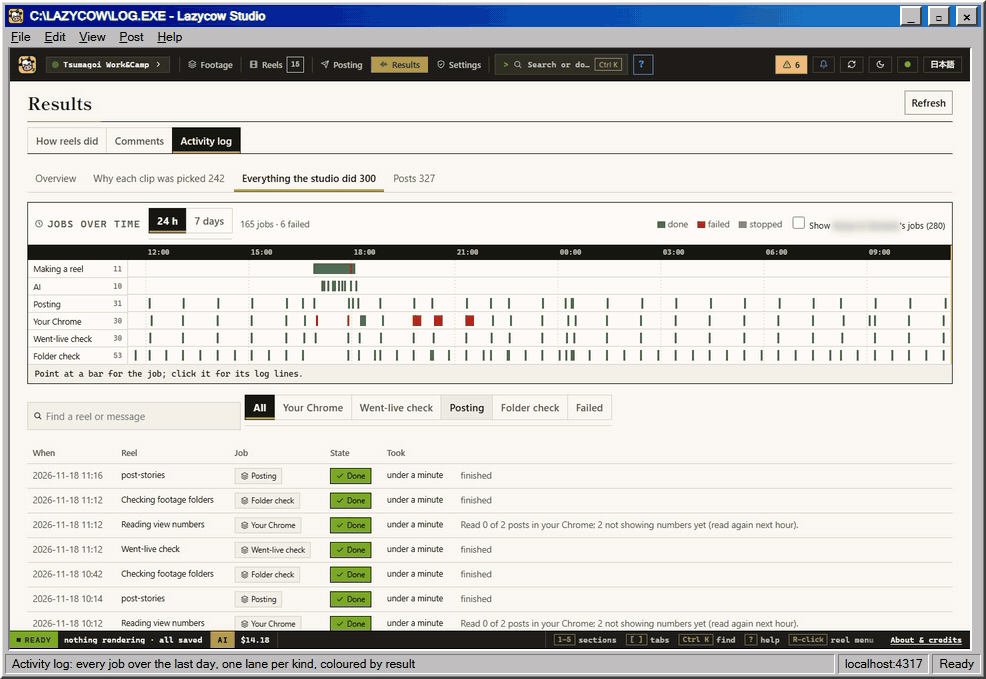 **処理の記録。** 直近1日または1週間の処理を、種類ごとの列に結果別の色で。棒を押すとログを表示。 | |
| 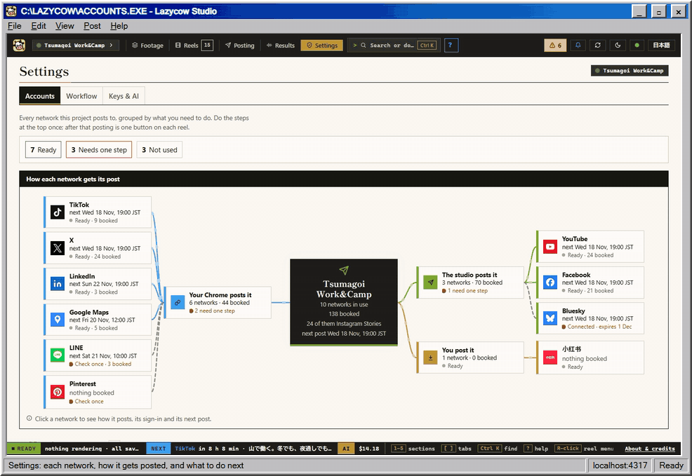 **設定 › アカウント。** SNSごとに、どう投稿されるかと、残りのひと手間。 | 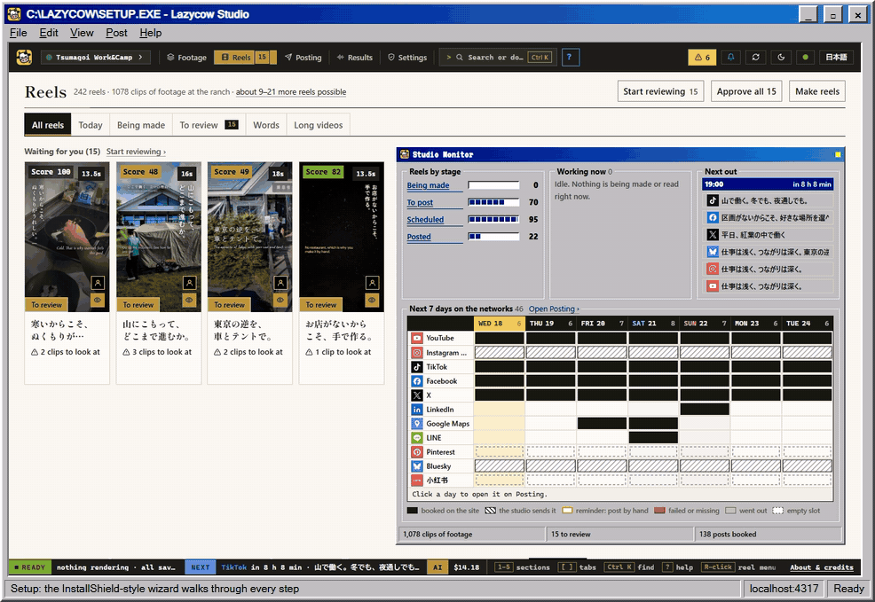 **セットアップ。** 1998年風のInstallShieldウィザードが、ケンジと一緒に一歩ずつ案内。 |
| 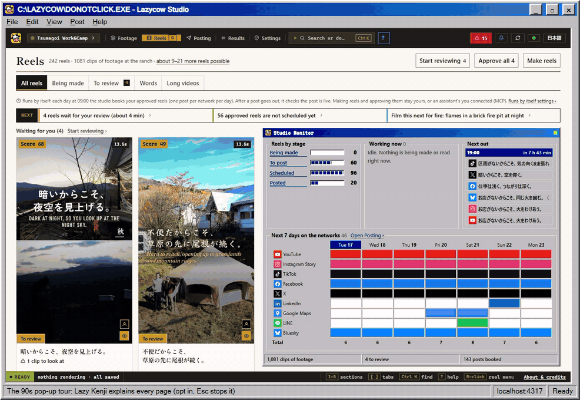 **押さないで。** 1999年風のポップアップで全ページを案内（Escで止まります）。 | |

## 承認は、人だけ

スタジオが決して破らないルールは、これ一つです。

- 新しいリールは下書きです。人が **Approve** を押すまで、予約もアップロードも投稿もできません。
- 顔が映っているリールは、本人の同意を確かめる（**Consent OK**）か、顔をぼかすまで承認できません。
- リールの文字を変えると、もう一度レビューに戻ります。
- 予約済みのリールを新しいバージョンに替えるのは、人が **Use the new version** を押したときだけです。
- AIツール、エージェント、スクリプトは、下書きを作ったり変更を提案したりできます。承認はできません。

## 費用

スタジオ、検索モデル、音楽、投稿は無料です。お金がかかるのは、自分で選んだときだけです。

- 有料のAIツール（fal.ai、OpenRouter）と、Web を調べる Firecrawl は任意です。使うときは自分のキーを入れます。Together AI のキーは保存できますが、いまはどのツールも使っていません。
- 有料の呼び出しは、先に金額を出し、上限を超えると実行しません。初期値は1日2ドル、1本2ドル、合計20ドルです。**Settings › Keys & AI** で変えられます。
- AIが承認済みのリールを書き換えることはありません。新しい下書きを作り、それをまた人がレビューします。

## kensaurusのほかのアプリ

Lazycow Studioは、[kensaurus](https://kensaur.us/?view=portfolio&utm_source=lazycow&utm_medium=readme&utm_campaign=family)がつくるアプリのひとつです。上のGIFのキャンプ場も、同じ会社で運営しています。

| アプリ | できること | 入手 |
|:--|:--|:--|
| **[Mushi Mushi](https://kensaur.us/mushi-mushi/?utm_source=lazycow&utm_medium=readme&utm_campaign=family)** | AIで作ったアプリが壊れた理由を説明し、直し方をエディタに渡します。ユーザーからの不具合報告を、わかりやすい診断と修正用のプロンプトに。Claude CodeやCursorからも使えます。 | [`npm i mushi-mushi`](https://www.npmjs.com/package/mushi-mushi) · [GitHub](https://github.com/kensaurus/mushi-mushi) |
| **[kenji skills](https://kensaur.us/notes/kenji-skills/?utm_source=lazycow&utm_medium=readme&utm_campaign=family)** | AIのコーディング助手を、最後まで正しく動かす手順書集。無料・オープンソース。 | [`@kensaurus/skills`](https://www.npmjs.com/package/@kensaurus/skills) · [GitHub](https://github.com/kensaurus/skills) |
| **[嬬恋牧場Work&Camp](https://tsumagoi.kensaur.us/?utm_source=lazycow&utm_medium=readme&utm_campaign=family)** | 自分たちで運営する、標高1,444mの山の24時間ラウンジ。Lazycowは、ここのリールを毎日投稿するために生まれました。 | [見る](https://tsumagoi.kensaur.us/?utm_source=lazycow&utm_medium=readme&utm_campaign=family) · [つくった話](https://kensaur.us/notes/lazycow-studio/?utm_source=lazycow&utm_medium=readme&utm_campaign=family) |
| **[Konte](https://kensaur.us/konte/?utm_source=lazycow&utm_medium=readme&utm_campaign=family)**（試作） | 絵コンテの順に、8秒のAI動画をつくる。 | [試す](https://kensaur.us/konte/?utm_source=lazycow&utm_medium=readme&utm_campaign=family) |

ほかのアプリと、それぞれをつくった理由は[kensaur.us](https://kensaur.us/?view=portfolio&utm_source=lazycow&utm_medium=readme&utm_campaign=family)で（一人会社の帳簿と申告のSolo Boss、タイ語のglot.it、yen-yenなど）。

## ドキュメント（英語）

| 読むもの | こんなときに |
|:--|:--|
| [User guide](docs/user-guide.md) | 画面ごとの使い方を知りたい、困ったことを解決したい |
| [撮影ガイド](docs/filming-guide.ja.md)（日本語） | スタジオがうまく編集できる素材を撮りたい（カットの長さ、構図、設定、チェックリスト） |
| [MCP](docs/mcp.md) | AIエージェントにスタジオを使わせたい |
| [Chrome link](docs/helper.md) | X、TikTok、Google マップ、LINE、LinkedIn の予約をしたい |
| [Architecture](docs/architecture.md) | 仕組み、どのAIモデルがどこで動くか、PCの中だけで動かす方法、データの置き場所を知りたい |
| [HTTP API](docs/openapi.yaml) | すべての API ルートを見たい（OpenAPI 3.1） |
| [Self-hosting](docs/self-host.md) | Docker や自分のサーバーでスタジオを動かしたい |

## 応援する

スタジオは無料で、これからも無料です。編集の手間が減ったと感じたら、開発費としてお支払いいただけます。一度だけでも（金額は自由）、月額でも（月 ¥500 から）大丈夫です。支払ってもアプリの機能は増えません。

プランの内容と解約の方法: [SUPPORTING.md の日本語の説明](docs/SUPPORTING.md#日本語)

## ライセンス

スタジオのコードは **[Apache License 2.0](LICENSE)** です。

> **Remotion のライセンスは別です。** 画面の文字を描くのに [Remotion](https://www.remotion.dev) を使っています。Remotion は個人、非営利団体、3人までの会社なら無料です。**4人以上の営利企業がこのスタジオでリールを作るには、[Remotion の会社向けライセンス](https://www.remotion.dev/license)が必要です。** これはあなたと Remotion の間の契約で、スタジオの Apache ライセンスには含まれません。

ほかの部品、モデル、フォント、音楽とそれぞれのライセンスは [THIRD_PARTY_NOTICES.md](docs/THIRD_PARTY_NOTICES.md) にあります。「Lazycow」「Lazycow Studio」という名前とアイコンは kensaurus LLC の商標で、ライセンスの対象外です。フォークするときは、別の名前とアイコンを付けてください（[TRADEMARKS.md](docs/TRADEMARKS.md)）。

## 作者

Lazycow Studio は **[kensaurus](https://kensaur.us)** が作っています。使うだけなら、何もしなくて大丈夫です。https://kensaur.us へのリンクをいただけると、とてもうれしいです。
