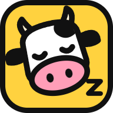

<p align="center"></p>

# Lazycow Studio

**撮ったのはあなた。編集は Lazycow。**

[English](README.md) · 日本語

撮ったまま編集していない写真や動画を、リールや旅の動画にします。あなたは **Approve** を押すだけです。

Lazycow Studio は、写真と動画の中から合うカットを探し、無料の音楽のビートに合わせて縦型の短いリールを作ります。地図とチャプター付きの長い YouTube 動画も、数本のパートに分けて作ります。そのあと、投稿の予約までします。すべて、あなたのPCの中で動きます。

作者は **[kensaurus](https://kensaur.us)** です。Apache-2.0 の無料のオープンソースです。

- **素材はPCの中に置いたまま。** タグ付けと検索は、あなたのPCのプロセッサーで行います。スタジオはファイルを読むだけです。SNSをつなぐか、有料のAIツールのキーを入れない限り、PCの外には何も出ません。
- **投稿は、すべて人が承認します。** **Approve** を押すまで、予約も投稿もされません。AIエージェントは下書きを作り、承認済みのリールを投稿できます。承認はできません。
- **AIエージェントから操作できます。** MCP サーバー、HTTP API（[OpenAPI](docs/openapi.yaml)）、npm パッケージがあります。Claude Code、Claude Desktop、Cursor は1行でつながります。

**こんな方に:** 小さなホテル、ゲストハウス、カフェ、お店の方。あるいはクリエイター。撮った素材はフォルダにあるのに、編集する時間がない方に向けて作りました。コードは書けなくても使えます。ダウンロードして、展開して、ダブルクリックするだけです。

YouTube、Facebook、Bluesky には直接投稿します。X、TikTok、LinkedIn、Google マップ、LINE は、あなたの Chrome で各サービスの予約画面に入力します。

## はじめ方は3通り

### 1. ダブルクリックで始める（おすすめ）

ターミナルも、Node や Python の事前インストールもいりません。

1. [最新のリリース](https://github.com/kensaurus/lazycow-studio/releases/latest)から **Lazycow-Studio-&lt;バージョン&gt;.zip** をダウンロードし、置いておく場所に展開します。
2. まず **README.TXT** を開いてください。1997年ふうの説明書で、最後に日本語の手順もあります。
3. **Start Lazycow** をダブルクリックします（Mac は初回だけ **Start Lazycow.command** を右クリック › 開く）。「WindowsによってPCが保護されました」と出たら、「詳細情報」›「実行」を選びます。新しいファイルだという意味で、危険なファイルという意味ではありません。中身はすべて [`scripts/bootstrap/windows.ps1`](scripts/bootstrap/windows.ps1) で読めます。
4. 青いセットアップ画面が、スタジオの作業データの保存先と、素材の場所を聞きます。そのあと Node、Python、ffmpeg の固定版をダウンロードします。どれも SHA-256 を確認してからユーザーフォルダに置くので、管理者権限はいりません。10〜30分、約1.5 GB です。
5. スタジオが開き、Lazy Kenji が案内します。次からは、デスクトップの **Lazycow Studio** をダブルクリックしてください。

対応しているのは Windows 10/11（64ビット）と、Apple シリコンの Mac（macOS 14 以降）です。途中で止まったら、もう一度 **Start Lazycow** をダブルクリックしてください。続きから再開します。何が起きたかは `setup.log` に残ります。

### 2. ターミナルから: `npx lazycow install`

Node 20 以降が入っていれば、1行でインストールできます。

```
npx lazycow install
```

このバージョンのリリース zip を GitHub からダウンロードし、パッケージに組み込まれた SHA-256 と照合してから、`~/Lazycow Studio` に展開します。そのあとは、ダブルクリックと同じセットアップが始まります。別のフォルダに入れるときは `--dir <空のフォルダ>` を付けます。

コードから動かしたい開発者は、`git clone` のあと `npm ci`、`npm run setup`、`npm run review` の順に実行し、**http://127.0.0.1:4317** を開いてください。必要なものと詳しい手順は [README.md の Quick start](README.md#quick-start) にあります。

### 3. AIエージェントをつなぐ

先にスタジオを起動しておきます。Claude Code なら、次の1行です。

```
claude mcp add lazycow -- npx -y lazycow mcp
```

Cursor（`.cursor/mcp.json`）や Claude Desktop（`claude_desktop_config.json`）には、次を書きます。

```json
{ "mcpServers": { "lazycow": { "command": "npx", "args": ["-y", "lazycow", "mcp"] } } }
```

この方法には、PATH の通った Node 20 以降が必要です。ダブルクリックで入れた場合、スタジオ専用の Node は PATH に入りません。そのときは、スタジオの **Settings › Keys & AI › Use with Claude or Cursor** に出る行を使ってください。あなたの環境のパスが入った状態で表示されます。

エージェントにできるのは、スタジオの状態を見る、リールを作る、投稿を計画する、承認済みのリールを投稿する、といったことです。承認するツールはありません。ツールの一覧は [docs/mcp.md](docs/mcp.md)（英語）にあります。

## 最初の流れ

画面の名前は、アプリの表示どおり英語で書いています。

1. 上のバーの **System**: すべての行が緑か黄色なら準備完了です。赤い行には、足りないものが書かれています。
2. **Footage › Add a folder**: 素材のフォルダを選びます。タグ付けは自動で始まります。
3. **Settings › Keys & AI › This project**: 名前、リンク、ハッシュタグ、使ってはいけない言葉を入れます。
4. **Reels › Make reels › New theme**: 見出しと、本当のことを書いた2〜3行、それぞれの行に合うカットの種類を書きます。
5. **Make reels** を押し、できたリールを1本ずつ **Review** します。見て、長さを整え、カットを入れ替えてから、**Approve** か **Reject** を押します。
6. **Settings › Accounts** で各SNSを一度だけつなぎます。**Posting › Plan posts** が、承認済みのリールを1つのSNSに1日1本ずつ予約します。

くわしい手順は [User guide](docs/user-guide.md)（英語）にあります。

## 承認は、人だけ

スタジオが決して破らないルールは、これ一つです。

- 新しいリールは下書きです。人が **Approve** を押すまで、予約もアップロードも投稿もできません。
- 顔が映っているリールは、本人の同意を確かめる（**Consent OK**）か、顔をぼかすまで承認できません。
- リールの文字を変えると、もう一度レビューに戻ります。
- 予約済みのリールを新しいバージョンに替えるのは、人が **Use the new version** を押したときだけです。
- AIツール、エージェント、スクリプトは、下書きを作ったり変更を提案したりできます。承認はできません。

## 費用

スタジオ、検索モデル、音楽、投稿は無料です。お金がかかるのは、自分で選んだときだけです。

- 有料のAIツール（fal.ai、OpenRouter、Together AI）と、Web を調べる Firecrawl は任意です。使うときは自分のキーを入れます。
- 有料の呼び出しは、先に金額を出し、上限を超えると実行しません。初期値は1日2ドル、1本2ドル、合計20ドルです。**Settings › Keys & AI** で変えられます。
- AIが承認済みのリールを書き換えることはありません。新しい下書きを作り、それをまた人がレビューします。

## ドキュメント（英語）

| 読むもの | こんなときに |
|:--|:--|
| [User guide](docs/user-guide.md) | 画面ごとの使い方を知りたい、困ったことを解決したい |
| [MCP](docs/mcp.md) | AIエージェントにスタジオを使わせたい |
| [Chrome link](docs/helper.md) | X、TikTok、Google マップ、LINE、LinkedIn の予約をしたい |
| [Architecture](docs/architecture.md) | 仕組みと、データの置き場所を知りたい |
| [HTTP API](docs/openapi.yaml) | すべての API ルートを見たい（OpenAPI 3.1） |

## 応援する

スタジオは無料で、これからも無料です。編集の手間が減ったと感じたら、開発費としてお支払いいただけます。一度だけでも（金額は自由）、月額でも（月 ¥500 から）大丈夫です。支払ってもアプリの機能は増えません。

プランの内容と解約の方法: [SUPPORTING.md の日本語の説明](SUPPORTING.md#日本語)

## ライセンス

スタジオのコードは **[Apache License 2.0](LICENSE)** です。

> **Remotion のライセンスは別です。** 画面の文字を描くのに [Remotion](https://www.remotion.dev) を使っています。Remotion は個人、非営利団体、3人までの会社なら無料です。**4人以上の営利企業がこのスタジオでリールを作るには、[Remotion の会社向けライセンス](https://www.remotion.dev/license)が必要です。** これはあなたと Remotion の間の契約で、スタジオの Apache ライセンスには含まれません。

ほかの部品、モデル、フォント、音楽とそれぞれのライセンスは [THIRD_PARTY_NOTICES.md](THIRD_PARTY_NOTICES.md) にあります。「Lazycow」「Lazycow Studio」という名前とアイコンは kensaurus LLC の商標で、ライセンスの対象外です。フォークするときは、別の名前とアイコンを付けてください（[TRADEMARKS.md](TRADEMARKS.md)）。

## 作者

Lazycow Studio は **[kensaurus](https://kensaur.us)** が作っています。使うだけなら、何もしなくて大丈夫です。https://kensaur.us へのリンクをいただけると、とてもうれしいです。
