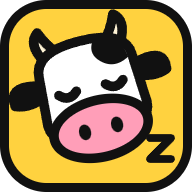
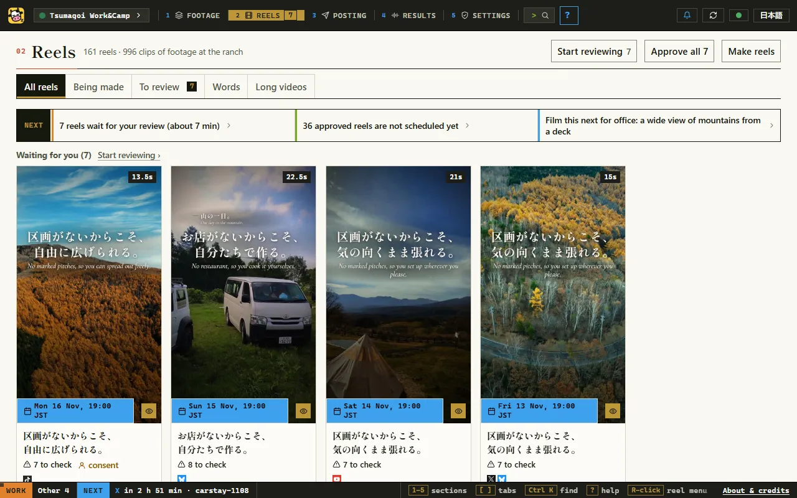
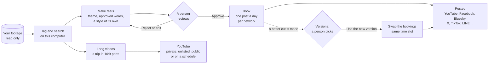

<p align="center"></p>

# Lazycow Studio

**You shot it. Lazycow edits it.**

[](LICENSE)
[](https://www.npmjs.com/package/lazycow)
[](https://registry.modelcontextprotocol.io/v0/servers?search=io.github.kensaurus/lazycow)
[](https://github.com/kensaurus/lazycow-studio/releases/latest)

The footage you never edited becomes reels and trip films. You only press **Approve**.

Lazycow Studio finds the right clips in your photos and videos, cuts short vertical reels on the beat of free music, and builds long YouTube videos in parts, with maps and chapters. Then it books the posts. It runs on your own computer.

Lazycow Studio is made by **[kensaurus](https://kensaur.us)**. It is free and open source under Apache-2.0.

- **Your footage stays on your computer.** Tagging and search run on your own processor. The studio only reads your files. Nothing leaves your computer unless you connect a network or add a key for a paid AI tool.
- **A person approves every post.** Nothing is booked or posted until you press **Approve**. AI agents can make drafts and post approved reels. They cannot approve.
- **Your AI agent can drive it.** An MCP server, an HTTP API ([OpenAPI](docs/openapi.yaml)) and an npm package. One line connects Claude Code, Claude Desktop or Cursor.

**Who it is for:** a small hotel, guesthouse, café or shop, or a creator, with a folder of footage and no time to edit it. You do not need to code: download, unzip, double-click. It posts to YouTube, Facebook and Bluesky, and fills in the schedulers of X, TikTok, LinkedIn, Google Maps and LINE in your own Chrome.

**[Download](https://github.com/kensaurus/lazycow-studio/releases/latest)** · [Quick start](#quick-start) · [Connect your AI agent](#connect-your-ai-agent) · [User guide](docs/user-guide.md) · [Support Lazycow](#support-lazycow)



*The Reels page. Each card is one reel with its words and its booked time. Press **Start reviewing** to watch them one by one.*

### Connect your AI agent

Start the studio first. Then, in Claude Code:

```
claude mcp add lazycow -- npx -y lazycow mcp
```

In Cursor (`.cursor/mcp.json`) or Claude Desktop (`claude_desktop_config.json`):

```json
{ "mcpServers": { "lazycow": { "command": "npx", "args": ["-y", "lazycow", "mcp"] } } }
```

This needs Node 20 or newer on your PATH. The double-click setup keeps its own Node out of your PATH, so use the lines in the studio's **Settings › Keys & AI › Use with Claude or Cursor** instead: they have your paths filled in. The agent can check the studio, make reels, plan posts and publish approved reels. It has no approve tool. Every tool: [docs/mcp.md](docs/mcp.md).

## Contents

- [Connect your AI agent](#connect-your-ai-agent)
- [Quick start](#quick-start)
- [The building blocks](#the-building-blocks)
- [How it works](#how-it-works)
- [A person approves every post](#a-person-approves-every-post)
- [Everything stays on your computer](#everything-stays-on-your-computer)
- [What you need](#what-you-need)
- [More, when you need it](#more-when-you-need-it): first run, a made-up brand, costs, accounts, YouTube, a second studio, AI agents
- [Documentation](#documentation)
- [Licence](#licence), [credit](#credit-and-contributing) and [support](#support-lazycow)

## Quick start

### The easy way: download, unzip, double-click

No terminal, no Node, no Python to install first. Just like 1997, minus the CD.

1. Download **Lazycow-Studio-&lt;version&gt;.zip** from the [latest release](https://github.com/kensaurus/lazycow-studio/releases/latest) and unzip it somewhere you will keep it.
2. Open **README.TXT** first. Yes, really. It has the steps, and some jokes.
3. Double-click **Start Lazycow** (Mac: right-click **Start Lazycow.command** › Open, the first time). If Windows says "Windows protected your PC", choose **More info › Run anyway**: the file is new, not bad. You can read every line in [`scripts/bootstrap/windows.ps1`](scripts/bootstrap/windows.ps1).
4. A blue 1997-style setup screen asks where to keep the studio's work and where your footage is, then downloads pinned copies of Node, Python and ffmpeg (each checked against its SHA-256, kept in your user folder, no admin rights). It takes 10 to 30 minutes, about 1.5 GB.
5. The studio opens, and Lazy Kenji shows you around. Next time, double-click **Lazycow Studio** on your desktop.

Windows 10/11 (64-bit), or a Mac with Apple silicon and macOS 14+. If anything goes wrong, double-click Start Lazycow again: it carries on where it stopped, and `setup.log` says what happened. How it works: [scripts/bootstrap/README.md](scripts/bootstrap/README.md).

### For developers: the terminal way

You need Node 20+, Python 3.12+ and a current ffmpeg ([details](#what-you-need)).

1. Get the code:

   ```
   git clone https://github.com/kensaurus/lazycow-studio.git
   cd lazycow-studio
   npm ci
   ```

2. Set up this computer. This writes `.env`, makes the Python environment, and fetches the picture-quality model and some free music:

   ```
   npm run setup
   ```

3. Start the studio:

   ```
   npm run review
   ```

4. Open **http://127.0.0.1:4317**. The first load takes 10 to 20 seconds while the search model starts. Follow the **Getting started** list on the page.

`npm run setup` ends with a list of anything still missing and the exact fix. Usually that is ffmpeg: put a current `ffmpeg` and `ffprobe` in the data folder's `bin`, or on your PATH. Run it again any time. `npm run setup -- --check` only reports.

To choose where things go on a first run:

```
npm run setup -- --data D:\studio-data --footage "D:\My Footage"
```

Both are optional. By default everything the studio makes goes in `./data` beside the code. Your footage is never moved or changed.

## The building blocks

| Building block | In plain words | You use it by… |
|:--|:--|:--|
| **Project** | One brand, client or trip, with its own footage, words, accounts and reels | pressing the project name beside the logo, then **New project** |
| **Footage** | Your photos and videos. The studio reads them and never changes them. | **Footage › Add a folder**, or **Add from Google Photos** |
| **Theme** | The story of a reel: a headline, two or three true lines, and the kind of shots each line needs | **Reels › Make reels › New theme** |
| **Reel** | One short vertical video (9:16), with files cut for each network | **Make reels**, then **Review** |
| **Reel style** | The type pairing, colours, how the words arrive, and the colour grade. Each new reel draws its own. | the reel editor's **Type, colours and motion**, or **Surprise me** |
| **Approve** | Your yes. Only approved reels are booked or posted. | **Approve** in the editor, after you watch the reel |
| **Booking** | A post held for a set time, on the network or by the studio | **Posting › Plan posts**, or **Runs by itself** |
| **Version** | A better cut of a reel that is already booked, made beside the live one | **Posting › Versions › Use the new version** or **Keep the live one** |
| **Swap** | The studio replaces an older booking with the newest approved render, at the same time slot | **Swap them by themselves** on the Posting page |
| **Long video** | A 5 to 15 minute (10 by default), 16:9 YouTube video from a trip, in parts with chapters | **Reels › Long videos** |
| **Chrome link** | The studio fills in the X, TikTok, Google Maps, LINE and LinkedIn schedulers in your own signed-in Chrome | **Settings › Keys & AI › Chrome link** ([how](docs/helper.md)) |
| **MCP** | A way for an AI agent (Claude Code, Claude Desktop, Cursor) to use the studio. It cannot approve. | `claude mcp add lazycow -- npx -y lazycow mcp` ([how](docs/mcp.md)) |

## How it works



Three programs run on one computer: a Node server and the studio page (`server/`), a Python pipeline (`py/studio/`), and Remotion for the words on screen (`src/`). More in [docs/architecture.md](docs/architecture.md).

## A person approves every post

This is the one rule the studio never breaks.

- A new reel is a draft. It cannot be booked, uploaded or posted until a person presses **Approve**.
- A reel with a face in it cannot be approved until someone confirms the person agreed (**Consent OK**), or blurs the face.
- When a reel's words change, it goes back to review.
- A new version replaces a booked reel only when a person presses **Use the new version**.
- AI tools, agents and scripts can make drafts and suggest changes. They cannot approve.

## Everything stays on your computer

- Your footage is only read, never changed, and never uploaded to be tagged. Search and tagging run on your own processor (OpenCLIP).
- Keys and sign-ins stay in `.env` and in your data folder. They are never in git.
- The studio listens on `127.0.0.1` only. Nothing leaves your computer unless you connect a service: a network you post to, or a paid AI tool you add a key for.
- On a shared computer, set `STUDIO_API_TOKEN` so other programs need a token.

## What you need

| | Minimum (works, slowly) | Recommended |
|:--|:--|:--|
| Processor | 4 threads | 8 threads or more |
| Memory | 6 GB | 12 GB or more |
| Free disk for renders | 3 GB | 20 GB or more |
| Screen | 1280 px wide | 1440 px or more |

Software: **Node 20** or newer, **Python 3.12** or newer, and a current **ffmpeg** (the build must support `-fps_mode`; builds from 2021 do not). A current Chrome, Edge or Safari for the studio page.

Windows is where the studio is used every day. macOS and Linux work for the main flow but are tested less.

A 9-clip reel takes about 6 to 7 minutes on a 32-thread desktop, and roughly twice that on 8 threads. Press **System** in the top bar to see what your computer can do.

## More, when you need it

<details>
<summary><b>First run, in order</b></summary>

1. **System** (top bar): every line green or amber. A red line says what is missing.
2. **Footage › Add a folder**: pick your footage. Tagging starts by itself.
3. **Settings › Keys & AI › This project**: your name, link, hashtags, and words the studio must never use.
4. **Reels › Make reels › New theme**: a headline, two or three true lines, and the kind of shots each line needs.
5. **Make reels**, then **Review** each one: watch, trim, swap clips, then **Approve** or **Reject**.
6. **Settings › Accounts**: connect each network once. **Posting › Plan posts** books approved reels, one a day per network.

The step-by-step guide is [docs/user-guide.md](docs/user-guide.md).

</details>

<details>
<summary><b>Try it with a made-up brand</b></summary>

Copy the four files in [`examples/cafe-kumo/`](examples/cafe-kumo) (`brand.json`, `themes.json`, `words.json`, `profiles.json`) into your data folder before the first `npm run review`. The studio opens as "Cafe Kumo", with two themes and a word bank. Change them in **Settings › Keys & AI › This project** when you start your own.

</details>

<details>
<summary><b>What costs money</b></summary>

Nothing, unless you choose it. The studio, its search model, the music and the posting are free.

| Optional service | What it adds | Needs |
|:--|:--|:--|
| [fal.ai](https://fal.ai) | Slow motion, sharpening, music made for a reel, a Japanese voice, a "living photo", sound effects, the music bed of a long video | Your key |
| [OpenRouter](https://openrouter.ai) | An AI reviewer that suggests fixes and judges a new version, suggested new lines for the word bank, post angles | Your key |
| [Together AI](https://together.ai) | Same kinds of tools, as an alternative | Your key |
| [Firecrawl](https://firecrawl.dev) | **Research** (Posting › Research): reads the web for trends and events nearby (read-only) | Your key |

- Every paid call is priced first and refused over your limits: by default 2 USD a day, 2 USD a reel and 20 USD in total. Change them in **Settings › Keys & AI**.
- AI never changes an approved reel. It makes a new draft, which a person reviews again.
- AI suggestions are suggestions. New words are used only after a person presses **Use it**.
- Free music comes from [Openverse](https://openverse.org) (CC0 and public domain only, 200 searches a day, no key).

</details>

<details>
<summary><b>Connect your accounts</b></summary>

| Network | How the studio posts | You need |
|:--|:--|:--|
| YouTube Shorts | Uploads as private; YouTube publishes at the time | Your own Google Cloud app (about 10 minutes; the studio walks you through it) |
| Facebook Page | Schedules a Page Reel through Meta's API | Your own Meta app's ID and secret |
| Bluesky | Sends it at the time (this computer must be on) | Sign in with Bluesky |
| X, TikTok, Google Maps, LINE, LinkedIn | Fills in each site's own scheduler in your Chrome | The Chrome link ([docs/helper.md](docs/helper.md)) and you signed in there |
| Instagram, others | You post by hand from the approved folder | Nothing |

- The studio posts only to accounts you connected, and only approved reels.
- Turn each network on or off for a project in **Settings › Accounts**. A new project starts with all of them off.
- Posts the studio sends itself (Bluesky, and posts marked "the studio sends it") go out for every project, whichever project is open. Leave the computer on at those times.
- **YouTube's upload allowance.** Since 1 June 2026, YouTube gives each Google Cloud app its own allowance of 100 uploads a day ([YouTube Data API](https://developers.google.com/youtube/v3/getting-started)). The automatic swap uses at most 20 of them a day. The rest are for new posts and long videos.

Details: [docs/integrations.md](docs/integrations.md).

</details>

<details>
<summary><b>Several YouTube accounts, and long videos on YouTube</b></summary>

A project can connect more than one YouTube channel.

- **main** is the channel your Shorts post to.
- **a2, a3, ...** are more channels: a personal channel for long videos, or a second brand. Each has its own sign-in.
- Connect them in **Settings › Keys & AI**, in the box **YouTube: Google account and app**: press **Connect another account**. They are listed there under **Other YouTube accounts**.
- One Google app can serve every project. Press **Use this Google app in every project** in the same box. A project made in the studio can then connect its own channels without an app of its own.

Long videos upload from **Reels › Long videos**. Pick the account and who can see them:

| Choice | What happens |
|:--|:--|
| Private | Only you see it in YouTube Studio |
| Unlisted | Only people with the link can watch |
| Public | On the channel and in search at once |
| Go public on a schedule | Private until each part's time, then public. The first part goes at the time you pick, then one every N days. |

The title, the description with chapters, the tags and the thumbnail go with it. The link shows on the part when it is up. From a terminal in the `py` folder, with the studio's Python (the venv in your data folder):

```
python -m studio youtube accounts
python -m studio youtube upload-vlog --part 1 --account a2 --privacy unlisted
python -m studio youtube upload-vlog --part 2 --account a2 --at 2026-12-01T19:00
```

`--at` is this computer's local time. The part stays private until then.

</details>

<details>
<summary><b>A second studio for another project</b></summary>

Work on a second project without switching the main studio away. Start a second studio pinned to that project, on its own port:

```
STUDIO_PROJECT=my-trip STUDIO_PORT=4318 STUDIO_QUIET=1 npm run review
```

On Windows (cmd), set each variable first: `set STUDIO_PROJECT=my-trip`, `set STUDIO_PORT=4318`, `set STUDIO_QUIET=1`. Then run `npm run review`.

- `STUDIO_PROJECT` is the project's id (its folder name under `~/.lazycow/projects`). The pinned studio never switches project.
- `STUDIO_QUIET=1` makes it a studio for looking and editing only. It does not post, book, swap or check by itself. The main studio still sends due posts for every project.
- Connect YouTube in the main studio on port 4317 (see the note in `.env.example`).

</details>

<details>
<summary><b>Use it from Claude Code, Claude Desktop or Cursor (MCP)</b></summary>

The studio has an MCP server. An AI agent can check the studio, make reels, watch renders, plan posts and publish **approved** reels. It has no approve tool.

```
npm run review
claude mcp add lazycow -- npx -y lazycow mcp
```

From a clone, without npm: `claude mcp add lazycow -- node C:\path\to\lazycow-studio\server\mcp.mjs`. **Settings › Keys & AI › Use with Claude or Cursor** shows these lines with your paths filled in. Full guide: [docs/mcp.md](docs/mcp.md).

</details>

## Documentation

| Read | When you want to |
|:--|:--|
| [User guide](docs/user-guide.md) | use the studio page by page, or fix a problem |
| [Architecture](docs/architecture.md) | know how the pieces fit, and where data lives |
| [MCP](docs/mcp.md) | let an AI agent use the studio |
| [Chrome link](docs/helper.md) | schedule X, TikTok, Google Maps, LINE and LinkedIn |
| [Connected services](docs/integrations.md) | see each outside service and why it is used |
| [AI tools](docs/ai-api.md), [results](docs/perf-api.md), [research](docs/research-api.md) | call those parts of the HTTP API |
| [HTTP API](docs/openapi.yaml) | see every route (OpenAPI 3.1) |
| [Roadmap](docs/ROADMAP.md), [changes](CHANGELOG.md) | see what is next and what changed |

## Licence

The studio's code is under the **[Apache License 2.0](LICENSE)**.

> **Remotion is not open source in the same way.** The studio uses [Remotion](https://www.remotion.dev) to draw the words on screen. Remotion has its own licence: it is free for individuals, non-profits and companies of up to 3 people. **A for-profit company with more than 3 people needs a [Remotion company licence](https://www.remotion.dev/license) to make reels with the studio.** That licence is between you and Remotion; the studio's Apache licence does not cover it.

Every other component, model, font and piece of music, with its licence, is listed in [THIRD_PARTY_NOTICES.md](THIRD_PARTY_NOTICES.md). The fonts in `public/fonts` each have their licence file beside them. Each reel's music credit travels with it in `credits.txt`.

The names "Lazycow" and "Lazycow Studio" and the icon are trademarks of kensaurus LLC and are not covered by the licence. A fork needs its own name and icon: see [TRADEMARKS.md](TRADEMARKS.md).

## Credit and contributing

Lazycow Studio is made by **Kenji Sakuramoto ([kensaurus](https://kensaur.us))** and contributors, and published by kensaurus LLC.

- **Using it?** Nothing to do. A link back to https://kensaur.us is always appreciated.
- **Forking it?** Keep `LICENSE` and [`NOTICE`](NOTICE), give your fork its own name and icon, and please keep "Based on Lazycow Studio by kensaurus" in your About screen.
- **Helping?** Read [CONTRIBUTING.md](CONTRIBUTING.md) and the [Code of Conduct](CODE_OF_CONDUCT.md). Security problems: [SECURITY.md](SECURITY.md).
- **Writing about it?** Use "Cite this repository" on GitHub ([CITATION.cff](CITATION.cff)).

## Support Lazycow

The studio is free and stays free. If it saves you evenings of editing, you can pay for its development: once, any
amount, or monthly with small benefits (your requests looked at first, your name or logo in the About window).

| | |
|:--|:--|
| **Pay once** | [In yen](https://buy.stripe.com/28E4gB2AoalOaiIc6abII0c) · [In US dollars](https://buy.stripe.com/14A5kFa2Q0LeaiIeeibII0d) |
| **Monthly** | [Supporter ¥500 / $4](https://buy.stripe.com/cNifZj8YM0Le1McgmqbII0e) · [Backer ¥1,500 / $10](https://buy.stripe.com/00w00l2Ao0LecqQb26bII0f) · [Sponsor ¥5,000 / $35](https://buy.stripe.com/6oU6oJ3Es2TmduUgmqbII0g) |

What each plan includes, and how to cancel: [SUPPORTING.md](SUPPORTING.md). Thank you to [everyone who does](SUPPORTERS.md).
