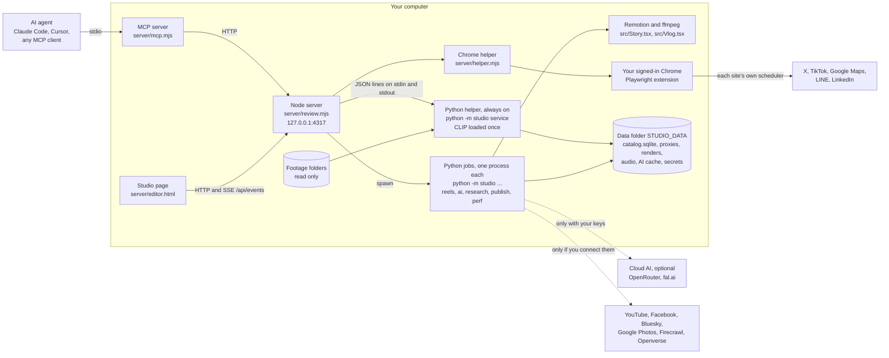
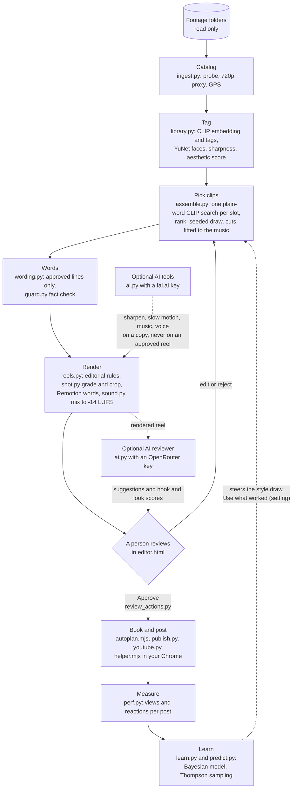
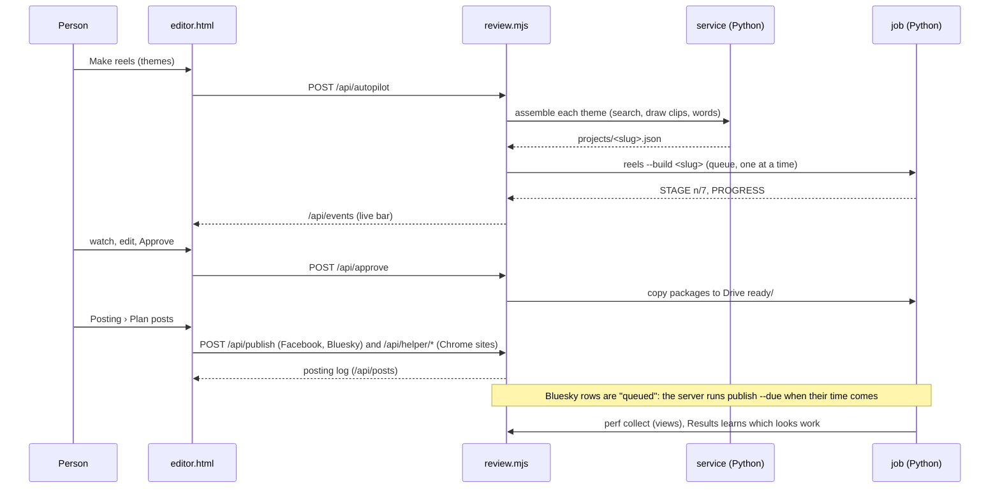
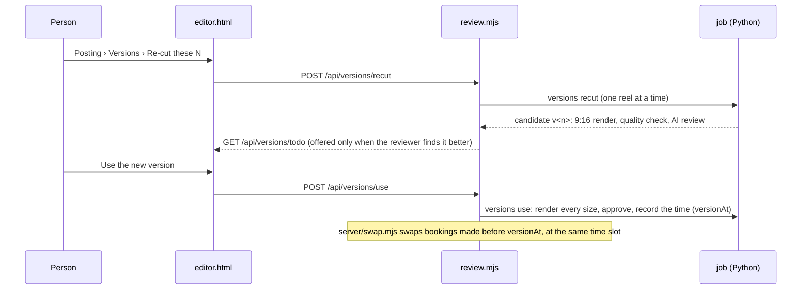
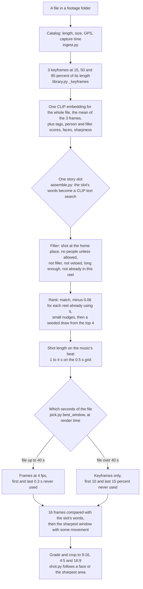

# Architecture

Lazycow Studio runs on one computer. A Node server (`server/review.mjs`, on `127.0.0.1:4317` only) serves the studio page and an HTTP API. It keeps one Python helper running for search (`python -m studio service`), and starts a separate Python process for each render, upload, post, research call or AI call. Renders use ffmpeg for the picture and sound and Remotion for the words on screen. Footage is read and never changed, and the catalog, renders and secrets stay in one data folder. Tagging, search, clip picking, rendering and the "what worked" model run on your computer and need no key. Cloud AI (OpenRouter, fal.ai) and web research (Firecrawl) are used only when you add their keys. Posting goes to the networks you connect.

On this page:
- [The pieces](#the-pieces)
- [The reel pipeline](#the-reel-pipeline)
- [How it picks which moments to use](#how-it-picks-which-moments-to-use)
- [AI and ML models](#ai-and-ml-models)
- [Run it fully local](#run-it-fully-local)
- [Use your own LLM](#use-your-own-llm)
- [What leaves your computer](#what-leaves-your-computer)
- [Projects and a second studio](#projects-and-a-second-studio)
- [Where data lives](#where-data-lives)
- [Key decisions](#key-decisions)
- [Where to read the code](#where-to-read-the-code)

## The pieces



| Piece | File | What it does |
|:--|:--|:--|
| Web page | `server/editor.html` (shell), `server/ui/css/*.css`, `server/ui/js/*.js`, `server/ui.mjs` | The whole interface: Home, Footage, Reels, Posting, Results and Settings, More tools, the reel editor, English and Japanese. Vanilla JS. The shell holds the head and header markup and one `<!--ui:…-->` line per part; `server/ui.mjs` joins the parts, in name order, into one `<style>` and one `<script>` on every load, so all parts share one script scope (a function in one part may call one in another) and a page reload shows a change. One file per page or tool: `js/10-results.js` is Results, `js/17-footage.js` is Footage, `js/01-i18n.js` holds the English and Japanese labels, `js/02-nav-tools.js` the `FEATURES` registry (simple or full, More tools). `test/ui-parts.test.mjs` checks every part is included once. |
| Node server | `server/review.mjs`, `server/health.mjs`, `server/trust.mjs` | Serves the page and the HTTP API (`docs/openapi.yaml`). Runs one render queue and pushes progress over `/api/events` (server-sent events). Accepts only loopback requests and only POSTs from its own page. |
| Runs by itself | `server/autoplan.mjs`, `server/swap.mjs`, `py/studio/live.py`, `scripts/autostart.mjs` | Books the next days' posts, checks they went out, sends late posts, and swaps older bookings for the newest approved render (`/api/autopost`, `/api/posts/autoreplace`). Every 5 minutes the server also sends due studio-sent posts (Bluesky, queued) for every other project (`tickOtherPosts`). |
| Python helper | `py/studio/service.py` | Keeps the CLIP model loaded, so searching, assembling and the overview are instant. It talks JSON lines on stdin and stdout. |
| Python jobs | `py/studio/__main__.py` and modules | Each render, upload, post, research call or AI call runs as its own process with its own log, so one failure cannot take down the server. |
| Rendering | `py/studio/reels.py`, `shot.py`, `sound.py`, `remotion.py`, `src/Story.tsx`, `src/looks.tsx` | ffmpeg grades and crops each shot; Remotion draws the words and cut styles; ffmpeg mixes the sound to −14 LUFS. |
| Reel styles | `shared/type-kits.json`, `py/studio/typekits.py`, `src/typekit.ts`, `/api/typekits` | Each new reel draws a type pairing (10), colours (6), word motion (5) and colour grade (5), seeded per reel; a value one of the last four reels used gets a quarter of its chance. Night and fire themes keep the house grade. A reel without these fields renders as before. Fonts are in `public/fonts`. |
| Versions | `py/studio/versions.py`, `/api/versions*` | A better cut of a booked reel, made beside the live one under `%STUDIO_DATA%\versions\<slug>\v<n>\`. Only a person's **Use the new version** makes it the reel; its bookings then swap (`versionAt`). The MCP server never calls it. |
| Sound levels | `py/studio/levels.py`, `/api/levels` | Fixes finished reels off −14 LUFS or over −1 dBTP by gain alone, keeping the masters as `*.orig.mp4`. |
| Long videos | `py/studio/vlog.py`, `src/Vlog.tsx`, `src/SeriesMap.tsx`, `/api/vlogs*` | Plans a trip into 16:9 parts with chapters by day, builds each part, writes its YouTube title, description, chapters and thumbnail. Maps are drawn locally as SVG from bundled Natural Earth outlines. |
| YouTube | `py/studio/youtube.py`, `/api/youtube*`, `POST /api/vlogs/youtube` | Several accounts per project (`main` for Shorts, then `a2`, `a3`, ...), Shorts uploads, long-video uploads (private, unlisted, public or scheduled), playlists. One Google app can be shared with every project. |
| Chrome helper | `server/helper.mjs`, `server/chrome-bridge.mjs` | Drives your own signed-in Chrome to fill in each site's scheduler. It refuses unapproved reels and times outside the site's window (`docs/helper.md`). |
| MCP server | `server/mcp.mjs` (also shipped as the npm package `lazycow`) | Lets an AI agent use the studio through the same HTTP API, over stdio. It calls no model itself. It has no approve tool and no tool to make a version live (`docs/mcp.md`). |

## The reel pipeline

From a folder of footage to a measured post. Solid arrows run on your computer with no key. Dotted boxes are optional and need a key.



Step by step, with the code that does it:

| Step | Code | What happens |
|:--|:--|:--|
| Catalog | `py/studio/ingest.py`, `sources.py` | Walks every footage folder, records each file in `catalog.sqlite`, makes 720p proxies, reads GPS and capture time. Finished edits and the studio's own renders are kept out (`is_output`). `sources watch` repeats this every `STUDIO_WATCH_MINUTES` (30). |
| Tag | `py/studio/library.py`, `aesthetic.py` | Three keyframes per clip go through OpenCLIP: one embedding per clip, zero-shot tags from a word list (scene, subject, time of day, season), a "person" and a "filler" score. YuNet counts faces. The LAION head scores how good a frame looks (1-10). |
| Pick clips | `py/studio/assemble.py`, `pick.py` | A theme is a headline, two or three lines and the kind of shot each needs. Each slot is one plain-word CLIP text search over the library, ranked with small nudges (recent, season, aesthetic, already used), filtered (no people unless allowed, no filler, no vetoed clips, photos at most 30 %), then one of the best four is drawn with a seeded random number. `pick.py` finds the best 1-2 s of each clip by sharpness and motion. The project stores the seed and a trace of every candidate and score. |
| Words | `py/studio/wording.py`, `guard.py`, `shared/guard.mjs` | Every on-screen line comes from the word bank: approved copy only. `draw()` takes the least-used lines that fit the shots. The fact guard refuses banned claims and prices. |
| Render | `py/studio/reels.py`, `shot.py`, `sound.py`, `remotion.py`, `src/Story.tsx` | `check_reel` enforces the rules (shot lengths, 0.5 s grid, hook in the first 0.5 s, location and source gates). ffmpeg grades and crops each shot (following a face or the sharpest area), Remotion draws the words, `sound.py` places CC0 music, whooshes and hits, ducks the music under clip sound and normalises to −14 LUFS. One master per size, plus a network folder per channel. Seven stages, reported as `STAGE n/7`. |
| Review | `server/editor.html`, `py/studio/review_actions.py` | A person watches, edits and presses Approve. A reel with faces cannot be approved without Consent OK or Blur faces. |
| Book and post | `server/autoplan.mjs`, `py/studio/posting.py`, `publish.py`, `connectors/`, `youtube.py`, `server/helper.mjs` | One post a day per network. YouTube, Facebook and Bluesky through their APIs; X, TikTok, Google Maps, LINE and LinkedIn through the site's own scheduler in your Chrome; Instagram by hand from the approved folder. Every route refuses a reel that is not approved. |
| Measure | `py/studio/perf.py` | Collects views and reactions from YouTube, Facebook and Bluesky; manual entry or CSV import for the rest (`docs/perf-api.md`). |
| Learn | `py/studio/learn.py`, `predict.py` | A Bayesian additive model (closed form, numpy) over theme, layout, look, length, weekday and hour, with Thompson sampling for what to try next. `predict.py` gives each booking an 80 % range and later checks it against the result. It steers new reels after 15 measured posts while **Use what worked** is on (Settings › Workflow, on by default; the `learned` flag on autopilot or `STUDIO_PERF_STEER` override it), and each reel keeps why in `made.steer`. |

### A reel's life, as requests



### A better version of a booked reel



Without a reviewer key the candidate is still made and kept for a person to judge (`py/studio/versions.py`).

## How it picks which moments to use

People ask: how does the studio know which part of a video to take? It decides in two passes. First it chooses **which file** fits each line of the story, using a short description of the whole file made when the footage was tagged. Then, at render time, it chooses **which seconds** of that file to use. No language model is involved: both passes use CLIP, the image model on your processor, plus simple picture measurements.



### Pass 1: describing each file (when footage is tagged)

`library.scan()` in `py/studio/library.py` runs once per new file (`python -m studio library --ingest --scan`, or by itself every 30 minutes through `sources watch`).

- **Three frames per video, whatever its length.** `_keyframes()` grabs one frame at 15 %, 50 % and 85 % of the duration. A photo is one frame. There is no scene-by-scene index of a video in this pass.
- **One description per file.** `_clip()` runs OpenCLIP on the three frames and stores their **mean** embedding. Search compares the slot's words with that one vector. The same frames give the zero-shot tags (scene, subject, season, time of day), a "person" score (`PERSON_MAX` 0.35) and a "filler" score (ground, blur, screenshots, paper, a hand; `JUNK_MAX` 0.4 in `assemble.py`). The tags come from the mean; the person and filler scores take the worst of the three frames.
- **Measured from the same frames:** faces (YuNet, the most in any one frame), sharpness (variance of the Laplacian), exposure and orientation (`_analyse()`). The LAION head turns the embedding into a 1-10 picture-quality score (`aesthetic.py`).
- **From the file, not the picture:** capture time (metadata, else a date in the file name, `media.captured_from_name`), season (from the month), the event (the dated folder), and the place (`place_from()`: the file's GPS, then its folder's, then its event folder's, then the folder name).

### Pass 2: choosing the file for each slot (`assemble.py`)

A theme is a list of slots. Each slot is a plain-word description of a shot ("an aerial drone view of mountain ridges"). For each slot, `assemble()`:

1. Searches the library with the slot's words (`library.items()`, the dot product of CLIP text and image vectors). The opening slot takes video only.
2. Drops files not shot at the project's home place, files with faces or a high person score (unless the theme allows faces), filler, vetoed files, and files from another camera when the theme names one (`device`).
3. Ranks by match. Then come small nudges, none of which can beat a clearly better match: −0.06 for each reel already using the file, up to ±0.02 for picture quality, +0.02 for recent footage, +0.04 for the theme's season or tag.
4. Skips a file already in this reel, a photo once photos would pass 30 % of the slots, a video shorter than the shot plus 0.8 s, and a near-duplicate of a picked file (CLIP cosine over 0.93).
5. Draws one of the best four with a seeded random number, weighted by exp((score − best) / 0.03). The seed, every candidate and every score are kept in the project's `trace` (Results › Log).

Then shot lengths are fitted to the music. `sound.fit_cuts()` finds the beats with librosa and gives each shot 1-3 s that lands on a beat, on the 0.5 s grid. A shot is capped at 4 s, at 2 s for a photo, and at the clip's length minus 0.6 s. If the reel is under 8 s, `_reach_min_length()` lengthens shots. The words are drawn from the approved bank to suit the picked shots' tags (`wording.draw`). If the headline does not suit the first shot, a better-suited shot moves to the front (`_open_on_hook`).

### Pass 3: choosing the seconds (`pick.py`, at render time)

`reels._shots()` calls `best_window(src, seconds, prompt=<the slot's words>)` for each shot without a pinned start:

- **A clip barely longer than the shot** (up to the shot plus 0.6 s) is used from its middle.
- **A file up to 40 s** is read as small grey frames at 4 fps. The first and last 0.3 s are never used.
- **A file over 40 s** is read at its keyframes only (fast for long drone files). The first 10 % and the last 15 % are never used: the code treats them as take-off and landing. Bursts of motion above 1.5 times the 90th percentile are marked down.
- **Picture check** (`picture_fit`): 16 colour frames spread evenly over the file are compared with the slot's words. Stretches clearly less like them than the file's best (`FIT_SLACK` 0.02) are left out. This keeps "a wooden deck" from being played over the drive through town later in the same file.
- **Score per window:** sharpness (z-score) plus 0.6 times motion (z-score), minus 2 for nearly black or nearly white frames (mean brightness under 6 % or over 96 %). The highest mean wins.
- Then `faces_at()` counts faces in that window. If a person trims or splits the shot in the editor, its start is pinned and this pass is skipped (`method: "pinned"`). The pick is cached in `public/mezz/<slug>/picks.json`.

Before anything renders, `check_reel()` in `reels.py` enforces the editorial rules:
- no source file used twice;
- photos at most 30 % of shots, and held 2 s at most;
- every shot on the 0.5 s grid and 4 s at most;
- the reel 8-25 s long (30-60 s for the long explainer);
- the hook on screen within the first 0.5 s;
- the words ending with the picture.

The location gate (`off_site`) and the source gate (`is_output`) also refuse files.

Long videos (`py/studio/vlog.py`) use the same `best_window()`, but pass `avoid` so that one file can give several moments that do not overlap.

### Long files compared with short takes

The same moments, filmed as one 20-minute file or as twenty 15-second takes, as the code treats them:

| | One 20-minute file | Twenty 15-second takes |
|:--|:--|:--|
| What search sees | One blend of 3 frames, 7 minutes apart | 20 descriptions, each from 3 frames about 5 s apart |
| Shots it can give one reel | 1 (`check_reel`: no file twice) | Up to 20 |
| After one reel uses it | Every moment in it ranks 0.06 lower | Only that take ranks lower |
| Never picked | The first 2 and last 3 minutes (10 % and 15 %) | The first and last 0.3 s of each take |
| Window search | Keyframes only | Every frame at 4 fps |
| Picture check | 16 frames, about one every 75 s | 16 frames, about one a second |
| Tagging time | 3 seeks and 3 CLIP frames, about the same per file | 20 times that, still seconds in total |
| Each new pick at render | The picture check decodes nearly the whole file: minutes for a long 4K file | Seconds |
| Preview in the editor | A full-length 540p copy is made when you open it (`proxyFor` in `server/review.mjs`); a very long file can pass the 15-minute limit | Quick |

So long files do hurt in this code. They are found by a blurred description, give one shot per reel, lose their start and end, and are slow to pick from. Indexing time is not the problem.

### What it does not understand

- **Sound.** Picking never listens. The clip's own sound is kept and mixed under the music, but whether it is speech, wind or a dog barking plays no part in the choice. Long videos measure wind and turn windy clips down (`quality.py`).
- **Speech.** Words spoken in a clip are not used for picking. If `faster-whisper` (or `mlx-whisper` on a Mac with Apple silicon) is installed, long videos get subtitles, English by default (`speech.py`). Reels do not use it.
- **What happens over time.** Each file is described by three still frames, and windows are judged by sharpness and motion. The studio does not know that someone lights a fire at 0:42.
- **Who someone is.** It counts faces and scores "a person" with CLIP. It does not recognise anyone.
- **Text in the picture.** Signs and screens are not read for reels. A document or screenshot scores as filler. Long videos can send signboard pictures to the AI vision model if you added a key (`vlog.place_hints`).
- **Season and time of day from the picture.** Season comes from the capture month. Night comes from darkness or a "night" tag, dusk from a "sunset" tag. A wrong camera clock gives wrong marks.
- **A wish to skip one moment.** A veto (Footage, "never auto-pick", `library.veto`) covers the whole file. To use a different moment, trim the shot in the editor.

What to film, given all this: [docs/filming-guide.md](filming-guide.md).

## AI and ML models

Every model the code loads or calls. "Local" means it runs on your processor; nothing about the task is sent anywhere.

### Local (no key, no account)

| Task | Model | Code | Notes |
|:--|:--|:--|:--|
| Tag footage, plain-word search, pick clips per slot, find signboards for long videos | OpenCLIP `ViT-B-32-quickgelu` with OpenAI weights | `py/studio/library.py` (`CLIP_ARCH`), `service.py` | CPU. `npm run setup` installs `torch` (CPU build) and `open_clip_torch`; open_clip downloads the weights once on first use. |
| Faces: consent gate, Blur faces, face-following crop | YuNet face detector (OpenCV Zoo, ONNX) | `py/studio/library.py`, `pick.py`, `shot.py` | Reads `<data>/bin/face_detection_yunet_2023mar.onnx`. Only `python -m studio shots` downloads it (`YUNET_URL` in `py/studio/shots.py`). **If the file is missing, no faces are found**, so the consent gate and Blur faces have nothing to act on. Put the file there before you rely on them. |
| How good a frame looks (a small nudge when picking) | LAION aesthetic predictor v1, a linear head on the CLIP embedding | `py/studio/aesthetic.py` | `npm run setup` fetches the 4 KB head into `<data>/bin`. Without it nothing changes. |
| Spoken words to subtitles (long videos) | faster-whisper `small` (language) and `medium.en` (text) with its voice-activity filter: float16 on an NVIDIA GPU (CUDA), else int8 on the CPU. On a Mac with Apple silicon: mlx-whisper `mlx-community/whisper-large-v3-turbo` (Metal) | `py/studio/speech.py` (`settings`, `device`) | **Optional**: not in `py/requirements.txt`. Install `faster-whisper` (or `mlx-whisper` on Apple silicon) into the studio's venv to turn it on; it fetches its models from Hugging Face once (`small` is about 0.5 GB, `medium.en` is larger). English by default. `STUDIO_WHISPER_BACKEND`, `STUDIO_WHISPER_MODEL` and `STUDIO_WHISPER_LANGUAGE` change it ([Transcription](#transcription)). Without it, long videos have no subtitles. |
| Beats for cuts | librosa beat tracker | `py/studio/sound.py`, `vlog.py`, `extras.py` | Signal processing, not a neural network. |
| Scene cuts | PySceneDetect | `py/studio/shots.py` | Signal processing. |
| What worked, predictions | Bayesian additive model with Thompson sampling | `py/studio/learn.py`, `predict.py` | numpy, closed form. Steers only when switched on. |

The studio's **Results › Log** page lists the local models too (`LOCAL_MODELS` in `py/studio/activity.py`).

### Cloud (only with your key; priced first, inside your limits)

| Task | Provider and model | Code | Key in `.env` | Change the model |
|:--|:--|:--|:--|:--|
| AI reviewer: watches the rendered reel (video and sound) and suggests fixes; judges a new version; gives the hook and look scores | OpenRouter, `google/gemini-3.8-flash` | `py/studio/ai.py` (`REVIEW_MODEL`, `review`) | `OPENROUTER_API_KEY_PARKED` (what **Settings › Keys & AI** saves), else `OPENROUTER_API_KEY` | `STUDIO_AI_REVIEW_MODEL` (another OpenRouter model that accepts video), or `STUDIO_LLM_VISION_MODEL` on [your own server](#use-your-own-llm): it then reviews still frames for free, and the result is marked partial |
| Long videos: chapter and video titles from pictures, a check of map labels and captions, place names read from signs | OpenRouter, `google/gemini-3.8-flash` | `py/studio/ai.py` (`vision_json`), `vlog.py` | same as the reviewer | `REVIEW_MODEL`, or `STUDIO_LLM_VISION_MODEL` on [your own server](#use-your-own-llm) |
| Suggested new lines for the word bank (saved as "suggested"; a person approves each) | OpenRouter, `google/gemini-3.8-flash` | `py/studio/wording.py` (`suggest_lines`), `research.py` (`_llm`) | `OPENROUTER_API_KEY`, else the reviewer key | `openrouter.edlModel` in `shared/spec.json` (update `usdPerMInput` and `usdPerMOutput` with it), or `STUDIO_LLM_MODEL` on [your own server](#use-your-own-llm) |
| Post angles in **Ideas** (research) | OpenRouter, same model | `py/studio/research.py` (`_llm_angles`) | same | same |
| Older paid tagging and tag check (command line only, off by default) | OpenRouter, `openrouter.tagModel` (`google/gemini-3.8-flash`) | `py/studio/tag.py`, `tagcheck.py` | `OPENROUTER_API_KEY`, or the reviewer key with `STUDIO_PAID_TAGGING=on` | `openrouter.tagModel` in `shared/spec.json` |
| Sharpen and upscale | fal.ai, `topaz/upscale/video/precision` (was `fal-ai/topaz/upscale/video`, which fal's catalogue no longer lists) | `py/studio/ai.py` | `FAL_KEY` | per project in **Settings › AI** (`POST /api/ai/select`): Replicate `topazlabs/video-upscale`, kie.ai `topaz/video-upscale`, fal SeedVR2 |
| Slow motion | fal.ai, `fal-ai/rife/video` | `py/studio/ai.py` | `FAL_KEY` | Settings › AI: fal FILM |
| Living photo (a slow camera move on a still; labelled as AI) | fal.ai, `fal-ai/kling-video/v2.5-turbo/pro/image-to-video` | `py/studio/ai.py` | `FAL_KEY` | Settings › AI: Kling 2.6 on Replicate or kie.ai |
| Sound for silent shots | fal.ai, `fal-ai/mmaudio-v2` | `py/studio/ai.py` | `FAL_KEY` | Settings › AI: ElevenLabs sound effects v3, Stable Audio 2.5 (both from a description of the shot) |
| Headline behind the subject (cut-out of the opening shot) | fal.ai, `fal-ai/birefnet/v2/video` | `py/studio/ai.py` | `FAL_KEY` | Settings › AI: Bria on Replicate |
| Music for one reel; music bed of a long video | fal.ai, `fal-ai/stable-audio-25/text-to-audio` | `py/studio/ai.py`, `vlog.py` (`music_beds`) | `FAL_KEY` | Settings › AI: Stable Audio 2.5 direct from Stability or on Replicate (kie.ai's Suno only knowingly: unofficial). The credit line follows the choice. Without the music provider's key, long videos use free CC0 tracks. |
| Japanese voice reading the approved words (labelled as AI) | fal.ai, `fal-ai/minimax/speech-02-hd` | `py/studio/ai.py` | `FAL_KEY` | Settings › AI: ElevenLabs `eleven_v3`, `eleven_multilingual_v2`, `eleven_flash_v2_5` with a voice from its list (`ELEVENLABS_API_KEY`); MiniMax Speech 2.8 Turbo on Replicate; ElevenLabs through kie.ai |
| Gap fill (experimental, command line only, a dry run unless `--confirm`) | OpenRouter, `bytedance/seedance-2.0` | `py/studio/extras.py` (`gap_fill`) | `OPENROUTER_API_KEY` | in code |

Every paid model above is an entry in `shared/ai-providers.json` (`py/studio/providers/registry.py`), not code. A project picks
per job in **Settings › AI**, saved in `<data>/workflow.json`; without one, the defaults in this table. Keys: `FAL_KEY`,
`ELEVENLABS_API_KEY`, `STABILITY_API_KEY`, `REPLICATE_API_TOKEN`, `KIE_API_KEY`. Prices, the four protocols and the rules
(closed capability list, no text-to-video, commercial licences only): `docs/ai-api.md`, "The provider registry".

- **Together AI**: Settings checks and saves a `TOGETHER_API_KEY` and the Log shows its balance, but no tool calls it today.
- **Firecrawl** (`FIRECRAWL_API_KEY`) is web search and page reading for **Ideas**, not a model (`py/studio/research.py`, `docs/research-api.md`).
- Every paid call goes through `charge()` in `py/studio/ai.py` (or the daily budget check in `research.py`, `tag.py`, `tagcheck.py`): priced first, refused over the per-reel limit (`STUDIO_AI_REEL_CAP_USD`, default 2 USD), the AI total (`STUDIO_AI_TOTAL_CAP_USD`, 20 USD) or the daily budget (`STUDIO_DAILY_USD_BUDGET`, 2 USD), and recorded in the `spend` table. Request and response shapes: `docs/ai-api.md`.
- The rules hold with or without AI: AI never makes a scene that was not filmed, on-screen words stay approved words, AI tools never change an approved reel (they make a copy), and nothing AI does approves or posts.

## Run it fully local

Everything in the main flow (catalog, tags, search, picking, words, render, review, approve, the learning model) runs with no key and no account.

1. **Install.** First the check (`npx lazycow doctor`, or `scripts/bootstrap/doctor.ps1` / `doctor.sh` before Node is there): system, memory, disk and the download hosts; a BLOCKED computer downloads nothing. Then the zip and `npx lazycow install` download pinned Node, Python and ffmpeg, then run the same setup as `npm run setup` (`scripts/setup.mjs`): the Python packages, the CPU build of torch and open_clip, the aesthetic head, and a first set of CC0 music. This needs the internet once. The CLIP weights download the first time the studio tags footage.
2. **Face model.** Download the YuNet file (`YUNET_URL` in `py/studio/shots.py`) to `<data>/bin/face_detection_yunet_2023mar.onnx`, so faces are found and the consent gate works.
3. **Leave the AI keys empty.** `FAL_KEY`, `OPENROUTER_API_KEY`, `OPENROUTER_API_KEY_PARKED`, `TOGETHER_API_KEY` and `FIRECRAWL_API_KEY` in `.env` (see `.env.example`). With no key there are no calls to those services.
4. **Optional subtitles.** Install `faster-whisper` into the studio's venv (`%STUDIO_DATA%\venv`) for subtitles on long videos; on a Mac with Apple silicon, `mlx-whisper` is faster. Either downloads its models once, then runs offline ([Transcription](#transcription)).
5. **Do not connect networks**, if you want nothing to go out. Approved reels are copied to the approved folder (`STUDIO_READY`, default `%STUDIO_DATA%\ready\`) for you to post by hand.

What you lose without keys, and what happens instead:

| Feature | Without a key |
|:--|:--|
| AI reviewer, hook and look scores | Not available, unless [your own vision model](#use-your-own-llm) is set: it reviews still frames (no sound, no motion) and the review is marked partial. Without either, reel scores (`/api/perf/scores`) leave those parts out and say the score is partial. |
| A better version of a booked reel | Still made; a person judges it instead of the reviewer. |
| Suggested new lines | Refused with a message, unless [your own model](#use-your-own-llm) is set. Write and approve lines yourself on the Words page. |
| Post angles in Ideas | Fixed templates, or [your own model](#use-your-own-llm). (Ideas itself needs a Firecrawl key.) |
| Long-video titles from pictures, caption check | CLIP-based names stay; the result says the captions were not checked. A local vision model ([your own model](#use-your-own-llm)) does this offline. |
| Music for a reel or a long video | Free CC0 and public-domain tracks from Openverse (no key, but a web search). |
| Sharpen, slow motion, living photo, sound for silent shots, voice, headline behind the subject | Not available. |

Music search uses Openverse over the internet. To stay offline after setup, use the tracks `npm run setup` fetched, or add your own files to `<data>/audio/music`.

### Transcription

Subtitles for long videos come from `py/studio/speech.py`, on your computer. It picks a backend by itself; `.env` can override it:

| Setting | Values | Default |
|:--|:--|:--|
| `STUDIO_WHISPER_BACKEND` | `auto`, `faster-whisper`, `mlx`, `off` | `auto`: `mlx` on a Mac with Apple silicon when `mlx-whisper` is installed, else `faster-whisper`. `off` treats every clip as silent. |
| `STUDIO_WHISPER_MODEL` | any model the backend loads, e.g. `large-v3-turbo` (faster-whisper) or `mlx-community/whisper-small-mlx` (mlx) | `medium.en`; `medium` when you keep other languages; `mlx-community/whisper-large-v3-turbo` on mlx |
| `STUDIO_WHISPER_LANGUAGE` | a language code or a comma list, e.g. `ja` or `en,ja` | `en`. Speech in other languages, and noise guessed as one, is dropped. An English-only model (`*.en`) with another language is refused with a message. |

- **NVIDIA GPU.** faster-whisper runs on CUDA in float16 when CTranslate2 finds a GPU (`ctranslate2.get_cuda_device_count()`), else int8 on the CPU. If CUDA is found but will not run (a missing cuBLAS or cuDNN), it says so once and finishes on the CPU (`device`, `_faster_safe`).
- **Apple silicon.** `pip install mlx-whisper` in the studio's venv. It reads the same 16 kHz audio and returns the same segments; the same filters drop noise and repeated lines (`_keep`).
- Each clip is transcribed once and cached in `<data>/speech`. Changing the backend, model or language makes a fresh entry; CPU and CUDA share one.
- YouTube captions are labelled with the language of their words: Japanese when the subtitles have kana or kanji, else English (`upload_vlog` in `py/studio/youtube.py`).

## Use your own LLM

**Yes, since 0.18.0,** for the writing jobs and the picture questions, and for the AI reviewer from still frames. Point the studio at any server that speaks the OpenAI chat API: a local one (Ollama, LM Studio, vLLM, llama.cpp server) or a hosted one (OpenAI, Groq, OpenRouter with any model).

**In the app:** Settings › Keys & AI › **Your own AI model**. Pick a preset, type the model name, press **Check and save**. Before saving, the studio asks the server for its `/models` list, so a wrong address or model name is caught there. **Stop using it** goes back to OpenRouter.

**Or in `.env`:**

```
STUDIO_LLM_BASE_URL=http://127.0.0.1:11434/v1      # Ollama; LM Studio is http://127.0.0.1:1234/v1
STUDIO_LLM_MODEL=qwen3:8b                          # writing: suggested lines, post angles
STUDIO_LLM_VISION_MODEL=qwen3-vl:8b                # optional: long videos' names, chapters, caption check; the reviewer (frames)
STUDIO_AI_REVIEW_LOCAL=1                           # optional: review on your vision model even with an OpenRouter key
STUDIO_LLM_API_KEY=                                # only if your server asks for one
```

| Feature | With your own model | Code |
|:--|:--|:--|
| Suggested new lines (Words), post angles (Ideas) | `STUDIO_LLM_MODEL` | `_llm` in `py/studio/research.py` |
| Long videos: names and chapters from pictures, caption and map-label check, signboards | `STUDIO_LLM_VISION_MODEL` (a model that reads images); without it, OpenRouter as before | `vision_json` in `py/studio/ai.py` |
| AI reviewer: hook and look scores, captions over the wrong picture, unapproved claims, fixes | `STUDIO_LLM_VISION_MODEL`, from **still frames**, when there is no OpenRouter key, or when `STUDIO_AI_REVIEW_LOCAL=1` (with a key and without that line, OpenRouter watches the video as before). It sends 12 to 16 frames (the opening, the middle of every shot, evenly spaced moments), 540 px tall, as labelled contact sheets, with the captions and their times, the shot times and the approved facts. The answer has the same shape as the video review, marked `"partial": true, "basis": "frames"`: it hears nothing and sees no motion, so its look score leaves out sound and movement | `review_basis`, `frame_times`, `_review_frames` in `py/studio/ai.py` |
| fal.ai tools, older paid tagging, gap fill | Unchanged | `py/studio/ai.py`, `tag.py`, `extras.py` |

Calls to your own server are not priced or charged to the AI limits. Replies must be JSON; most servers honour `response_format: json_object`, and the studio also reads JSON wrapped in a sentence or a code fence. A model that answers poorly gives worse suggestions; nothing it writes reaches a reel until a person approves it. The setting lives in `config.own_llm` (`py/studio/config.py`); the `.env` file is read fresh on each call, so a change applies without a restart.

**Other ways to use your own model:**

1. **Run without any LLM.** The main flow does not need one ([Run it fully local](#run-it-fully-local)). Search and tagging use CLIP on your processor, not an LLM.
2. **Drive the studio with your own agent and model.** The MCP server (`server/mcp.mjs`, `npx -y lazycow mcp`) calls no model. The reasoning happens in your MCP client, so whatever model that client runs, cloud or local, is the model in charge. The agent can check the studio, make reels, plan posts and publish approved reels; it cannot approve (`docs/mcp.md`).
3. **Pick another model on OpenRouter.** `STUDIO_AI_REVIEW_MODEL` in `.env` for the reviewer (it must accept video). `openrouter.edlModel` and `openrouter.tagModel` in `shared/spec.json` for the OpenRouter path of word suggestions, post angles and paid tagging (also update `usdPerMInput` and `usdPerMOutput`).

## What leaves your computer

By default, after setup, nothing but what you turn on.

| When | What is sent | To |
|:--|:--|:--|
| Setup and first run | Downloads only: Node, Python, ffmpeg, Python packages, CLIP weights, the aesthetic head, CC0 music | GitHub, PyPI, the PyTorch index, Hugging Face or the open_clip weight host, Openverse |
| Finding music | Your search words | Openverse |
| AI reviewer | A 360×640, 15 fps copy of the rendered reel with its sound, its captions and shot times, and the approved facts | OpenRouter, which passes it to the model's provider |
| Long-video titles and checks | JPEG contact sheets of frames, chapter text | OpenRouter |
| Word suggestions, post angles | Your approved copy and existing lines; search result titles and snippets | OpenRouter |
| fal.ai tools | The shot each tool works on (a short clip or a still), the approved lines for the voice, a text prompt for music | fal.ai (uploaded to fal's file storage) |
| Ideas (research) | Search words and page addresses | Firecrawl |
| Posting | The approved reel, its text and its time | The networks you connected; Chrome-helper sites through your own browser |
| Results | Requests for your posts' numbers | The networks you connected |

Not sent: your footage for tagging or search, your keys (they stay in `.env`, never in an error or a log), and anything from a network you did not connect. The reviewer's and the picture requests to OpenRouter carry the app name (`X-Title: Lazycow Studio`). The server listens on `127.0.0.1` only; set `STUDIO_API_TOKEN` on a shared computer.

## Projects and a second studio

One studio serves one open project at a time. The list of projects lives in `%STUDIO_HOME%\workspaces.json` (default `~/.lazycow`); each project made in the studio has its own data folder under `%STUDIO_HOME%\projects\<id>`. Switching restarts the server on that project's folders, after running jobs finish.

A second studio can run beside the first: `STUDIO_PROJECT=<id> STUDIO_PORT=4318 STUDIO_QUIET=1 npm run review`. `STUDIO_PROJECT` pins it to one project (`PINNED` in `server/review.mjs`; a switch answers 409). `STUDIO_QUIET=1` stops everything that runs by itself there (posting, booking, swaps, checks, the Chrome link, resumed renders); what a person presses still works. The main studio keeps sending due studio-sent posts for every project.

## Where data lives

| Store | Path | Holds |
|:--|:--|:--|
| Catalog | `%STUDIO_DATA%\catalog\catalog.sqlite` | `assets`, `shots`, `library` (tags, embeddings, faces), `vetoes`, `spend`, `drafts` (review status), `posts` (the posting log), `metrics` (results) |
| Renders | `%STUDIO_DATA%\renders\story-<slug>\` | Masters per size, network folders, `job-<slug>.log`, `jobs.jsonl` (every finished job) |
| AI results | `%STUDIO_DATA%\ai\` | Reviews, AI clips cached per source window, price lists |
| Models | `%STUDIO_DATA%\bin\` | The YuNet face model, the aesthetic head, ffmpeg when the studio installed it |
| Versions | `%STUDIO_DATA%\versions\<slug>\v<n>\` | Each version's three masters, cover, manifest, reel definition and review (about 60 MB each) |
| Long videos | `%STUDIO_DATA%\vlog-plan.json`, `%STUDIO_DATA%\renders\vlogs\vlog-<n>\`, `%STUDIO_DATA%\vlog-youtube.json` | The plan; each part's `master.mp4`, `youtube.json`, `description.txt`, `thumbnail.jpg`, `uploaded.json`; the project's YouTube choice for long videos |
| Secrets | `%STUDIO_DATA%\secrets\` | YouTube tokens (`youtube_token.bin` for main, `youtube_token-a2.bin` and on for more accounts; DPAPI-encrypted on Windows), the project's Google app, connector sessions. Never in git. |
| Shared Google app | `%STUDIO_HOME%\youtube_client.json` | The Google app every project without its own uses (Settings › Keys & AI › Use this Google app in every project) |
| Reel projects | `%STUDIO_DATA%\projects\<slug>.json` (the original ranch workspace: `projects/` in its private git) | Shots, words, look, seed, music: enough to rebuild the reel |
| Settings | `.env` (not in git), `shared/*.json` (in git) | Keys and paths; sizes, safe zones, looks, playbooks, the OpenRouter model ids (`shared/spec.json`) |
| Projects list | `%STUDIO_HOME%` (default `~/.lazycow`) | One folder per brand or client |
| Approved files | `STUDIO_READY` (default `%STUDIO_DATA%\ready\`) | What a person posts by hand (Instagram) |

## Key decisions

**Why local, not cloud?**
- The footage is large and private, and stays on the PC.
- There are no hosting costs or accounts.
- One owner, one PC.

The cost is that the PC must be on for Bluesky posts and for Chrome scheduling.

**Why CLIP for search, not an LLM?**
- CLIP turns each clip and each search line into vectors on the CPU, so tagging a whole library is free and private.
- A plain-word search over thousands of clips is one matrix product once the model is loaded (`service.py` keeps it loaded).

**Why the owner's own Chrome for five networks?**
- X, TikTok, Google Maps, LINE and LinkedIn either have no API this account can use, or charge for it, or need an app review.
- Their own schedulers are free and already signed in.

The cost: sign-ins expire, and a site redesign can break a step. The helper checks each booking on the site's own list and logs the proof link. The API options are compared in `docs/integrations.md`.

**Why a long-running Python helper plus one-off jobs?**
- Loading CLIP takes 10–20 seconds, so the helper keeps it loaded.
- Renders take minutes and use a lot of memory, so each runs alone and can be stopped (`/api/job/cancel`).

**Why only approved words?**
- Every on-screen line comes from the website's approved copy, and `shared/guard.mjs` refuses banned claims.
- The studio never writes new claims about the place. AI-suggested lines wait as "suggested" until a person approves them.

**Why one render at a time?**
- A 9-clip reel uses every core for about six minutes. Two at once would be slower than one after the other.

## Where to read the code

| Folder | Start with |
|:--|:--|
| `server/` | `server/00_readme.md`: every HTTP route, the render queue, trust rules |
| `py/studio/` | `py/studio/00_readme.md`: one line per module |
| `src/` | `src/00_readme.md`: the Remotion compositions |
| `scripts/` | `scripts/00_readme.md`: setup, packaging, release |
| `packages/lazycow/` | The npm package: installer, MCP server, API client |
| API | `docs/openapi.yaml` (every route), `docs/ai-api.md`, `docs/perf-api.md`, `docs/research-api.md` |
