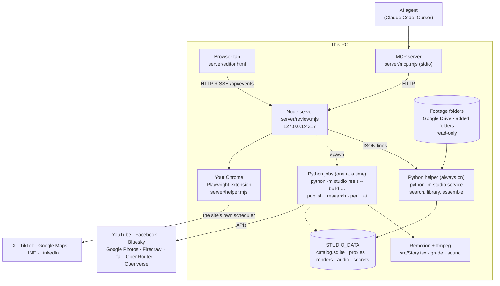
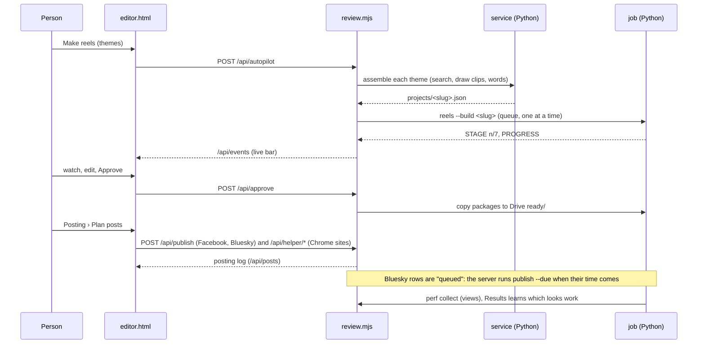
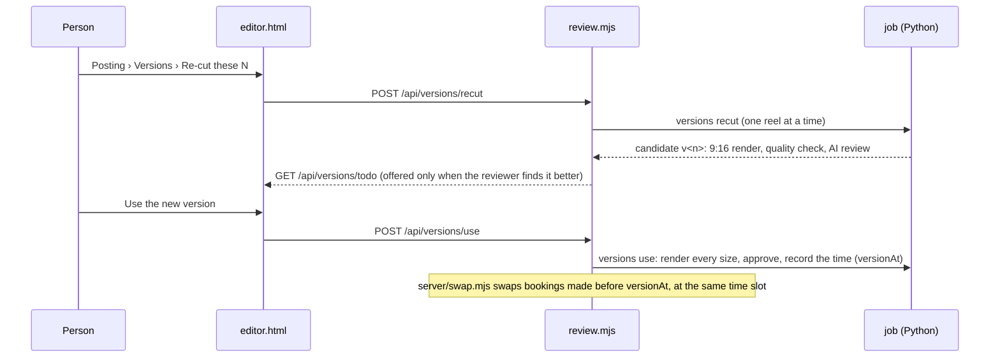

# Architecture

Lazycow Studio is three local programs on one PC:
- a Node web server;
- a long-running Python helper;
- short Python jobs.

It also uses the owner's own Chrome for sites that have no usable API. Nothing runs in the cloud. Footage is read and never changed.

## The pieces

| Piece | File | What it does |
|:--|:--|:--|
| Web page | `server/editor.html` | The whole interface: five sections (Footage, Reels, Posting, Results, Settings), the editor, English and Japanese. It is served fresh from disk, so a page reload shows a change. |
| Node server | `server/review.mjs`, `server/health.mjs` | Serves the page and the HTTP API (`docs/openapi.yaml`). Runs one render queue and pushes progress over `/api/events`. Accepts only loopback requests and only POSTs from its own page. |
| Runs by itself | `server/autoplan.mjs`, `server/swap.mjs`, `py/studio/live.py`, `scripts/autostart.mjs` | Books the next days' posts, checks they went out, sends late posts, and swaps older bookings for the newest approved render (`/api/autopost`, `/api/posts/autoreplace`). Every 5 minutes the server also sends due studio-sent posts (Bluesky, queued) for every other project (`tickOtherPosts`). |
| Python helper | `py/studio/service.py` | Keeps the CLIP model loaded, so searching, assembling and the overview are instant. It talks JSON lines on stdin and stdout. |
| Python jobs | `py/studio/__main__.py` and modules | Each render, upload, post, research call or AI call runs as its own process with its own log, so one failure cannot take down the server. |
| Rendering | `py/studio/reels.py`, `shot.py`, `sound.py`, `src/Story.tsx`, `src/looks.tsx` | ffmpeg grades and crops each shot; Remotion draws the words and cut styles; ffmpeg mixes the sound to −14 LUFS. |
| Reel styles | `shared/type-kits.json`, `py/studio/typekits.py`, `src/typekit.ts`, `/api/typekits` | Each new reel draws a type pairing (10), colours (6), word motion (5) and colour grade (5), seeded per reel; a value one of the last four reels used gets a quarter of its chance. Night and fire themes keep the house grade. A reel without these fields renders as before. Fonts are in `public/fonts`. |
| Versions | `py/studio/versions.py`, `/api/versions*` | A better cut of a booked reel, made beside the live one under `%STUDIO_DATA%\versions\<slug>\v<n>\`. Only a person's **Use the new version** makes it the reel; its bookings then swap (`versionAt`). The MCP server never calls it. |
| Sound levels | `py/studio/levels.py`, `/api/levels` | Fixes finished reels off −14 LUFS or over −1 dBTP by gain alone, keeping the masters as `*.orig.mp4`. |
| Long videos | `py/studio/vlog.py`, `src/Vlog.tsx`, `/api/vlogs*` | Plans a trip into 16:9 parts with chapters by day, builds each part, writes its YouTube title, description, chapters and thumbnail. |
| YouTube | `py/studio/youtube.py`, `/api/youtube*`, `POST /api/vlogs/youtube` | Several accounts per project (`main` for Shorts, then `a2`, `a3`, ...), Shorts uploads, long-video uploads (private, unlisted, public or scheduled), playlists. One Google app can be shared with every project. |
| Chrome helper | `server/helper.mjs`, `server/chrome-bridge.mjs` | Drives your own signed-in Chrome to fill in each site's scheduler. It refuses unapproved reels and times outside the site's window (`docs/helper.md`). |
| MCP server | `server/mcp.mjs` | Lets an AI agent use the studio through the same HTTP API. It has no approve tool and no tool to make a version live (`docs/mcp.md`). |

### Projects and a second studio

One studio serves one open project at a time. The list of projects lives in `%STUDIO_HOME%\workspaces.json` (default `~/.lazycow`); each project made in the studio has its own data folder under `%STUDIO_HOME%\projects\<id>`. Switching restarts the server on that project's folders, after running jobs finish.

A second studio can run beside the first: `STUDIO_PROJECT=<id> STUDIO_PORT=4318 STUDIO_QUIET=1 npm run review`. `STUDIO_PROJECT` pins it to one project (`PINNED` in `server/review.mjs`; a switch answers 409). `STUDIO_QUIET=1` stops everything that runs by itself there (posting, booking, swaps, checks, the Chrome link, resumed renders); what a person presses still works. The main studio keeps sending due studio-sent posts for every project.

## A reel's life

## A better version of a booked reel

## Where data lives

| Store | Path | Holds |
|:--|:--|:--|
| Catalog | `%STUDIO_DATA%\catalog\catalog.sqlite` | `assets`, `shots`, `library` (tags, embeddings, faces), `vetoes`, `spend`, `drafts` (review status), `posts` (the posting log), `metrics` (results) |
| Renders | `%STUDIO_DATA%\renders\story-<slug>\` | Masters per size, network folders, `job-<slug>.log`, `jobs.jsonl` (every finished job) |
| Versions | `%STUDIO_DATA%\versions\<slug>\v<n>\` | Each version's three masters, cover, manifest, reel definition and review (about 60 MB each) |
| Long videos | `%STUDIO_DATA%\vlog-plan.json`, `%STUDIO_DATA%\renders\vlogs\vlog-<n>\`, `%STUDIO_DATA%\vlog-youtube.json` | The plan; each part's `master.mp4`, `youtube.json`, `description.txt`, `thumbnail.jpg`, `uploaded.json`; the project's YouTube choice for long videos |
| Secrets | `%STUDIO_DATA%\secrets\` | YouTube tokens (`youtube_token.bin` for main, `youtube_token-a2.bin` and on for more accounts; DPAPI-encrypted on Windows), the project's Google app, connector sessions. Never in git. |
| Shared Google app | `%STUDIO_HOME%\youtube_client.json` | The Google app every project without its own uses (Settings › Keys & AI › Use this Google app in every project) |
| Reel projects | `%STUDIO_DATA%\projects\<slug>.json` (the original ranch workspace: `projects/` in its private git) | Shots, words, look, seed, music: enough to rebuild the reel |
| Settings | `.env` (not in git), `shared/*.json` (in git) | Keys and paths; sizes, safe zones, looks, playbooks |
| Projects list | `%STUDIO_HOME%` (default `~/.lazycow`) | One folder per brand or client |
| Approved files | `STUDIO_READY` (default `%STUDIO_DATA%\ready\`) | What a person posts by hand (Instagram) |

## Key decisions

**Why local, not cloud?**
- The footage is large and private, and stays on the PC.
- There are no hosting costs or accounts.
- One owner, one PC.

The cost is that the PC must be on for Bluesky posts and for Chrome scheduling (see `docs/HANDOFF.md`).

**Why the owner's own Chrome for five networks?**
- X, TikTok, Google Maps, LINE and LinkedIn either have no API this account can use, or charge for it, or need an app review.
- Their own schedulers are free and already signed in.

The cost: sign-ins expire, and a site redesign can break a step. The helper checks each booking on the site's own list and logs the proof link. API options are compared in `docs/research/2026-11-10-integrations-docs-pain-points.md`.

**Why a long-running Python helper plus one-off jobs?**
- Loading CLIP takes 10–20 seconds, so the helper keeps it loaded.
- Renders take minutes and use a lot of memory, so each runs alone and can be stopped (`/api/job/cancel`).

**Why only approved words?**
- Every on-screen line comes from the website's approved copy, and `shared/guard.mjs` refuses banned claims.
- The studio never writes new claims about the place.

**Why one render at a time?**
- A 9-clip reel uses every core for about six minutes. Two at once would be slower than one after the other.
