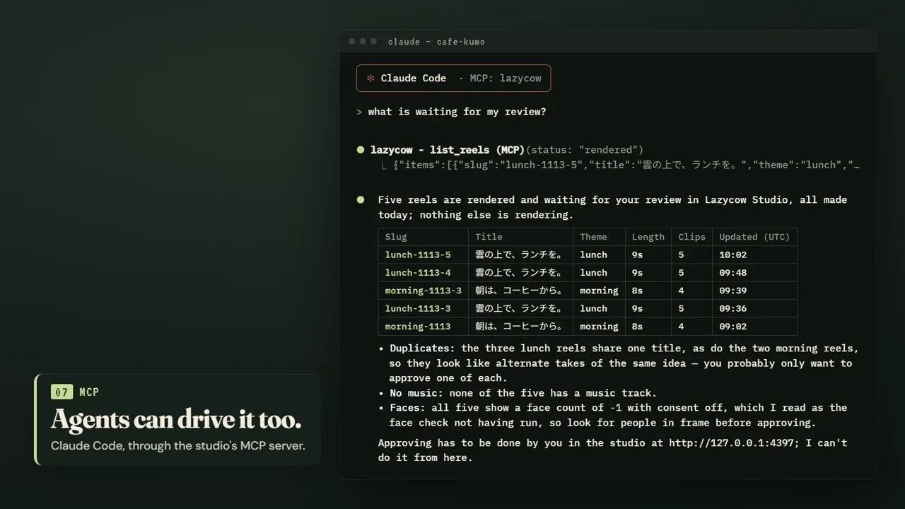

# Let an AI agent run the studio (MCP)

Lazycow Studio includes a small MCP server (`server/mcp.mjs`). It lets an AI agent such as Claude Code,
Claude Desktop or Cursor do what you would do in the studio's page: check the studio, make reels, watch
renders, plan posts, publish approved reels, switch projects and read the log.

It has no dependencies. It talks to the studio you already run, so start the studio first:

```bash
npm run review        # the studio, at http://127.0.0.1:4317
```

If the studio is not running, every tool answers: "Lazycow Studio is not running … Start it with
`npm run review`".



*A real session against a demo studio: one question, the `list_reels` tool, and an answer that ends with "Approving has to be done by you in the studio".*

## What the agent can do

| Tool | What it does | Changes anything? |
| --- | --- | --- |
| `studio_status` | Is the studio up, which project, can this computer render, what is rendering | no |
| `list_reels` | Reels with their review status (draft, rendered, approved, rejected, reroll, making) | no |
| `reel_details` | One reel: shots, music, network files, review notes, render job | no |
| `list_themes` | Themes a reel can be made for | no |
| `make_reels` | One new reel per theme from the newest footage, queued to render | yes, on this computer |
| `make_reel` | One new reel for one theme under a name you choose | yes, on this computer |
| `remix_reel` | Re-render only a reel's sound | yes, on this computer |
| `job_status` | Progress of a render, remix, upload or post | no |
| `cancel_job` | Stop a render or remix | yes, on this computer |
| `list_posts` | The posting log | no |
| `plan_post` | Add a "post this then" reminder (posts nothing) | yes, on this computer |
| `list_accounts` | Networks on or off, account names, which ones are connected. Never passwords, tokens or keys | no |
| `publish_reel` | Post an **approved** reel now, or schedule it | yes, **posts to the internet** |
| `schedule_reel` | Schedule an **approved** reel on X, TikTok or Google Maps through the browser helper ([helper.md](helper.md)) | yes, **schedules on the internet** |
| `list_projects` / `switch_project` | See projects, open another one (the studio restarts on it). A switch is refused while a job runs, and always in a studio pinned with `STUDIO_PROJECT` | switch: yes |
| `read_log` | Finished jobs, AI spend, how reels were made, YouTube uploads (today's count against the 100-a-day upload allowance) | no |
| `research_ideas` | Recent web pages and news on a topic, hashtags, keywords, 3-5 post angles with sources | no (reads the web, uses Firecrawl credits) |
| `research_site_check` | The brand website's prices, altitude, inclusions and booking link against the approved copy's facts | no (reads the web) |
| `research_page` | One page's summary, selling points, and what it says that the approved copy does not | no (reads the web) |
| `research_events` | Upcoming events near the project's home place, with a post-by date | no (reads the web) |
| `research_links` | Whether every link in planned or scheduled posts and the profile kit still loads | no (reads the web) |
| `ai_estimate` | The price of AI tools on one reel (per tool, total) against the per-reel, total and daily limits | yes (spends nothing) |
| `ai_review` | A video model watches a rendered reel: hook and look scores, captions that do not match their shot, unapproved claims, 1-3 fixes | yes for the reel (suggestions only; one review costs about $0.01, cached per render) |
| `ai_run` | Apply AI tools (sharpen, slowmo, living, foley, behind, music, voice) to a reel or an AI copy (`into`), then render; refuses over a limit | no (spends money inside the limits; never approves or posts) |
| `perf_summary` | What worked and what did not across posted reels (look, recipe, layout, length, hook, posting time) in plain sentences with their uncertainty ([perf-api.md](perf-api.md)) | no |
| `perf_suggest` | Next-reel suggestions (look, recipe, layout, length, posting hour) by Thompson sampling, 30% exploring | no (suggestions only) |

**Research is read-only.** The `research_*` tools return suggestions with their source URLs; their words are not
approved copy and nothing is posted. They need a Firecrawl key in the studio (Settings › Keys & AI); answers are cached
24 h. Shapes and errors: `docs/research-api.md`.

**Some work stays in the studio's page.** The agent has no tool for these; a person does them in the studio:

| Work | Where |
|:--|:--|
| Approve or reject a reel | Reels › To review |
| Make a better version live (**Use the new version**) or keep the live one | Posting › Versions |
| Plan, build and upload long videos | Reels › Long videos |
| Connect YouTube accounts, share a Google app with every project | Settings › Keys & AI |

**AI tools spend money only inside the studio's limits.** `ai_run` prices the tools first and refuses (nothing spent)
over the per-reel, total or daily limit, or above its own `max_usd`; it never changes an approved or scheduled reel (pass
`into` for a copy). A voice or a living photo needs the platform's AI label when posted. Shapes: `docs/ai-api.md`.

**Approving stays with a person.** There is no approve tool. `publish_reel` checks the reel's review
status first and refuses anything that is not "approved". Approve reels in the studio's page.

## Add it to Claude Code

The quickest way: open the studio's **Settings › Keys & AI › Use with Claude or Cursor**. It shows the lines below
with this computer's paths already filled in, each with a Copy button.

Run this once in a terminal. It needs Node 20 or newer and nothing else: the `lazycow` npm package carries the
same MCP server and finds the studio on this computer by itself.

```bash
claude mcp add lazycow -- npx -y lazycow mcp
```

Or point at the copy in your studio folder (no download; it always matches the studio's version):

```bash
claude mcp add lazycow -- node C:\path\to\lazycow-studio\server\mcp.mjs
```

Add `--scope user` to have it in every project. If your studio runs on a different port (`STUDIO_PORT`),
pass the same port to the MCP server:

```bash
claude mcp add lazycow -e STUDIO_PORT=4318 -- node C:\path\to\lazycow-studio\server\mcp.mjs
```

The same works for a second studio pinned to one project (`STUDIO_PROJECT=<id> STUDIO_PORT=4318 npm run review`): add
it under its own name, for example `lazycow-trip`, with `-e STUDIO_PORT=4318`. Its tools then act on that project only.

Check it with `claude mcp list`, or `/mcp` inside Claude Code.

## Add it to Claude Desktop

Open Settings › Developer › Edit Config. That opens `claude_desktop_config.json`
(Windows: `%APPDATA%\Claude\claude_desktop_config.json`; macOS:
`~/Library/Application Support/Claude/claude_desktop_config.json`). Add the `lazycow` entry, then restart
Claude Desktop:

```json
{
  "mcpServers": {
    "lazycow": {
      "command": "node",
      "args": ["C:\\path\\to\\lazycow-studio\\server\\mcp.mjs"],
      "env": { "STUDIO_PORT": "4317" }
    }
  }
}
```

In JSON, a Windows path needs double backslashes. `env` is optional; 4317 is the default.

With the npm package instead of a path: `"command": "npx", "args": ["-y", "lazycow", "mcp"]`. It finds
the studio by `STUDIO_PORT` / `STUDIO_API_TOKEN`, else the `.env` in `LAZYCOW_DIR`, else the folder the double-click
setup recorded.

## If the studio asks for a token

With `STUDIO_API_TOKEN` set in the studio's `.env` (useful on a shared computer), every caller must carry the token.
The MCP server reads it from the studio's `.env` by itself, so the configs above need no change. A client that runs
the MCP server from another folder can pass it in `"env": { "STUDIO_API_TOKEN": "..." }`. Without it, every tool
answers that the studio asks for its API token.

## Add it to Cursor

Put the same `mcpServers` block in `.cursor/mcp.json` (this project) or `~/.cursor/mcp.json`
(every project).

## Things to ask it

- "Is the studio running? What is waiting for my review?"
- "Make reels for the fire and aerial themes from footage since 1 November, and tell me when they finish."
- "Which approved reels have no post planned? Plan each one on YouTube at 19:00 Japan time, one a day."
- "Publish fire-1107 to Bluesky now."
- "Why did the last render fail?"

## How it works

The MCP server speaks JSON-RPC 2.0 over stdio, one message per line. It supports the current MCP
revision (2026-07-28: the version is sent on every request, `server/discover`) and the earlier
`initialize` handshake (2025-11-25, 2025-06-18, 2025-03-26, 2024-11-05). Each tool is one or a few calls
to the studio's HTTP API on `127.0.0.1` (see `server/00_readme.md`), so the studio enforces every rule
the page does: disk space, render rules, consent before approval, network connections.

Every tool answers with text for the model: one plain sentence, then the data as JSON. The same data also comes as
`structuredContent` (an object; a list arrives as `{ "items": [...] }`), so a program can read it without parsing the
text. Account secrets are removed from both. A failed call answers `isError: true` with a sentence that says what to do.
Arguments are checked against each tool's schema first; a bad one never reaches the studio.

Tests (`npm test`):

- `test/mcp.test.mjs`: the protocol, the refusals (no approve tool, unapproved reels, AI over the limits), no secrets.
- `test/mcp-every-tool.test.mjs`: all 27 tools, each called once against a fake studio, through `server/mcp.mjs` and
  through the npm package (`npx lazycow mcp`); and every route the tools call is in `docs/openapi.yaml`.
- `test/lazycow-package.test.mjs`: the npm package (files, attribution, client, installer).
