# User guide

This guide is for the people who use the studio day to day. You do not need to code.

- **New to the studio?** Read [Your first day](#your-first-day), then [A tour, page by page](#a-tour-page-by-page).
- **Know your way round?** Jump to [Tasks](#tasks) or [When something goes wrong](#when-something-goes-wrong).

The README says what the studio is and how to install it. [architecture.md](architecture.md) explains how it is built.

Open the studio at **http://127.0.0.1:4317** on the studio computer. If the page does not load, open a terminal in the studio folder and run `npm run review`.

## Contents

- [Your first day](#your-first-day)
- [A tour, page by page](#a-tour-page-by-page)
- [Every week and every month](#every-week-10-minutes)
- [What runs by itself](#what-runs-by-itself)
- [Tasks](#tasks)
- [When something goes wrong](#when-something-goes-wrong)
- [What the studio will not do](#what-the-studio-will-not-do)
- [Words used in the studio](#words-used-in-the-studio)

## Your first day

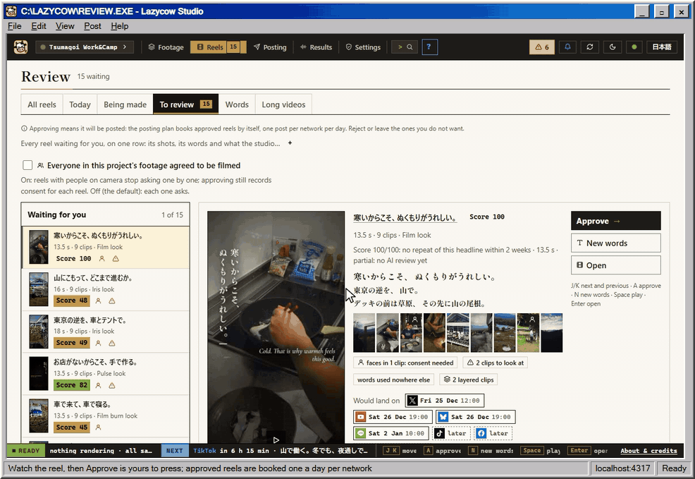

*The whole idea in one loop: review, Approve, booked. The [40-second demo](media/lazycow-demo.mp4) shows it from a folder of clips.*

New here, with no terminal? Download the release zip, unzip it, read **README.TXT** and double-click **Start Lazycow**
([how it works](../scripts/bootstrap/README.md)). Lazy Kenji, on the cow-print bean bag, walks you through the rest. If
you like your tours loud, press the blinking **DO NOT CLICK** button at the end of the setup guide (or find "90s pop-up
tour" with Ctrl K): pop-up windows explain every page, 1999 style. Esc, or **MAKE IT STOP**, ends it.

| | |
|:--|:--|
| 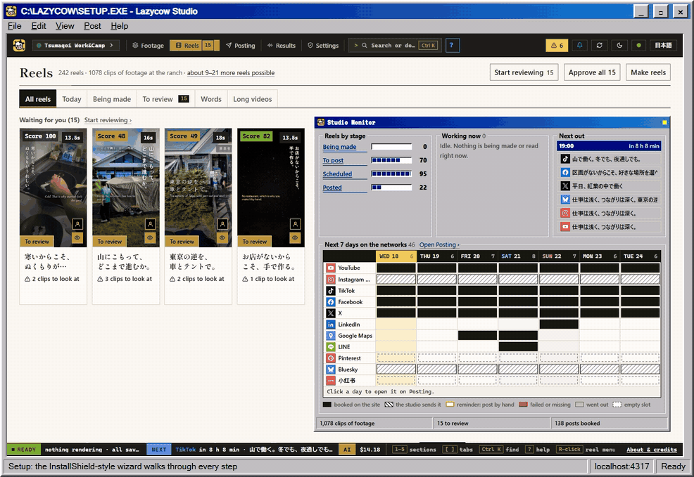 *The setup guide. Each step says what it needs; a green tick appears as each one is done.* | 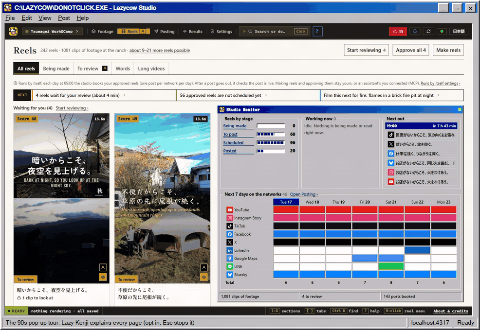 *The pop-up tour, for the brave. Esc stops it.* |

*The GIFs in this guide are recorded in the author's own studio (嬬恋牧場Work&Camp). They open, scroll and play pages; none of them approves or books anything. `node scripts/docs-gifs.mjs` records them again.*

The page shows a **Getting started** list until each step is done. The steps, in order:

1. **System** (top bar). Every line is green or amber. A red line says what is missing.
2. **Footage › Add a folder**. Pick the folder or drive with your videos, or press **Add from Google Photos**. Tagging starts by itself.
3. **Settings › Keys & AI › This project**. Type your name, link and hashtags, and the words the studio must never use.
4. **Reels › Make reels › New theme**. Write a headline, two or three true lines, and the kind of shots each line needs.
5. **Make reels**. Each reel takes about six minutes. You can keep working.
6. **Reels › To review**. Watch each reel. Press **Approve** or **Reject**.
7. **Settings › Accounts**. Connect each network once.
8. **Posting › Plan posts**. The studio books your approved reels, one post a day per network.

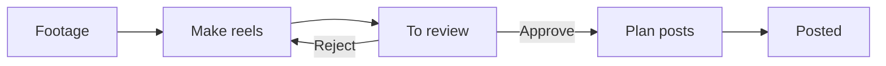

## A tour, page by page

The top bar has five sections, in the order work moves: **Footage**, **Reels**, **Posting**, **Results** and **Settings**. Keys 1 to 5 open them. A section with more than one page shows its pages as tabs.

Under the top bar, on every page, **What needs you** says in one row what to do, worst first, each with one button that fixes it. Red means something is broken: a post or a render will not happen until you fix it. Amber means it will become a problem, for example a sign-in that ends in a few days. A plain item is a to-do, such as reels waiting for review. **All N** opens the whole list in place, with each item's detail; × hides the row until something new comes up. When nothing needs you, it says so, and how posting runs by itself.

The maps, the lanes and the other graphics move a little: footage and posts flow along the wires, dots breathe, entrances play once. **Settings › Keys & AI › This studio › Motion on the graphics** sets it: **Auto** follows your system's reduced-motion setting, **On** moves them anyway, **Reduced** keeps everything still. When Auto keeps them still, a note above the first graphic says so, with **turn them on**.

### Footage

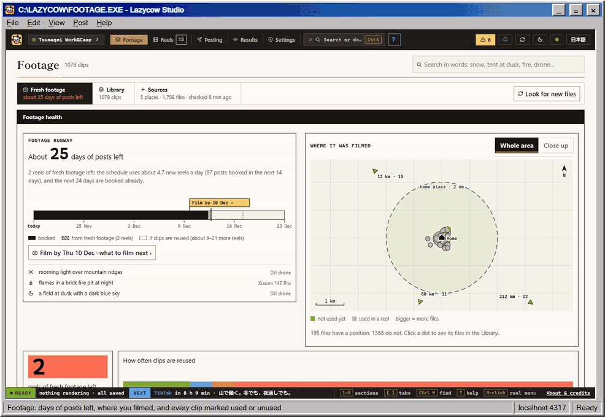

Every photo and video the studio can use, with its tags, in three tabs: **Fresh footage** (how long it lasts, where it was filmed, reuse, cameras, what to film next), **Library** (the filters and every clip, grouped, the newest group open and the rest folded, ten groups at a time) and **Sources** (every way in, and where footage comes from). Opening Footage shows Fresh footage when footage is running low, otherwise the Library; each tab has its own address (`#/footage/health`, `#/footage/library`, `#/footage/sources`), and typing in the search box opens the Library. **Sources** holds every way in, and under it **Where footage comes from**: a map with the project in the middle and each place it reads as a branch (a Drive folder, the Google Photos picks, the drop box, files dropped on the page, a Google Form), with its clips, how many are unused, when it was last checked and whether it is watched. A soft pulse moves along the line of each place the studio watches, towards the project; a dashed line means nothing comes in from there yet (red: the studio cannot read it). If your computer is set to reduce motion, nothing on the maps moves. Click a place for its details, **Look for new files**, **Browse this folder** or **Stop reading this folder**. **Fresh footage** says how many more reels your unused clips can make, and what to film next. At its top:

- **Footage runway**: about how many days of posts are left. It counts the days already booked, then how long the reels your fresh footage can still make would last at the pace the schedule uses new reels (different reels booked over the next 14 days). The bar shows booked days (solid), days from fresh footage (hatched) and what reusing clips could add (dashed). The yellow **Film by** flag is three days before it runs out; press it (or the button) to jump to **Film next**, whose first three lines are shown under it.
- **Where it was filmed**: a small map with no map tiles: your home place in the middle, its radius as a dashed circle, a grid and a scale bar. Each dot is the footage filmed within about 100 m of one spot (no file's own position is shown), bigger for more files; the green part is not used in a reel yet, the grey part is. Places further away sit on the edge as arrows with how far and how many. **Close up** zooms in on the home place. Click a dot or an arrow to show only its files in the Library tab; the yellow **Filmed** chip beside the tags clears it. Files without a GPS position are counted but not drawn.

**Add from Google Photos** opens Google's picker: since March 2025 an app can only read the photos you pick there, so a renamed or new album is not seen until you pick its items. Search does not find album names in the picker; open the album in Google Photos to see what is in it.

### Reels

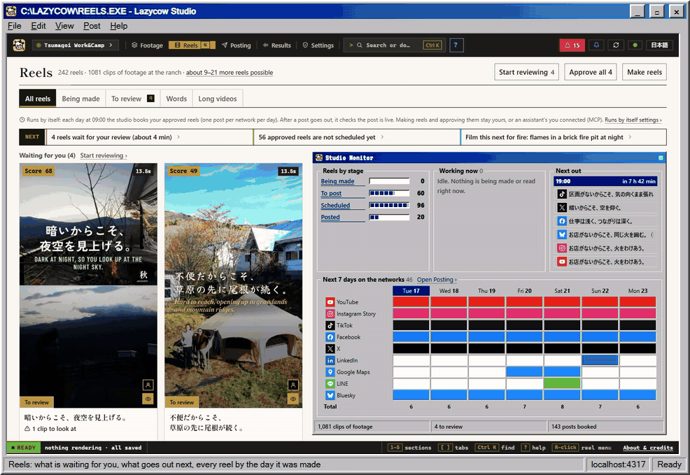

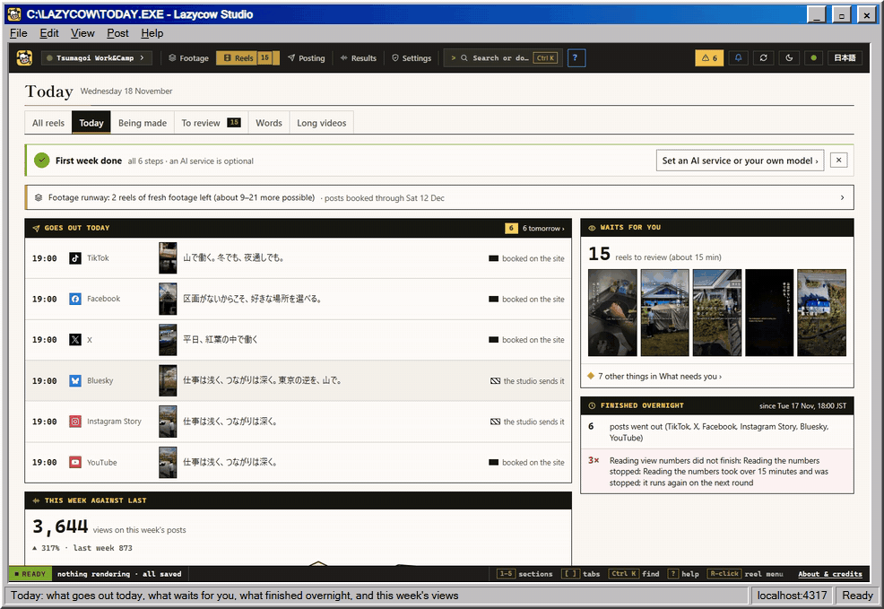

The page opens on the reels waiting for you and the **Studio Monitor**: how many reels are at each stage, what is being made now, every post of the next time slot, and **Next 7 days on the networks**: one row per network, one cell per day, filled by its state (solid = booked on the site, hatched = the studio sends it, amber outline = a reminder, red = failed or missing, green = out, dashed = an empty slot that network posts in). Point at a cell for its posts; click it to open that network and day on **Posting**. Below, every reel. **Group by** sorts them by kind, by stage, or by **When made** (today, yesterday, then each day of the last week, then by month; the default). The two newest groups are open with one row of cards each (**Show all** for the rest); every later group, and the house reels, fold to one line with their counts and first pictures; click a line to open it. Beside the state filter, **Every theme** and **Every network** narrow the reels to one theme or to those booked or out on one network. A card shows where the reel is booked or out; hover it for **Post**, **New version**, **Other opening** and **Don't post**. Move the mouse across a card's picture to scrub through the reel (it loads only while you point at it; a click still opens the reel, and the play button plays it with sound). A reel that is not posting says why: rejected in review, replaced by a new cut, or set aside. A person badge means someone can be recognised and has not agreed yet.

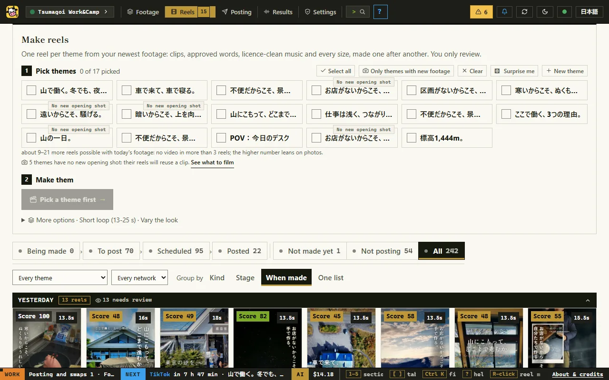

| Tab | What it is for |
|:--|:--|
| **All reels** | Every reel, with its words, its state and its booked time |
| **Today** | What goes out today (time, network, reel, state), what waits for you, what finished overnight, this week's views against last week's, and the footage runway in one line. Every row opens its place. On a new project, **Your first week** sits on top: add footage, connect a network, make the first reel, review it, book the first post, read the first numbers, and (optional) set an AI service or your own model. Each step ticks itself when the studio sees it happen (never by hand) and links to where it is done; once all are done it folds into one line, and **×** hides it for this project. |
| **Being made** | Reels that render now, and those waiting their turn. Each has a strip of its real stages (in line, best moments, 9:16, 4:5, 16:9, sound, network copies, review sheet, ready): the live one moves, with the time in that stage, the time so far and, once there are past runs to go by, the time left. A sound-only remix skips the picture stages. A failed reel shows the stage it stopped at in red, the cause in plain words and **Try again** |
| **To review** | Reels waiting for your yes or no. **Start reviewing** opens the first one. |
| **Words** | The word bank: every approved headline and line, and how often reels repeat them |
| **Long videos** | Long YouTube videos from a trip (see [A long video from a trip](#a-long-video-from-a-trip)) |

#### To review

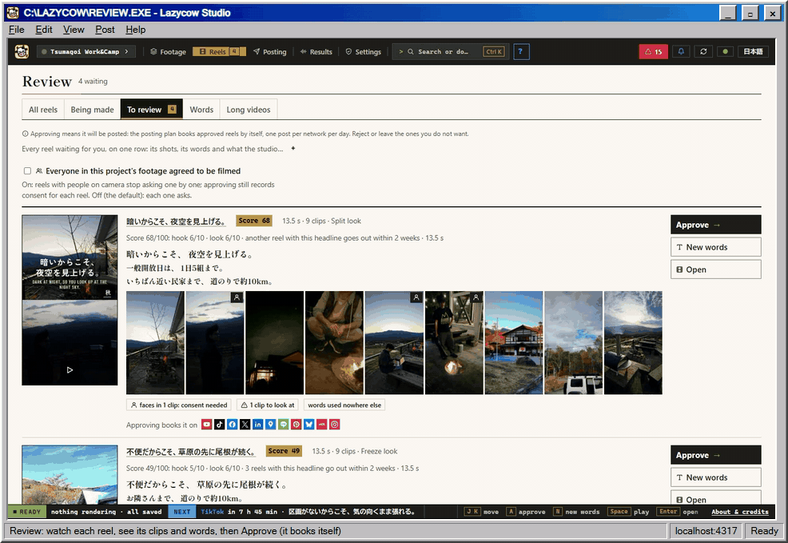

The queue of reels waiting for you is on the left (picture, headline, score, and a mark for faces, clips to look at or repeated words); the one you pick fills the right: the reel (press it to play), its score, its words, every clip it uses, and notes such as clips to look at or faces that need consent. After **Approve** the next reel in the queue takes its place. **Would land on** shows, for each network Plan posts books on, the first free day and time that would be left for this reel if you approved it now: the reels already approved take their slots first, then the Plan posts rules apply (one post per network a day, each site's booking limit, its posting times, no headline twice on a network within two weeks, no people on Google Maps, LinkedIn only for the long cut). **later** means no free slot within that site's limit yet; **not suited** lists the networks it will not go to. Click a day to see it in **Posting › Week**. It is a preview only: nothing is booked from here. Move the mouse across the reel's picture to scrub through it. **Approve**, **New words** or **Open**. Keys: J and K move through the queue, A approves, N draws new words, Space plays, Enter opens.

#### The reel editor

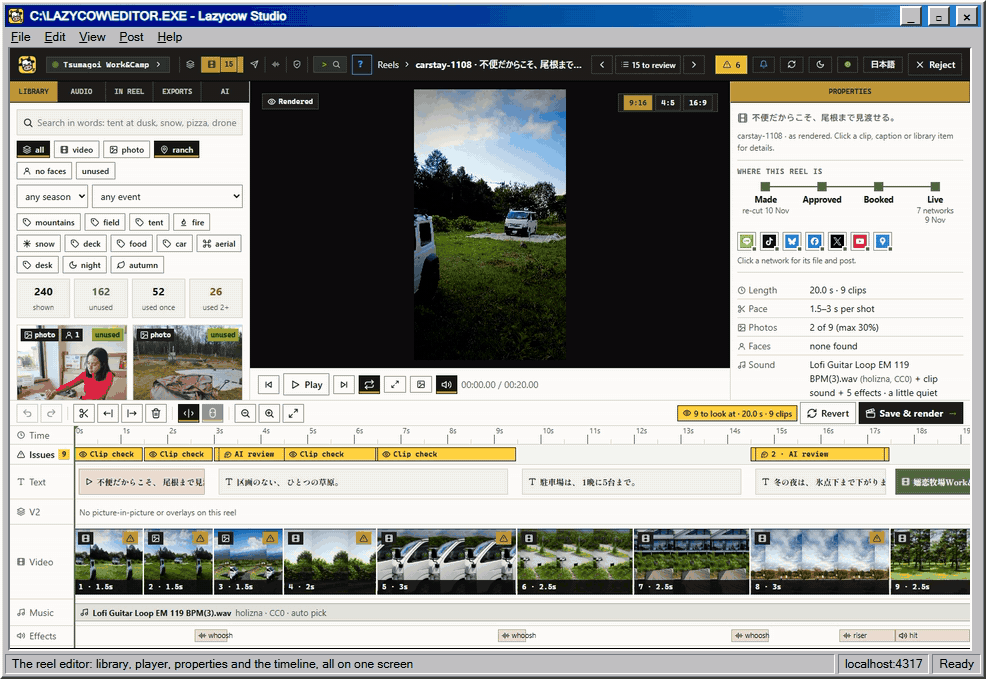

Open a reel to edit it. The editor has the clips on a timeline, the words, the music and the reel's style.

**Where this reel is** sits at the top of **Properties**: made, approved, booked and live, each with its date, and the step it waits on marked in yellow. Under it is one small logo for each network the reel is booked on or out on, with a dot for its state (green: out, blue: booked, amber: a reminder, red: not found). Click a logo to open **Exports** at that network.

**Issues** is the lane right under the time ruler: every issue at its place in the reel. Red stops **Save & render** (a rule: a clip used twice, too many photos, a shot over 4 s, no headline in the first half second, the wrong length). Yellow is worth a look before approving: the clip checks (the same warning signs as on the clips), the AI review's captions over the wrong picture or claims not among the approved facts, words too many to read in their time or on screen for under a second, black, frozen or silent stretches from the quality check, and clips enlarged from a small source. A thin band along the lane is a whole-reel issue. Click an issue: the playhead jumps there, its clip or caption is selected and a note says what it is. The chip in the timeline's tool row (**3 to look at**, **All clear**, or the first red rule) and the **Rules** line in **Properties** count the same list; click the chip to go to the first one.

**Each reel has its own style.** A new reel draws one of each:

| Part | Choices |
|:--|:--|
| Type | 10 type pairings: Mincho classic, Editorial, Clean gothic, Soft rounded, Bold poster, Handwritten journal, Brush, Decorative, Condensed sport, Retro pixel |
| Colours | 6: Paper, Snow and sky, Amber, Meadow, Sunset, Black and white |
| Words arrive | 5: Typed letter by letter, Lines rise, Letters pop, Out of focus into focus, Wiped on |
| Colour grade | 5: House film look, Warm, Cool and clear, Soft matte, Crisp and vivid |

The draw rarely repeats what the last four reels used. Night and fire reels keep the house grade, so their dark stays dark. To change a style, open the reel and find **Type, colours and motion**. Pick from each list, or press **Surprise me** for a new set. Then press **Save & render**. Reels made before styles existed look as they did.

### Posting

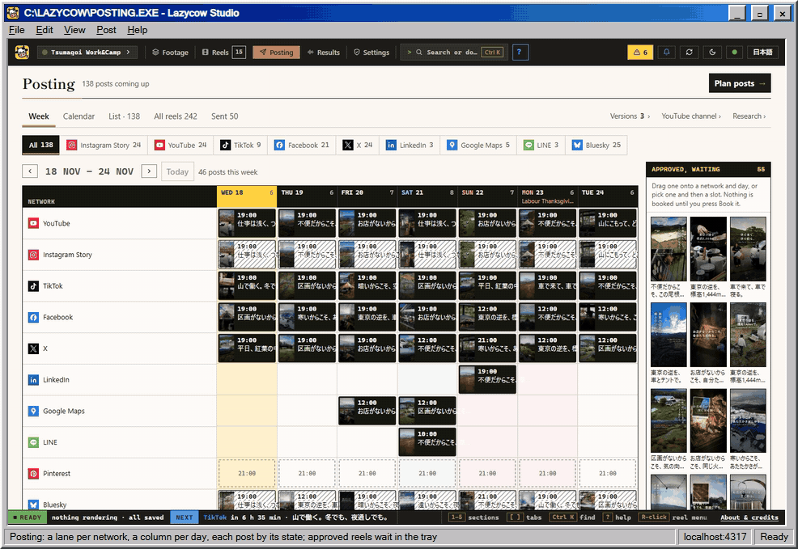

**Posting › Week** opens first: one row per network, one column per day, today in yellow, holidays and events over their day. Each post is a chip with its time and reel: solid = booked on the site, hatched = the studio sends it, amber outline = a reminder, red = failed or missing, green = out, and a dashed box is an empty slot from that network's posting times.

- **Move a post**: drag a hatched or outlined chip to another day of its row (the same time of day). It moves at once; **Undo** in the note moves it back. A post booked on the site itself says why it does not move (move it there). Keyboard: arrow keys move between cells, Enter opens a post, Alt+← and Alt+→ move the focused post a day.
- **Book a reel**: drag an approved reel from **Approved, waiting** beside the lanes onto an empty slot (or press the reel, then a green slot). A card says what will happen (for example "Booked on TikTok through your Chrome"), and nothing is booked until you press **Book it**. The rules of **Plan posts** apply: one post per network a day, how far ahead each site takes bookings, no reel twice on one network, no people on Google Maps.

*Posting › Calendar. Each icon is one booked post. A solid border means the network holds it; a dashed border means the studio sends it. Each day shows its post times and the reel it uses on the most networks; past weeks with nothing in them are left out.*

| Tab or link | What it is for |
|:--|:--|
| **Week**, **Calendar** and **List** | Every booked post by day: the week as lanes, a month, or a list. Filter by network with the row of network buttons. |
| **All reels** | One square per network for each reel: posted, booked, a reminder, or not yet |
| **Sent** | What is out |
| **Versions** | Better cuts of booked reels, side by side with the live ones |
| **YouTube channel** | Your channel's videos and playlists. Each card has a views bar. Its total is YouTube's own count now for the newest 15 uploads (any video, the studio's or not); Results counts only the Shorts the studio posted in the last 60 days, as last read, so the two numbers differ. Results › **YouTube channel** shows the channel's all-time total |
| **Research** | Ideas and trends, events nearby, your website against your reels, broken links (needs a Firecrawl key) |
| **Plan posts** | Books every approved reel that is not booked yet |

Under the schedule: the swap of older bookings, booked reels whose sound is off the level (**Fix their sound**), better versions, and **Runs by itself**. What needs a look among them is also in **What needs you** at the top.

### Results

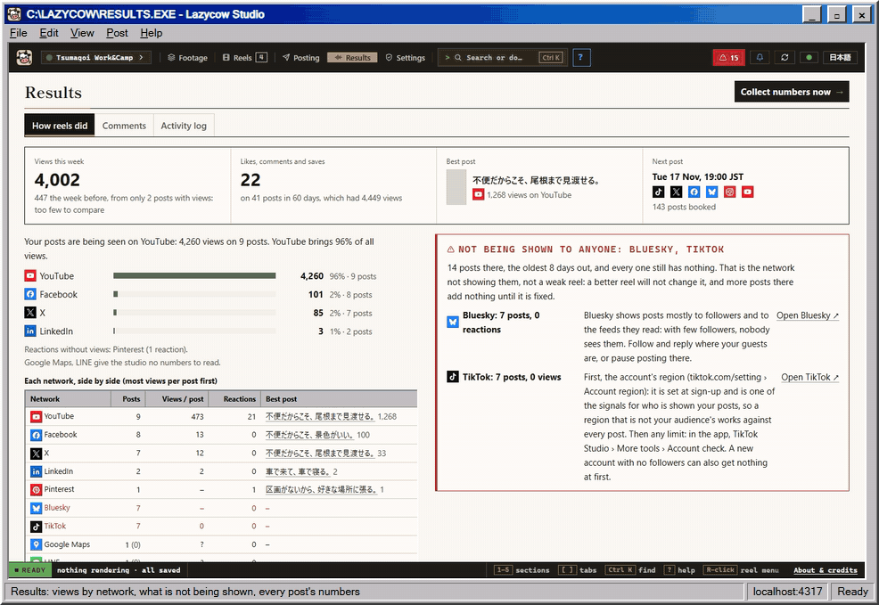

The top says how many people saw your posts this week and on which networks. **Each network, side by side** is one line naming the network with the most views per post; click it for the table (posts, views per post, reactions, views by week, best post). **Posts in, views out** draws it as one band per network: from its posts on the left to the views they brought on the right. A dashed red band means the network shows your posts to nobody; a dashed grey one means the studio cannot read its numbers. Point at a band to lift it, or click it (or press Enter) for the reason and the numbers. On a phone the same shows as bars. Under the picture's legend, one red line names any network that shows your posts to nobody; press **why?** for what to check there. A network's name on the left opens its row in **Posting › Week**; so does **See its week in Posting** in its details. Networks that give the studio no numbers at all (Instagram Stories, Google Maps, LINE) are not drawn as bands: they sit in one short **No numbers to read** line under the picture. The views column counts only posts the studio sent, over the last 60 days. **Each network, side by side** compares posts, views per post, reactions, **Views by week** (a small line of the views on each week's posts, with last week's change against the week before; with too few views it shows both numbers instead of a percentage) and the best post. **Every post** lists each post with its latest numbers.

**What to try next** opens with **Predicted and actual**: each measured post as a grey band (the 80% range frozen when it was booked), a tick for what was expected and a dot for what it did, on one scale from 0.1× to 10× a typical post on that network, grouped by network and oldest first. The dot is green above the range, black inside it and orange below. The line above it says plainly how good the predictions are, from the rank correlation (−1 always the opposite, 0 a coin toss, +1 always right): in November 2026 it was −0.22, about as good as a coin toss, even though 18 of 20 posts landed inside their range. It improves with more posts. Point at a row for its numbers; click it to open the reel. Under it, **Best time to post** is a day × hour grid of your own numbers: views per post at each hour (point at a cell for how many posts), with tabs per network. **All networks** compares each post with its own network's average, so YouTube does not drown the rest. The slots **Plan posts** books are outlined, so you can see whether they sit where the numbers are good. A network with fewer than about 10 posts says there is not enough data yet.

**How reels did** compares cut styles, themes and lengths on each network. Numbers come about 3 days after a post. They mean little before about 15 measured posts. **Activity log** lists every finished job, with how long it took and why it failed. Above the list, **Jobs over time** draws the last 24 hours (or **7 days**) as one lane per kind of job, each job a bar from its start to its end: green done, red failed, grey stopped. Point at a bar for what it was; click it (or use the arrow keys and Enter) for its times, its last line and, for a reel's make, its own log lines, with **Open** for the reel. The other project's due-post runs (they go out from this studio every few minutes) are hidden by default, in the lanes and in the list; tick **Show … jobs** to see them.

### Settings

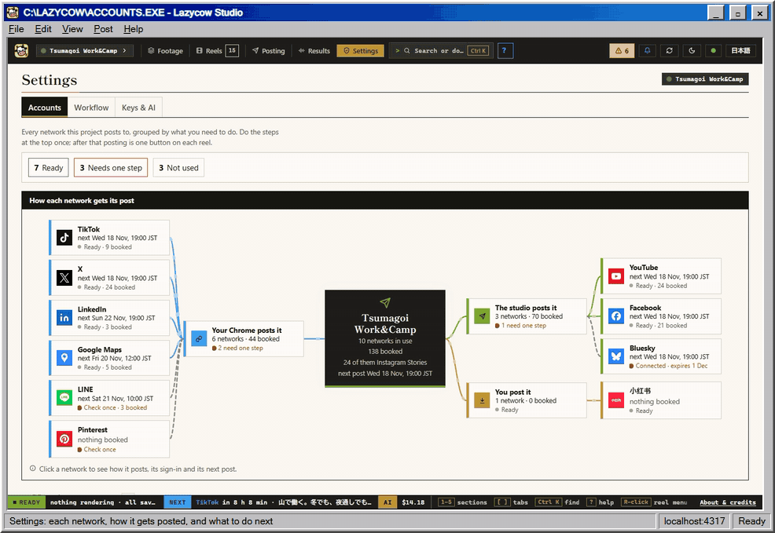

**Ready** (networks with nothing left to do) folds to one line with their logos while anything needs a step; click it for the cards. Under the map, **Needs one step** is one row per network with one main button: **Open … in my Chrome**, **Connect**, or, for a sign-in that ends before posts booked after it, **Add app password** (its form opens in the row; **Sign in again instead** is the other way). Its badge then says **Connected · expires 1 Dec**. **Ready** is one small card per network: its account, how it posts and one line; **How to post here · Settings** folds the playbook, the on/off switch and **Disconnect**.

The Facebook card also says whether **Instagram Stories** are on: every reel booked on YouTube then goes out as a story (shown for 24 hours) at the same time. They use the Facebook connection; **Connect again with Instagram** asks for the two Instagram permissions.

| Tab | What it is for |
|:--|:--|
| **Accounts** | **How each network gets its post**: a map with the project in the middle, the three ways a post leaves the studio (the studio posts it, your Chrome posts it, you post it from a reminder) and each network on its way, with its next booking and when its sign-in ends. A pulse moving out along a line means posts go out that way; a dashed, still line and an amber dot mean one step is left. Click a network for its details, **Show its card** or **See its posts**. The middle counts every booking still to go out, as Posting does, and says how many are Instagram Stories. Under the map, each network: on or off for this project, connected or not, and a button for anything that needs one step |
| **Workflow** | Every step a reel goes through, as a picture you can click (see **The Workflow page** below): which AI blocks are on, which service each uses, on this computer or in the cloud, what one reel costs, templates, and this month's AI spend |
| **Keys & AI** | A settings page: a side list of its sections, each with a one-line status (for example "4/4 working", "$9 of $23 spent", "Light · motion Auto"), and one section open at a time at its own address (`#/keys/keys`, `#/keys/blocks`, `#/keys/llm`, `#/keys/fallback`, `#/keys/caps`, `#/keys/studio`, `#/keys/brand`, `#/keys/chrome`, `#/keys/google`, `#/keys/connect`; the older `#/keys/motion` and `#/keys/theme` open This studio). **Find a setting** above the list narrows it by a word, in English or Japanese; Enter opens the first match. The sections: your AI keys, **AI blocks** (one row per AI job: its service and model, key saved or missing, the price per reel and per unit, on or off, and **Change** to pick another service), **Automatic switching** (when a service runs out: the switch to a backup service, how much dearer a backup may be, and each service's state with **Try again** and **Top up**), your own AI model, the spending limits, **This studio** (motion on the graphics: Auto, On or Reduced; **Colours**: Auto, Light or Dark. The sun/moon button in the top bar switches Light ⇄ Dark in one click, from Auto to the opposite of what shows; Ctrl K also has **Light colours**, **Dark colours** and **Colours follow the system**), **This project** (your name, link and words), the **Chrome link**, **YouTube: Google account and app**, and **Use with Claude or Cursor** |

#### The Workflow page

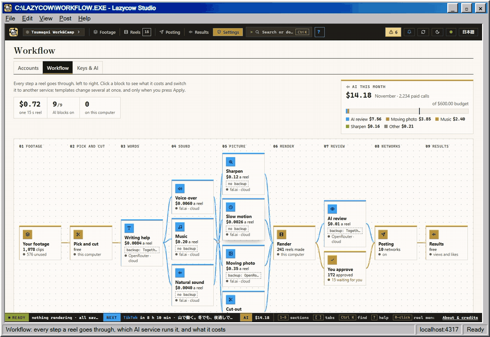

Settings › **Workflow** draws the whole pipeline left to right, like a node editor: **Footage → Pick and cut → Words →
Sound (voice-over, music, natural sound) → Picture (sharpen, slow motion, moving photo, cut-out) → Render → Review (AI
review and you) → Networks → Results**. Each block shows whether it is on, which service runs it, whether that is
**this computer** (green), **the cloud** (blue) or the studio itself (gold), and what it adds to one 15-second reel. A
block that is off is dashed, and its wire carries nothing; with motion on, a flow runs along the wires of the blocks that
are on.

Click a block for its details: what it does, its service and model, its key, its price per reel and what it cost this
month, and every other service that can do the same job, each with a link to its own documentation and the date its
entry was checked. **Use** switches to it (the same as Keys & AI › AI blocks). A service marked **unofficial** asks you
to read why and tick **I accept the risk** first; one with **no price yet** (Luma bills in credits) asks for your price
before it can be picked. **Switch off** / **Switch on** and **Back to the default** are under the details. **Not offered,
and why** lists the services the studio looked at and left out, with the reason.

**Templates** are ways people who make reels for a living mix the blocks: *Local and free* (your own model writes and
reviews from still frames, nothing paid), *Voice-over storyteller*, *Music-first mood reels*, *Low-cost cloud* (the
cheapest service you have a key for, per job), *Pro polish* (Topaz, FILM slow motion, the most expressive voice) and
*Studio defaults*. Each card shows its nine blocks as bricks and its cost per reel against yours. **Preview** lists what
would change (and marks those blocks on the graph); nothing changes until you press **Apply**. **Undo** puts the
previous workflow back. Templates are files in `shared/workflows/`; the choices are saved in the project's
`workflow.json`.

**If a service runs out or is down.** When an AI service is out of credit, refuses its key, is busy or not answering,
the studio uses the next service in that block's backup list, and every other block on that service does the same
until it is back (6 hours for credit, until you paste a new key for a key problem, 10 minutes for busy or down). It
never switches when a request is refused for what it shows. Each AI block on the graph says **backup: …**; a block
running on its backup has an amber outline and **switched**. Click it: **If this service runs out or is down** has the
block's **Auto-switch**, its backups in order (each with its key, price per reel and docs; move up or down, add,
remove, or go back to the studio's order: services with a key and a price, the default first, then the cheapest) and a
line such as "Using Runway since 14:02: fal.ai is out of credit". **Voice-over** does not switch until you turn it on,
because another service reads in another voice. A backup that would cost more than twice the first choice (you can
change this in Keys & AI) is skipped, and each attempt still keeps to your AI limits; one result is never paid twice.
**Needs you** then says, for example, "fal.ai is out of credit, so 3 jobs used Runway instead" (amber), or in red which
blocks have no backup, with **Try fal.ai again** and **Top up**.

**AI this month** (on this page, in AI blocks, and as **AI $…** in the status bar) adds up what was really paid this
calendar month, by job and by service, against the month's budget (the daily budget × the days in the month), with a
mark for an even pace to today and the AI limit that is left. On this page the top shows the total and the bar; the
section at the bottom (folded to one line; click it) adds the month's pace and the split by service.

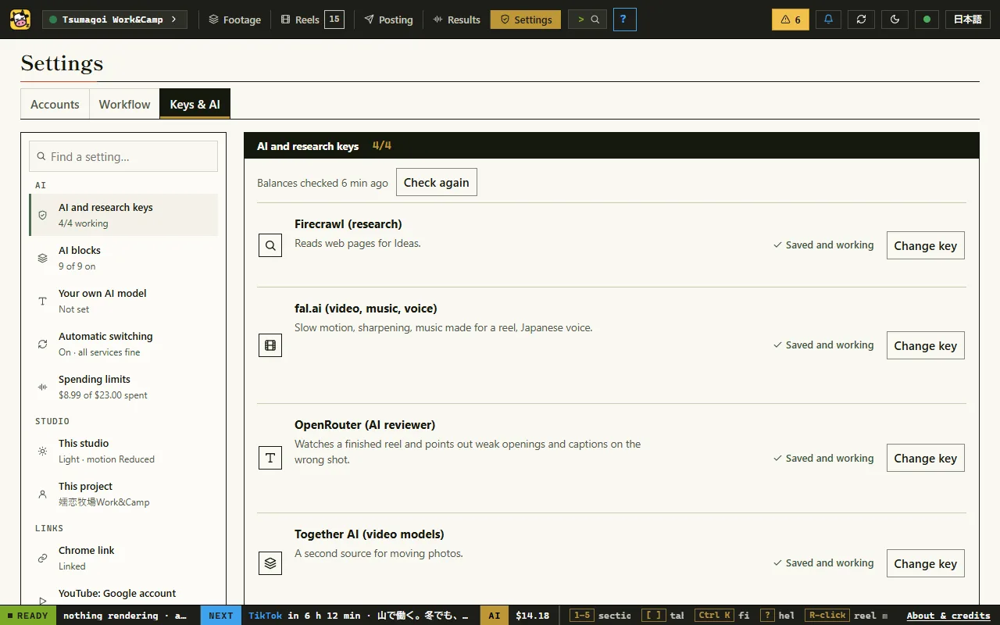

## Every week (10 minutes)

1. **Reels › To review**: play each reel, then press **Approve** or **Reject** (say why).
2. **Posting › Versions**: compare any better cuts, and choose (see [Versions of a booked reel](#versions-of-a-booked-reel)).
3. **Posting › Week**: check the coming days. A red post failed. Open it to see why, fix the cause (usually a sign-in), and book it again.
4. **Settings › Accounts**: anything under **Needs one step** has one button. Press it.

If **Runs by itself** is off, also press **Posting › Plan posts › Everything** once a week. TikTok accepts bookings only 10 days ahead.

## Every month (20 minutes)

1. **Results**: which cut styles, themes and lengths did better on each network.
2. **Footage**: **Fresh footage**. When it is low, the list under it says what to film next and with which camera.
3. **Posting › Research**: **What is on nearby** (events to post about) and **Check links** (broken links in posts and profiles).

## What runs by itself

**Posting › Runs by itself** shows every job the studio does on its own, with a switch for each one and the time it last ran.

| Job | What it does | How often |
|:--|:--|:--|
| Book posts | Books the next days' posts from approved reels on every connected network. Each network gets one post a day at its own hour, and never the same reel twice. TikTok is booked 9 days ahead. Networks booked in Chrome wait until the Chrome link is on. | Once a day, after the hour you set |
| Check posts went out | Confirms each booked post on its network (YouTube, Facebook, and your Chrome for the others). A post still not seen 6 hours after its time goes to **Needs a look** and rings the bell. | Every hour |
| Send late posts | Sends posts that came due while the computer was off, if they are up to 2 hours late. Later posts are marked missed, so nothing goes out days late without warning. | When the studio starts |
| Set aside failures | Marks a failed booking "replaced" when the same day was booked again. | Every hour |
| Check sign-ins | Warns days before a Facebook token or a Bluesky sign-in runs out. | Once a day |
| Start with Windows | Starts the studio when you sign in, so all of the above keeps running. | At sign-in |

Two more jobs run with no switch on that list:

- **Posts the studio sends itself** (Bluesky, and posts marked "the studio sends it") go out at their time for every project, whichever project is open. The studio checks every 5 minutes.
- **The swap.** When a booked reel gets new words, new sound or a new version, the studio replaces the older booking with the newest approved render at the same time slot. Facebook and YouTube go by API; X and TikTok go through your Chrome. YouTube swaps take at most 20 of the 100 uploads YouTube allows each Google app a day. LINE, LinkedIn and Google Maps bookings cannot be taken off from the studio. Turn the swap on or off with **Swap them by themselves** on the Posting page.

**Needs a look** lists posts that did not go out as booked. Each one has three buttons:

- **Book again**
- **It is out**: the post is there after all
- **Set aside**: keep it as history; nothing is deleted

**Preview** shows what **Book now** would book, without booking anything.

## Tasks

### Make new reels

**Reels › Make reels**: tick themes, choose how recent the footage should be, then press **Make N reels**. **Surprise me** picks a random set of themes, a footage window and a cut. Each card shows its progress; you can keep working. A reel takes about six minutes.

### Fix one reel

Open the reel. Then:

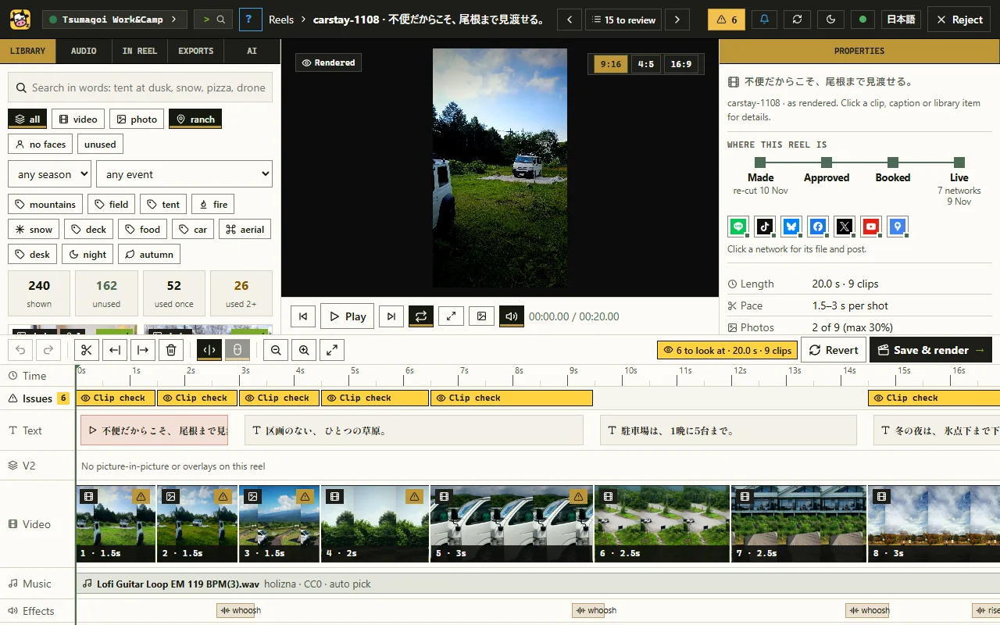

- Drag a clip from **Library** onto the timeline to swap it.
- Change words in **Properties**.
- Press **Save & render** (about six minutes).

To change only the music, use the **Audio** tab, then **Apply sound** (about 30 seconds).

### Versions of a booked reel

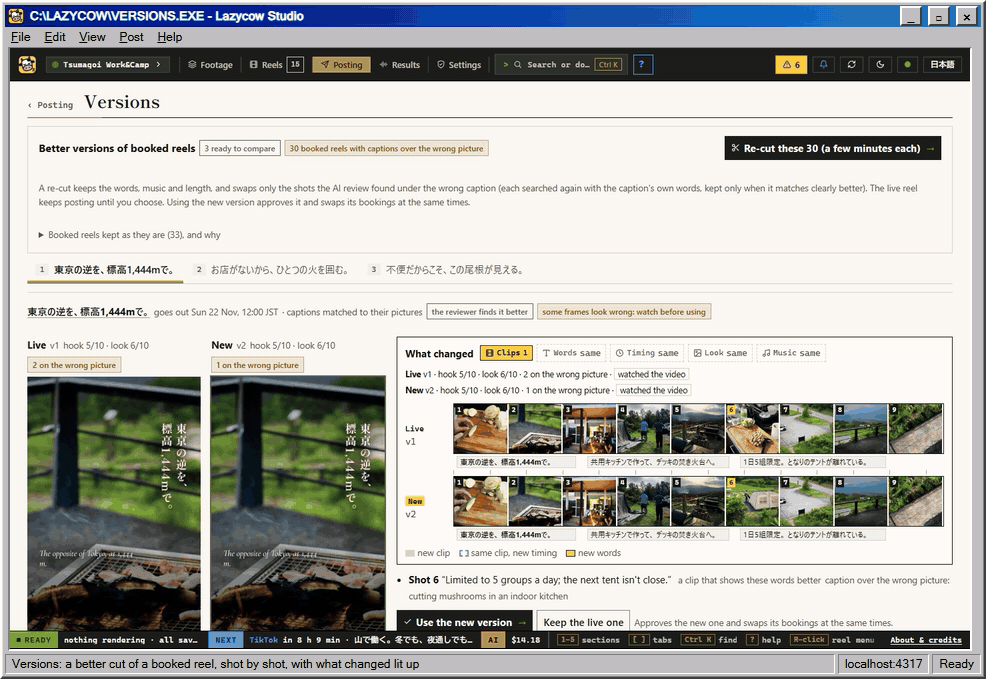

A booked reel keeps posting while the studio makes a better cut beside it. A re-cut keeps the words, music and length. It changes only the shots the AI review found under the wrong caption. Each of those shots is searched again with the caption's own words, and a new shot is kept only when it matches clearly better.

1. Open **Posting › Versions**. Booked reels with captions over the wrong picture are listed at the top. Press **Re-cut these N**.
2. Each new cut is rendered at 9:16, checked, and watched by the AI reviewer. It is offered only when the reviewer finds it better.
3. One reel is shown at a time; the row above it lists every reel with a better cut ready, a click away. Booked reels kept as they are fold into one line under the summary. Watch **Live** and **New** side by side. Each changed shot shows its caption, the old and new file, and how well each matches. Beside the players, **What changed** lines up both versions as shot strips on one time axis, with their words under them: a new clip is outlined in yellow, the same clip at a new time is dashed blue, new words are yellow. The chips above say which of clips, words, timing, look and music changed. Each version's review score says what it was based on (**watched the video** or **from still frames**); when the two differ, the studio cannot say which is better and says so.
4. Choose:
   - **Use the new version**: the studio renders every size and network file (about 10 minutes), approves it, and swaps its bookings at the same times. Your press is the approval.
   - **Keep the live one**: the new cut is set aside. Nothing changes.

Good to know:

- A re-cut that was not better is not offered. The page lists those reels.
- When the footage has no clearly better shot for a reel, the studio remembers. It does not offer the same search again until the reel's review changes, or 14 days pass.
- A re-cut whose run stopped half way (the studio closed, the computer slept) counts as interrupted after 45 minutes. Press **Re-cut** again.

From a terminal in the `py` folder, with the studio's Python: `python -m studio versions recut --booked` and `python -m studio versions list --slug <reel>`. Only a person makes a version live.

### A booking holds an older version

After a reel gets new words or a new render, **Posting › Calendar** marks its earlier bookings "An older version is booked here". With the swap on, the studio replaces them by itself. To do it now, press **Replace with the new version**. A reel waiting for review is replaced after you approve it.

### Reels say the same thing

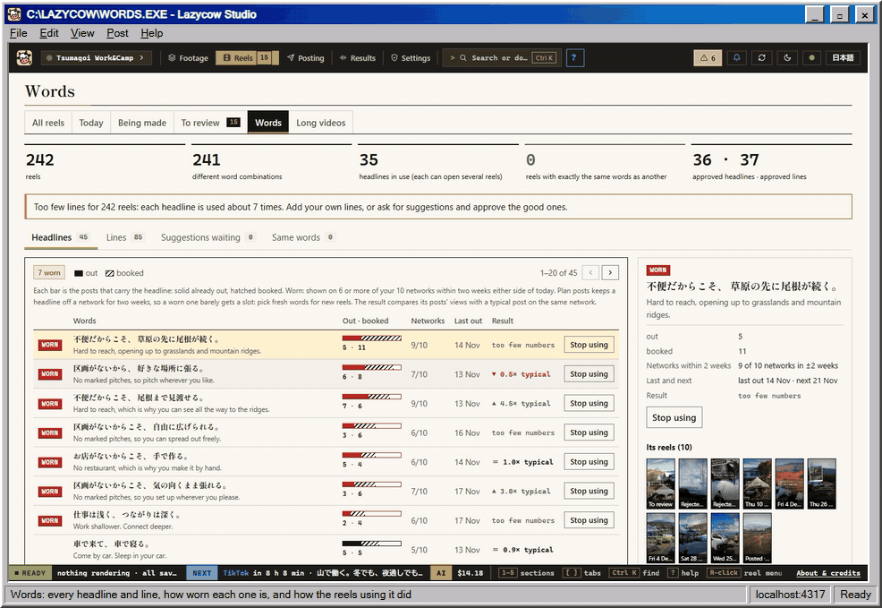

**Reels › Words** shows how many reels repeat another reel's words, in four tabs, each at its own address: **Headlines** (`#/words/headlines`), **Lines** (`#/words/lines`: every kept line, filtered by kind or by a word, 20 at a time), **Suggestions waiting** (`#/words/waiting`: ask for new lines, add your own, approve or reject suggestions) and **Same words** (`#/words/same`). Headlines is a table, 20 headlines a page, sorted by wear (click a column to sort by uses, last time out, result or the words); click a headline, or move with the arrow keys, and its reels, its numbers and every post that carries it open in the panel beside the table.

**How worn each headline is** gives every headline one bar: its posts already out (solid) and booked (hatched), when it last went out and next goes out, how many networks show it within two weeks either side of today, and how its posts did against a typical post on the same network (once at least two have numbers). **Worn** (red) means it is on most of your networks in those two weeks; Plan posts keeps a headline off a network for two weeks, so a worn one barely gets a slot. Pick fresh words for new reels, or press **Stop using**. Click a row for the reels that use it.

- **New words for all N** gives each one fresh approved words, keeping its footage. Then press **Render the N with new words**, and approve them again.
- To add variety for good, add your own lines (**Add a line**), or press **Suggest new lines** and press **Use it** on the good ones.

In the editor, **Properties › Words › Draw new words** does the same for one reel. Then press **Save & render**.

### Layers (V2)

The V2 row on the timeline holds cutaways (a detail shot for about a second) and insets (a paper print of a second clip). Click one to change it to the other kind, or to remove it. Then press **Save & render**.

### Words follow the voice, natural sound, headline behind

- **Words follow the voice.** When a reel has the AI voice, each word on screen lights up as it is said. The timing comes from the voice clips, so there is no extra cost. To switch it off, use the "Words follow the voice" toggle on the reel.
- **Natural sound for silent shots** (AI tab). MMAudio V2 makes the sound of what is on screen, with no music and no voices. It is used only for shots with no sound: photos, slow motion, 360 shots, or clips quieter than −50 dB. It costs about $0.001 a second, and each shot is made once.
- **Headline behind the subject** (AI tab). The opening shot's subject is cut out from its own picture, so the headline sits behind it. It costs about $0.03 a reel. It works with no look or the ember look, after one render.
- **Whip and zoom looks** use a real camera motion blur on their cuts, with no extra render time.

### A long video from a trip

For a trip, not a reel: 16:9 parts of about 5 to 10 minutes, made from the trip's own clips and photos.

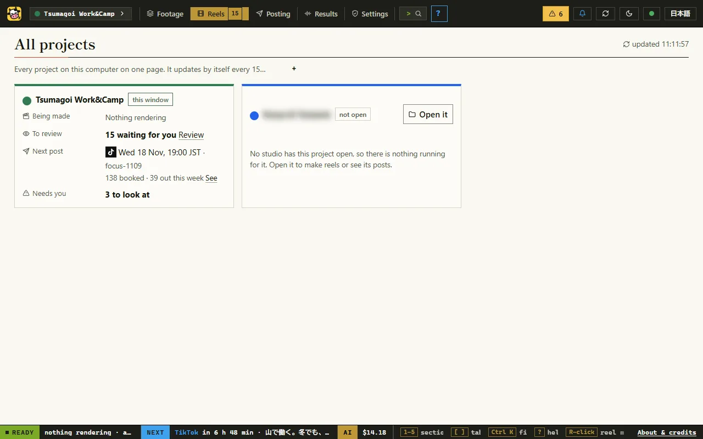

1. **Make a project for the trip.** Press the project name beside the logo, then **New project**. Add the footage, or pick an album with **Add from Google Photos**. Wait until the scan has finished.
2. **Open Reels › Long videos.** The top says what your footage can become: videos, moving minutes, photos and days.
3. **Write the trip notes.** One row per day:
   - **Where were you?** goes on screen with the day and into the YouTube description. Leave it blank to show no place.
   - **Country** (for a series): the country that day was in, as on a map (Kenya, Tanzania, Qatar). The map pin follows the place by itself; pins are approximate park, gate and airport positions.
   - **What happened (your words)** (optional): "a birthday", "a first sighting". Chapter names may use it where the pictures show it.
   - **Names may mention personal moments**. Off: titles say only what is seen, unless you wrote what happened. On: they may also name a moment the pictures clearly show (a proposal, a birthday).
   - **Use private-looking pictures**. Off (the default): pictures that look private, such as a hospital bed or a passport, stay out of every video. On: they may be used like any other picture.
4. **Pick a plan.** The first option is a **series** (see the next task): parts of the same length, in the order the trip happened. Each option says how many parts, how long, and how much of the time moves. Films that are not a series sit under **More looks (separate films, not a series)**; each of those parts can have its own look (for example Field guide, Black and white, Slow safari, Road movie).
5. **Build.** Parts build one at a time, about 20 minutes each, with a cold open, a title, chapters by day, the clips' own sound and a quiet music bed. Each part gets a quality check, a title, a description with chapters, and a thumbnail. Building a part's music costs about $0.60, inside the AI limits.
   What a build does for you, so a part does not go out looking or sounding home-made:
   - **Blurry and shaky pictures stay out.** A picture under the trip's own sharpness floor is left out (a sharp animal against a soft background stays), and so is a clip too shaky to steady. The first time, run `python -m studio quality scan` (it measures every file once).
   - **Wind.** Each clip's sound is measured. A windy stretch with nobody speaking is turned right down, so the music carries it; with someone speaking, the wind is cut and the noise lowered; calm sound only loses its low rumble. The music dips for speech, not for every breeze.
   - **Music, always.** New AI music inside the limits, then music this part already paid for, then free CC0 tracks: the bed covers the whole film. A part that should have music and has none stops instead of going out silent. The description credits the music really used.
   - **Captions checked.** Every animal label, note and chapter title is checked against the very frame on screen, by the AI reviewer: what it does not see is dropped or renamed. The quality check says how many.
6. **Watch each part once.**
7. **Upload** (see the next task), or press **Copy title and description** and upload it yourself.

**The yardstick.** Under your videos, the page shows how much of the footage they use (clips, moving minutes, photos), and how many more videos the rest can make. **From what is left** makes new videos only from moments and photos no video uses yet. No moment of a clip is shown twice across videos.

From a terminal in the `py` folder:

```
python -m studio vlog plan --parts 4 --minutes 8 --name "My trip"
python -m studio vlog build 1
```

Each part's files are in `renders/vlogs/vlog-<n>/` in the project's data folder: `master.mp4`, `youtube.json` (title, tags, chapters), `description.txt` and `thumbnail.jpg`.

### A trip as a series

A series tells the trip in order, in parts of the same length. Each day of the trip is in exactly one part, and every
part has the same look (documentary).

1. **Set the length.** On **Reels › Long videos**, step 2, type **Length of each episode** (5 to 15 minutes, 10 by
   default). The page shows how many episodes that makes ("≈ 4 episodes") and saves the length with the trip.
2. **Check the trip notes.** Places and countries draw the maps. Days are counted in the trip's own time: clips keep
   UTC and photos keep their camera's clock, so a camera set to another country's time is moved back to the trip's
   days (the trip notes' `tz` and `clocks`; `python -m studio vlog clocks` measures each camera's clock).
3. **Press Make this** on **A series in story order**. The studio picks the fewest parts the footage can fill honestly
   at that length, keeps the day something happened with the day before it, and never changes country in the middle
   of a part, except on the flight home.
4. **What each part holds:**
   - a cold open from its strongest moment (the day you noted something happened, if there is one);
   - from Part 2 on, "Previously": a few moments of the part before, with the route so far on a map;
   - the title over a map of the trip, with this part's leg drawing itself;
   - a place tag at each chapter: the day ("Day 4 of 10 · Wed 16 Sep"), the place, the country, or the border crossed
     ("Kenya → Tanzania"), with a small map; a flight day shows the flight's arc;
   - the last 20 seconds: the next part's opening, its name and its leg. The right side is kept clear for YouTube's
     end screen. Part 4 points back to Part 1.
   - music in the mood of its place in the story; long clips may give two or three moments, each from its own stretch.
5. **Each built part says whether it kept to its length** ("on length (10 min)"). A part that came out long loses its
   weakest shots; a short one lets its best clips hold longer.

The YouTube description says where the part sits in the series ("Part 2 of 4"), has **Where and when** (day, date,
place, country) and chapters named by what they show. The links to the part before, the part after and the playlist
are added once the parts are on YouTube (below).

From a terminal in the `py` folder:

```
python -m studio vlog plan --series --target 10 --name "My trip"
python -m studio vlog plan --series --target 10 --name "My trip" --titles '["", "", "The River Crossing and a Birthday", ""]'
python -m studio vlog build 1
```

`--titles` sets your own episode titles, in order; an empty one is named from the pictures.

A day you noted a moment for (the **Moment** column, for example "A birthday by the river") ends on it: its own chapter, titled
in your words, from that day's pictures of people. The AI never renames it.

### Where you went, from Google Maps Timeline

Long videos › step 1 › **Bring in where you went**. The maps then draw the real road, the place tags say how long you
stayed ("2 nights"), and each episode's description lists the day's stops ("4 h 20 min drive · 212 km → River
Camp · 2 nights").

1. Export Timeline on your phone. **Android**: phone Settings › Location › Location services › Timeline › Export
   Timeline data. **iPhone**: Google Maps › your picture › Settings › Location & Privacy › Export Timeline data.
   Do it soon after a trip: Timeline deletes old days by itself (3 months unless you changed it).
2. Send the `.json` file to this computer and choose it on the card. Older Takeout files and GPX tracks work too.
3. Name the places you want named (each has a **See it in Google Maps** link; Google's file has no names) and untick
   any you would rather not show. **Save names and choices.**

What the studio keeps: this trip's days only. Home and work, raw GPS fixes and Wi-Fi scans are never kept, and the file
you chose is deleted after reading. Countries are worked out on this computer. Nothing is sent anywhere.
**Remove the Timeline** deletes all of it; your own trip notes stay. From a terminal: `python -m studio timeline import
--file Timeline.json`, `timeline show`, `timeline forget`.

### Upload long videos to YouTube

On **Reels › Long videos**, the YouTube box uploads one part (**Upload to YouTube**) or every ready part (**Upload N ready parts**).

1. **Account**: the channel. "Shorts post here" marks the main one. **Connect another account** adds a channel (a2, a3, ...).
2. **Who can see them**:
   - **Private (only you)**
   - **Unlisted (anyone with the link)**
   - **Public**: on the channel and in search at once
   - **Go public on a schedule**: private until each part's time, then public. Pick the first one's time, then "every N days".
3. Press the upload button and confirm. Parts upload one after another. The link shows on each part when it is up.

The schedule's first time must be at least 20 minutes away. A part already on YouTube is not uploaded twice. Each Google app may upload 100 videos a day; the swap of Shorts uses at most 20 of them.

**A series** uploads the same way, best as **Private** first. Each part also gets its English captions (what people say
in the clips). A series uses the same folders as earlier plans: a video an earlier plan uploaded stays on YouTube as it
is, and its record is kept beside the new one (`uploaded-<id>.json`).

### Link a series on YouTube

Once every part is on YouTube, the box **Do in YouTube Studio** appears on **Reels › Long videos**.

1. **Link the series.** Makes the playlist "<trip> · the series" with the parts in order, then puts the links to the
   part before, the part after and the playlist into every description. Only the parts this plan uploaded are changed.
   The playlist is as private as the most private part: unlisted parts give an unlisted playlist (a public one would show
   them to anyone).
2. **Post the pin comments** (once the parts are public or unlisted: YouTube allows no comments on private videos):
   "Part 2 of 4: … Next: Part 3, …".
3. Then, in YouTube Studio (no app can do these), tick each step when it is done:
   - **Playlist**: Settings › Ordering › Manual; then **Set as official series**, or Options › **Add show features** › Serial.
   - Each part's **End screen**: a video (the next part; Part 4: Part 1), the playlist and Subscribe, placed on the faint frames.
   - **Pin the comment** on each part.
   - **Shorts**: in each Short about a part, set **Related video** to that part.
   - **Make it public**: Part 1 first and the rest every 2 to 3 days, or all at once.

From a terminal: `python -m studio youtube link-series --account main` (add `--dry-run` to see the descriptions first)
and `python -m studio youtube series-comments --account main`.

### Several YouTube accounts in one project

**Settings › Keys & AI › YouTube: Google account and app**:

- **Connect YouTube** connects the main channel. Shorts post there.
- **Connect another account** adds more channels (a2, a3, ...). They are listed under **Other YouTube accounts**, each with **Disconnect**.
- **Use this Google app in every project** shares this project's Google app. Other projects (a trip, a second brand) can then connect their own channels without making a Google app.

### Work on two projects at once

Start a second studio pinned to the other project, on another port. It opens that project whatever the main studio has open, and never switches.

```
STUDIO_PROJECT=my-trip STUDIO_PORT=4318 STUDIO_QUIET=1 npm run review
```

Then open http://127.0.0.1:4318. With `STUDIO_QUIET=1` it does not post, book or check by itself; the main studio still sends due posts for every project. Connect YouTube in the main studio (port 4317).

### Know what is going out

The bell in the top bar shows the next post and counts down. Open it for the next five posts and what happened. Allow desktop notifications there to hear about a post that goes live or fails while the studio tab is in the background.

### Rename or share a project

Press the project name beside the logo. Click the name to rename it. **Share** saves the project as a file to send to someone or move to another computer. **Import a project file** opens one. Footage, renders, sign-ins and keys are not in the file.

### Never use a clip again

Click the clip, then **Never auto-pick** in its Properties. You can still add it by hand.

### Someone is on camera

The card says **needs consent**. If the person agreed, press **Consent OK**. To hide faces instead, turn on **Blur faces** in Properties, then press **Save & render**. The studio never blurs faces by itself.

### Post one reel now, by hand

Open the reel, then **Exports**, then the network. Press **Copy text** and **Download**, and post it in the app. Back in the studio, press **Mark posted** and paste the link.

### Instagram

The studio does not post to Instagram. Approved reels appear in the ready folder (`STUDIO_READY`, by default `<data>\ready`) under `<date>_<reel>\instagram\`, with the text in a file next to the video. Point `STUDIO_READY` at a shared Drive folder if someone else posts them.

### Add new footage

**Footage › Add footage** shows every way in, one colour for each kind:

- **This computer**: drag photos and videos onto the box (or press **Choose files**), up to 8 GB each. They land in the studio inbox and are catalogued about 20 s after the last one. Or **Add a folder** the studio keeps watching.
- **Cloud**: **Google Drive folder** (a Drive folder synced by Drive for desktop) or **Add from Google Photos** (pick the items).
- **Phones and other people**: the drop box (a QR code for phones on this Wi-Fi) or your Google Form.
- Or put files in a dated folder inside your footage folder (`2026\20261123_winter-open\`). The studio finds them within 30 minutes.

Adding from a link (a shared video URL) is not built yet.

Short takes work best: 5 to 15 seconds, one subject each, with a still second at the start and end. Why, and the rest of the camera settings: [Filming guide](filming-guide.md).

### Quality check, colour match and steadying

Every render is checked when it finishes, at 9:16, 4:5 and 16:9. The result is in the render's `manifest.json` as `qa` (one entry per aspect). A check marked **bad** only flags the reel for you; nothing is blocked or deleted.

| Check | Passes when | Level when it misses |
|---|---|---|
| `format` | size, H.264, 30 fps, AAC 48 kHz match the aspect | bad |
| `loudness` | within ±1.5 LU of −14 LUFS | warn up to ±3 LU, then bad |
| `peak` | true peak at or below −1 dBTP | warn up to 0 dBTP, then bad |
| `black` | no black run over 0.4 s (the last 1.5 s, the end card's fade, is not counted) | bad |
| `freeze` | no still run over 2.5 s | warn only: photo shots are still on purpose |
| `silence` | the reel is not silent | bad when music was chosen, else warn |

Two project settings change how shots are graded (both are plain fields in the project file):

- `colorMatch` (default `true`): before grading, each shot's colour cast is measured and pulled half way toward the reel's middle value, so cuts between cameras do not jump in colour. No colour channel changes by more than 8 %, and brightness by no more than 6 %. Night shots and 360 shots are left as they are. `false` grades exactly as before.
- `stabilize`: `"auto"` (default) steadies a handheld clip when its measured shake is clearly visible; `"on"` steadies every handheld clip; `"off"` never. Drone (DJI), 360, photo and AI clips are never steadied. Steadying zooms in slightly so no edge shows.

Each shot in `manifest.json` records what was done: `shots[].color` (measured values, the target, the gains) and `shots[].stab` (the measured shake, the threshold, and whether it was steadied, with the reason).

## When something goes wrong

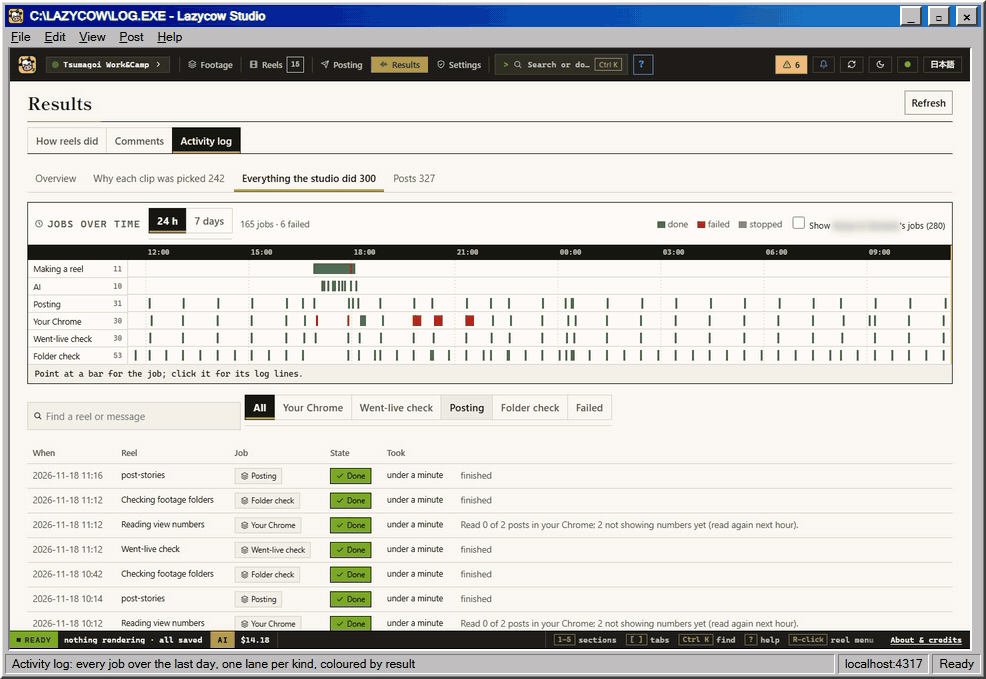

First look at **What needs you** under the top bar, and the **red or amber button** next to the bell. They list what went
wrong and stay until it is fixed, even if the page was closed when it happened.

| Colour | Means | For example |
|:--|:--|:--|
| Red | Broken: something will not happen until you fix it | a booked reel that is not approved; a post that did not go out, or was not seen live hours after its time; a sign-in that has ended, ends within a day, or ends within 3 days with posts booked after it; a job that stopped with an error |
| Amber | It will become a problem, or works worse than it could | a sign-in (Bluesky's lasts about two weeks) that ends within two weeks with posts booked after it; a network whose measured posts reached nobody yet (a new or restricted account, or a number the studio cannot read); a network booked through your Chrome that nobody has checked is signed in (LINE, Pinterest: press **Open … in my Chrome**, then **I'm signed in**); long videos that repeat days or vary a lot in length |

The list is grouped by cause (making stopped, posts that did not go out, sign-ins, networks not showing your posts,
project notes). A bar at the top shows every problem in its group's colour; click a group to jump to it. Each group
says in one line what fixes all of it.

Each one has a **Fix** button that opens the right page, and some have a second one that opens the network itself
(**Look on Google Maps**, **Open TikTok Studio**). On **Posting**, the panel under the schedule has **Book again**,
**It is out** and **Set aside** for a post that was not seen. Problems about the future (a sign-in, red or amber) cannot
be dismissed, only fixed; the strip's × hides it until something new goes wrong (the button stays), and it moves out
of the way while you scroll.

<details>
<summary><b>The page says "the studio is not answering"</b></summary>

The server stopped, or a browser extension blocked a request. The page first asks the studio's health address and says which request was blocked.

- If the server stopped, run `npm run review` in the studio folder.
- If an ad blocker blocked a request, allow `127.0.0.1` in it.

Renders that were waiting need **Save & render** again.

</details>

<details>
<summary><b>An amber bar asks to restart the studio</b></summary>

The studio's code changed on disk. Press **Restart the studio**. During a long job the restart waits for a safe point (a long video restarts between two parts and carries on). Nothing is lost.

</details>

<details>
<summary><b>A sign-in ran out</b></summary>

**Settings › Accounts** shows which one.

| Network | What to do |
|:--|:--|
| YouTube | **Connect YouTube** again |
| Facebook | **Connect with Facebook** again (the sign-in lasts about 60 days) |
| Bluesky | **Sign in with Bluesky** again (it lasts about two weeks) |
| X, TikTok, Google Maps, LINE, LinkedIn | Open the site in your normal Chrome and sign in |

</details>

<details>
<summary><b>A post is red, or is under "Needs a look"</b></summary>

Open it to read why. The cause is usually a sign-in (above) or the computer being off.

- **Book again** books it again.
- **It is out** says the post is there after all.
- **Set aside** keeps it as history.

Posts that came due while the computer was off go out when the studio starts, if they are up to 2 hours late.

</details>

<details>
<summary><b>A YouTube upload failed</b></summary>

Read the message on the post or the part.

- "Quota" or "limit": YouTube's daily allowance is used up. It resets at midnight Pacific time. Each Google app may upload 100 videos a day.
- A sign-in error: connect that account again in **Settings › Keys & AI › YouTube: Google account and app**.
- A long video "already on YouTube": the part was uploaded before. The link shows on the part.

</details>

<details>
<summary><b>X, TikTok, Google Maps, LINE or LinkedIn did not book</b></summary>

These go through the Chrome link. Check **Settings › Keys & AI › Chrome link** says "Linked to your Chrome". If a small Chrome window titled "Welcome" is open, press **Allow & select** in it, and keep that window open. To skip that click for good, save the Chrome link key there once. More in [helper.md](helper.md).

</details>

<details>
<summary><b>A re-cut stays "re-cutting" for a long time</b></summary>

A re-cut renders one reel at a time, a few minutes each. If its run stopped (the studio closed, the computer slept), it counts as interrupted after 45 minutes. Press **Re-cut** again.

</details>

<details>
<summary><b>Research says "Add your Firecrawl key"</b></summary>

Paste your Firecrawl key in **Settings › Keys & AI**. Research reads the web through Firecrawl.

</details>

<details>
<summary><b>The second studio will not switch project</b></summary>

A studio started with `STUDIO_PROJECT` is pinned to that project. Switch projects in the main studio, or start the second one again with another `STUDIO_PROJECT`.

</details>

## What the studio will not do

- Post a reel nobody approved.
- Make a new version live without a person's press.
- Post to Instagram, or to a network switched off in Settings.
- Write new claims about your place or business. Every line comes from your approved words.
- Change or delete your original footage.
- Spend money on AI over the limits in **Settings › Keys & AI**.

## Words used in the studio

| Word | Meaning |
|:--|:--|
| Reel | One short vertical video |
| Theme | The story of a reel: its headline and the kind of shots it needs |
| Look | How one shot becomes the next (whip, glitch, film …) |
| Style | A reel's type pairing, colours, how its words arrive, and its colour grade |
| Approve | Your yes. Only approved reels are posted. |
| Booked / scheduled | The network has it and will publish it at the time |
| Queued | The studio itself will post it at the time (Bluesky), so leave the computer on |
| Version | Another cut of the same reel. The live one posts; a new one waits for your choice. |
| Swap | Replacing an older booking with the newest approved render, at the same time slot |
| Long video | A 16:9 YouTube video from a trip, in parts with chapters |
| Main / a2, a3 | A project's YouTube channels: main gets the Shorts, the others are extra channels |
| House reel | One of four fixed reels (view, fire, field, winter) that you review one by one (the original ranch workspace only) |
| Word bank | Every approved headline and line (Reels › Words) |
| V2 / layer | A second picture over the main shots: a cutaway or an inset |
