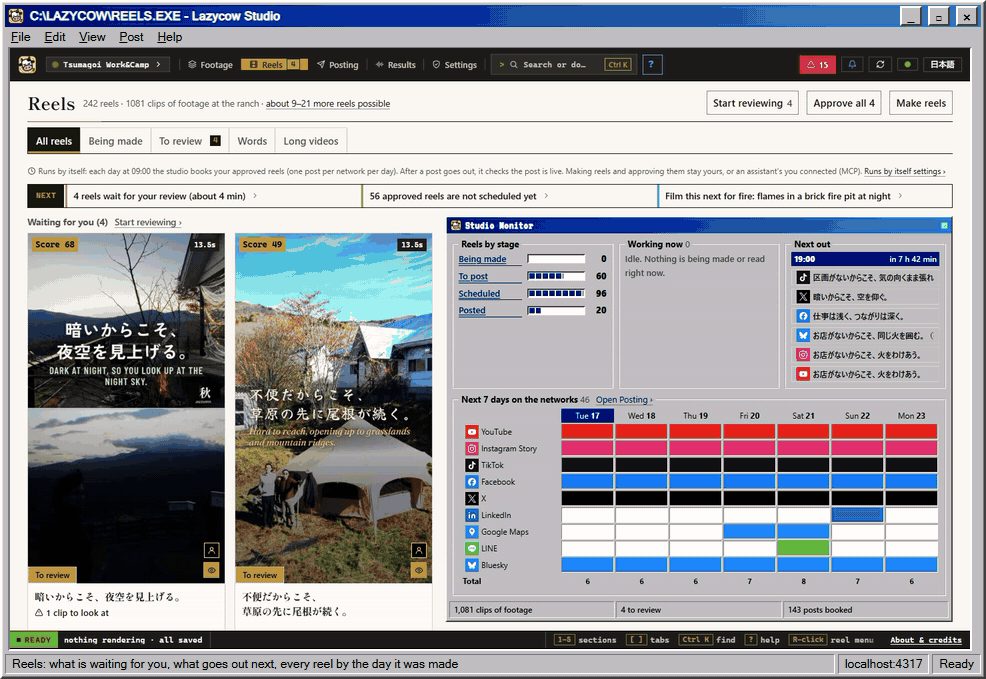
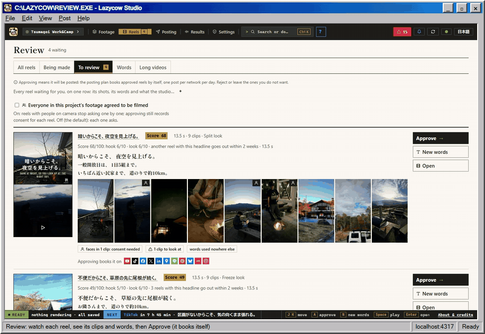
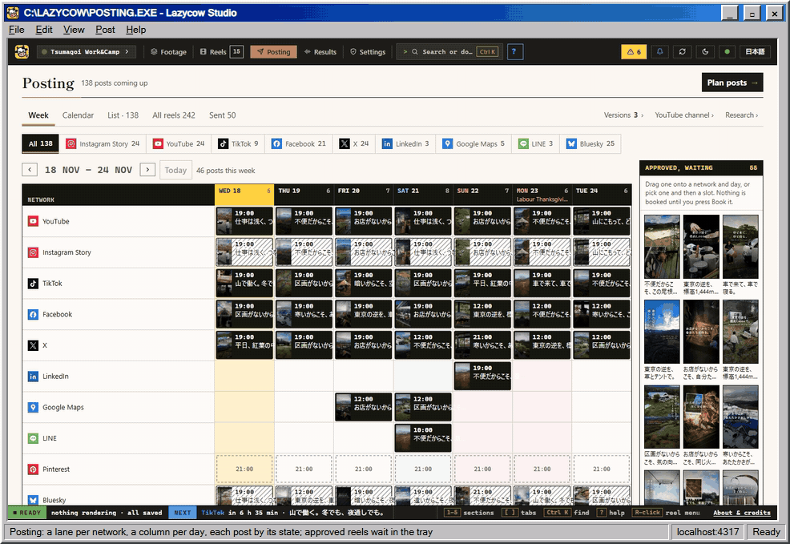
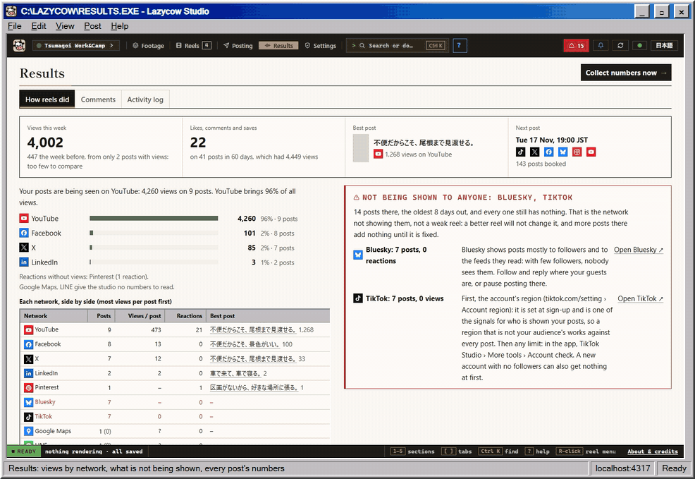
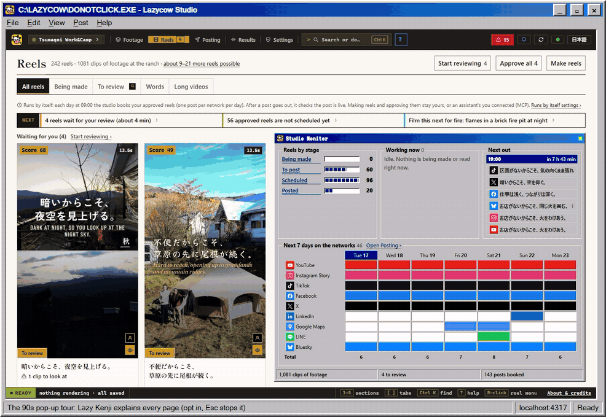

# lazycow

**Lazycow Studio from the command line, from your AI agent and from your code.**

[Lazycow Studio](https://github.com/kensaurus/lazycow-studio) turns the photos and videos you never edited into short vertical reels and YouTube trip films. It runs on your own computer, and a person approves every post. This package connects to it in three ways:

| You want to… | Run |
|:--|:--|
| Install the studio (no terminal skills needed after this line) | `npx lazycow install` |
| Let Claude Code, Claude Desktop or Cursor drive it | `claude mcp add lazycow -- npx -y lazycow mcp` |
| Script it from Node | `import { createClient } from "lazycow"` |

Approving a reel stays a person's job in the studio. Agents and scripts can make, plan and post approved reels. They cannot approve.


[Watch the 40-second demo](https://github.com/kensaurus/lazycow-studio/blob/main/docs/media/lazycow-demo.mp4) · [See the studio's pages](https://github.com/kensaurus/lazycow-studio#every-page-in-motion)

## Every page, in motion

Recorded in the author's own studio (everyone on camera agreed). Each GIF opens, scrolls and plays a page; none presses Approve.

| | |
|:--|:--|
|  **Reels.** Reels by stage, the next posts, a 7-day grid of every network, every reel by the day it was made. |  **Review.** Each reel beside its clips and words, and the networks Approve books it on. |
|  **The reel editor.** Library, player, properties and a timeline of words, clips, music and effects. |  **Posting.** Every booking on a calendar, filtered by network. |
|  **Results.** Views by network, networks showing posts to nobody, views per post, every post. |  **Footage.** Drive folders, Google Photos picks and a Google Form; what is still unused. |
|  **Accounts.** Each network, how it gets posted, and the one step left. |  **Setup.** A 1998 InstallShield-style wizard, step by step. |
|  **DO NOT CLICK.** The opt-in 1999 pop-up tour of every page. Esc stops it. | More in the [user guide](https://github.com/kensaurus/lazycow-studio/blob/main/docs/user-guide.md#a-tour-page-by-page). |

## Install the studio

```
npx lazycow install
```

It downloads this version's release zip from GitHub, checks it against the SHA-256 built into the package, unpacks it to `~/Lazycow Studio`, and starts the double-click setup. The setup installs Node, Python and ffmpeg for Lazycow only, in about 10 minutes. Options: `--dir <empty folder>`, `--yes` (take every suggestion).

Prefer to click? Download the zip from [Releases](https://github.com/kensaurus/lazycow-studio/releases), unzip it, read `README.TXT`, and double-click **Start Lazycow**.

## Connect an AI agent (MCP)

Claude Code:

```
claude mcp add lazycow -- npx -y lazycow mcp
```

Claude Desktop or Cursor (`claude_desktop_config.json` / `.cursor/mcp.json`):

```json
{
  "mcpServers": {
    "lazycow": { "command": "npx", "args": ["-y", "lazycow", "mcp"] }
  }
}
```

The server finds the studio by itself: `STUDIO_PORT` and `STUDIO_API_TOKEN` when set, else the `.env` in `LAZYCOW_DIR`, else the folder the setup recorded. So your agent config never holds a copy of the token.

The 30 tools ("reads" change nothing; "spends" means paid AI, priced first and kept inside the studio's limits):

| Area | Tools |
|:--|:--|
| The studio | `studio_status`, `list_projects`, `switch_project`, `read_log` (reads, except switching) |
| Reels | `list_reels`, `reel_details`, `list_themes` (reads); `make_reels`, `make_reel`, `remix_reel` (render in the background) |
| Jobs | `job_status`, `cancel_job` |
| Posting | `list_posts`, `list_accounts` (reads); `plan_post`, `publish_reel`, `schedule_reel` (approved reels only) |
| Research | `research_ideas`, `research_events`, `research_page`, `research_site_check`, `research_links` (reads the web through the studio; suggestions, never posted) |
| AI assist | `ai_estimate`, `ai_review` (reads); `ai_run` (spends, never changes an approved reel) |
| Results | `perf_summary`, `perf_suggest`, `perf_posts`, `youtube_channel`, `list_comments` (reads) |

Every tool, its inputs and examples: [docs/mcp.md](https://github.com/kensaurus/lazycow-studio/blob/main/docs/mcp.md).

Each tool answers with a plain sentence and the data, and the same data as `structuredContent` for programs (a list
arrives as `{ "items": [...] }`). Account secrets never leave the studio.

Listed in the official MCP Registry as `io.github.kensaurus/lazycow`.

## Use the API from code

```js
import { createClient } from "lazycow";

const studio = createClient();            // or createClient({ port: 4318, token: "..." })
const health = await studio.health();
const { reels } = await studio.overview();
const anything = await studio.request("GET", "/api/posts");
```

Every route is in the studio's [OpenAPI document](https://github.com/kensaurus/lazycow-studio/blob/main/docs/openapi.yaml). Errors are `StudioError` with `status`, `path` and `body`. Types are included.

From a shell:

```
npx lazycow status
npx lazycow api GET /api/posts
npx lazycow open
```

## More from kensaurus

Lazycow is one of the [kensaurus](https://kensaur.us/?view=portfolio&utm_source=lazycow&utm_medium=npm&utm_campaign=family) apps. Also on npm:

| Package | What it does |
|:--|:--|
| [**mushi-mushi**](https://www.npmjs.com/package/mushi-mushi) | Tells you why your AI-built app broke, and hands the fix to your editor. One package: an SDK and a setup wizard for any app; your users' bug reports become a diagnosis and a fix prompt, from Claude Code or Cursor too. [Site](https://kensaur.us/mushi-mushi/?utm_source=lazycow&utm_medium=npm&utm_campaign=family) |
| [**@kensaurus/skills**](https://www.npmjs.com/package/@kensaurus/skills) | Step-by-step playbooks that keep AI coding assistants (Claude Code, Cursor, Codex CLI) on track. Free and open source. |

And [Tsumagoi Work&Camp](https://tsumagoi.kensaur.us/?utm_source=lazycow&utm_medium=npm&utm_campaign=family), the mountain lounge Lazycow was built for; every app is on [kensaur.us](https://kensaur.us/?view=portfolio&utm_source=lazycow&utm_medium=npm&utm_campaign=family).

## Requirements

Node 20 or newer. The studio itself runs on Windows 10/11 and macOS 14+ (Apple silicon); Linux works from source.

## Credits and licence

Made by **kensaurus** (Kenji Sakuramoto, [kensaur.us](https://kensaur.us)). Apache-2.0: if you redistribute it or build on it, keep the `NOTICE` file, and please keep the line "Based on Lazycow Studio by kensaurus". "Lazycow" and the sleepy-cow icon are trademarks of kensaurus LLC ([TRADEMARKS.md](https://github.com/kensaurus/lazycow-studio/blob/main/TRADEMARKS.md)).

Like it? [Support Lazycow](https://github.com/kensaurus/lazycow-studio/blob/main/SUPPORTING.md): supporters get their feature requests looked at first.
