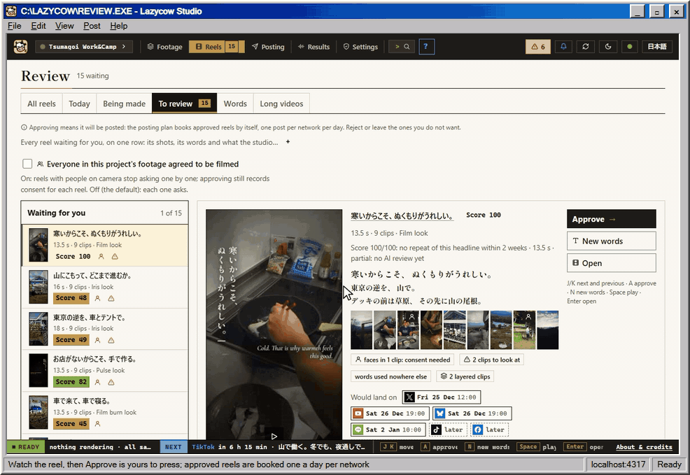
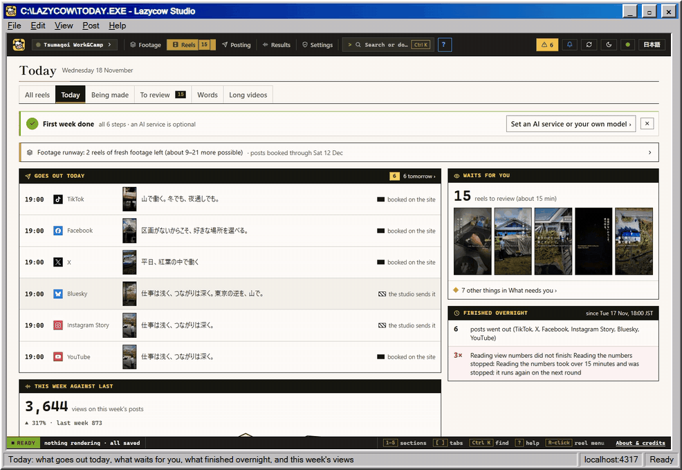
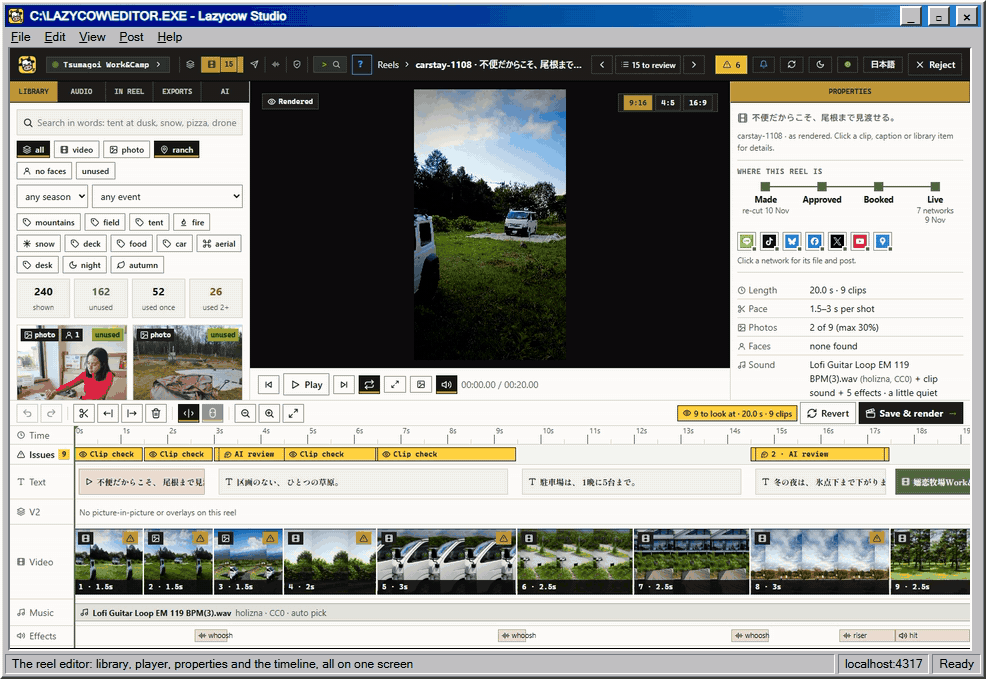
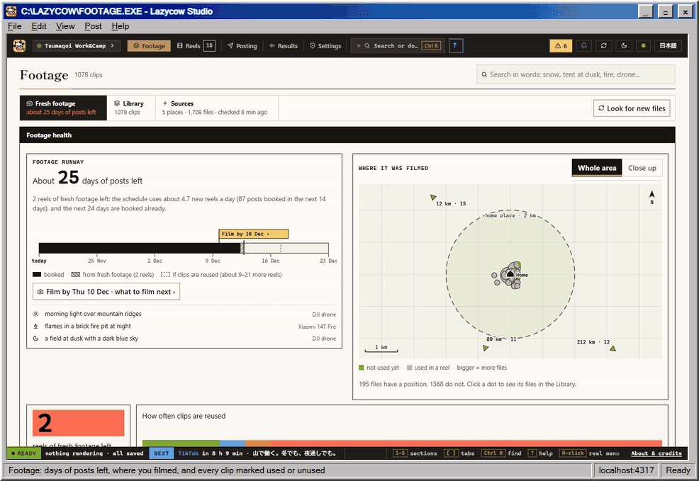
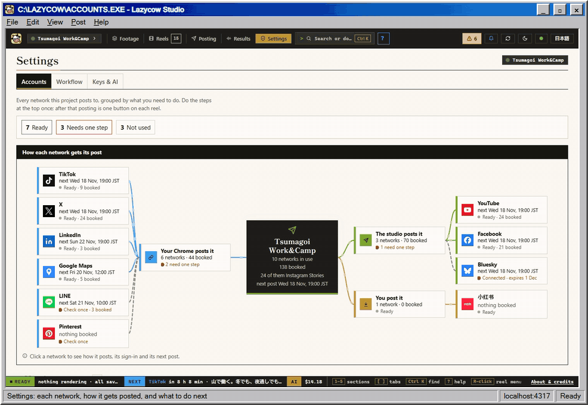
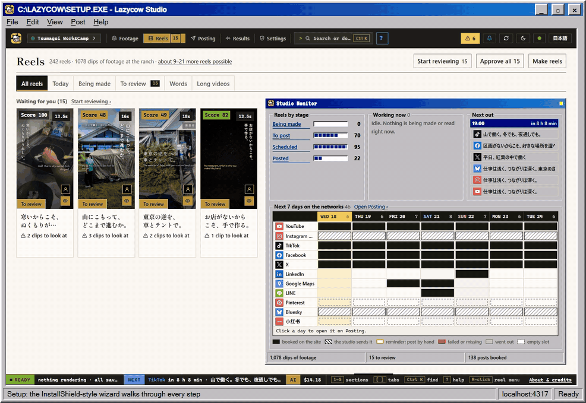

# lazycow

**Lazycow Studio from the command line, from your AI agent and from your code.**

[Lazycow Studio](https://github.com/kensaurus/lazycow-studio) turns the photos and videos you never edited into short vertical reels and YouTube trip films. It runs on your own computer, and a person approves every post. This package connects to it in three ways:

| You want to… | Run |
|:--|:--|
| Check this computer first (nothing is downloaded) | `npx lazycow doctor` |
| Install the studio (no terminal skills needed after this line) | `npx lazycow install` |
| Let Claude Code, Claude Desktop or Cursor drive it | `claude mcp add lazycow -- npx -y lazycow mcp` |
| Script it from Node | `import { createClient } from "lazycow"` |

Approving a reel stays a person's job in the studio. Agents and scripts can make, plan and post approved reels. They cannot approve.



[Watch the 40-second demo](https://github.com/kensaurus/lazycow-studio/blob/main/docs/media/lazycow-demo.mp4) · [See the studio's pages](https://github.com/kensaurus/lazycow-studio#every-page-in-motion)

## How it works

The studio has three parts. A Node server (listening on `127.0.0.1:4317` only) serves the page and an HTTP API. A Python engine catalogs, tags and picks clips. Remotion and ffmpeg render the reels. Tagging and search use OpenCLIP on your own processor, so the main flow needs no key and no LLM. Cloud AI runs only when you add a key: on OpenRouter, a reviewer and suggested lines; on fal.ai, tools such as slow motion, music and voice. The writing jobs and the picture questions can run on your own model instead: any OpenAI-compatible server, local (Ollama, LM Studio, vLLM, llama.cpp) or hosted (Settings › Keys & AI › Your own AI model, or `STUDIO_LLM_BASE_URL` in `.env`). This package's MCP server calls no model itself, so your agent can use any model.

```
your agent ──MCP──▶ npx lazycow mcp ──HTTP──▶ studio server 127.0.0.1:4317 ──▶ Python engine (CLIP on your CPU)
                                                     │                                 │
                                         approved reels only                 Remotion + ffmpeg render
                                                     ▼                                 ▼
                                   YouTube, Facebook, Bluesky, your Chrome     data folder (catalog, renders)
```

Read more: [architecture and diagrams](https://github.com/kensaurus/lazycow-studio/blob/main/docs/architecture.md), [every AI and ML model](https://github.com/kensaurus/lazycow-studio/blob/main/docs/architecture.md#ai-and-ml-models), [run it fully local](https://github.com/kensaurus/lazycow-studio/blob/main/docs/architecture.md#run-it-fully-local), [use your own LLM](https://github.com/kensaurus/lazycow-studio/blob/main/docs/architecture.md#use-your-own-llm), [what leaves your computer](https://github.com/kensaurus/lazycow-studio/blob/main/docs/architecture.md#what-leaves-your-computer).

Filming for it: each file gives at most one 1-4 s shot per reel, so film many short takes (5-15 s). [How it picks which moments to use](https://github.com/kensaurus/lazycow-studio/blob/main/docs/architecture.md#how-it-picks-which-moments-to-use) · [Filming guide](https://github.com/kensaurus/lazycow-studio/blob/main/docs/filming-guide.md) · [撮影ガイド](https://github.com/kensaurus/lazycow-studio/blob/main/docs/filming-guide.ja.md)

## Every page, in motion

Recorded in the author's own studio (everyone on camera agreed). Each GIF opens, scrolls and plays a page; none presses Approve, Book or Apply.

| | |
|:--|:--|
|  **Today.** What goes out today, what waits for you, what finished overnight, and this week's views. |  **Workflow.** Every step as blocks: which AI service runs it, local or cloud, the cost per reel, and templates you preview before applying. |
|  **Reels.** Reels by stage, the next posts, a week grid by state; point at a reel to scrub through it. |  **Review.** Each reel beside its clips and words, and the networks Approve books it on. |
|  **The reel editor.** Library, player, properties and a timeline of words, clips, music and effects. |  **Posting.** A lane per network and a column per day; drop an approved reel on a slot, then press Book it. |
|  **Results.** Views by network, each post's predicted range against its real views, and the best time to post. |  **Footage.** Days of posts left, a map of where you filmed, and what is still unused. |
|  **Accounts.** Each network, how it gets posted, and the one step left. |  **Setup.** A 1998 InstallShield-style wizard, step by step. |
|  **DO NOT CLICK.** The opt-in 1999 pop-up tour of every page. Esc stops it. | More in the [user guide](https://github.com/kensaurus/lazycow-studio/blob/main/docs/user-guide.md#a-tour-page-by-page). |

## Check this computer first

```
npx lazycow doctor
```

One screen, before anything is downloaded: system and processor type, threads, memory, free disk where the studio goes, graphics, any Python, Node or ffmpeg already there, whether each download site answers (5 s each, all at once), and a 3-second processor test that estimates the time per reel from the reference PC (Ryzen 9 5950X, 32 threads: a median 357 s over 364 real builds). It ends with **READY**, **SLOW** or **BLOCKED**, the reason and the fix, and exits 0, 1 or 2. `--json` for scripts, `--dir <folder>` to check another drive, `--offline` to skip the network.

```
Lazycow check · Windows 11 x64 · 32 threads · 64 GB RAM
✓ Free space on C: 774 GB (needs 6 GB to install, 20 GB for renders)
✓ Downloads reachable: github.com, release-assets.githubusercontent.com, nodejs.org, pypi.org, … (10 of 10)
! Graphics: AMD found. Lazycow renders on the processor today.
Estimated time per reel: about 6 minutes (processor test: 1.06x the AMD Ryzen 9 5950X)
Verdict: READY. Install downloads about 1.3 GB and takes 10–30 minutes.
```

No Node yet? The same core check (system, memory, disk, download sites) in one line:

```
irm https://raw.githubusercontent.com/kensaurus/lazycow-studio/main/scripts/bootstrap/doctor.ps1 | iex     # Windows PowerShell
curl -fsSL https://raw.githubusercontent.com/kensaurus/lazycow-studio/main/scripts/bootstrap/doctor.sh | sh   # macOS, Linux
```

An Intel Mac is BLOCKED: the footage search runs on PyTorch, which has had no Intel-Mac (macOS x86) builds since 2.2.

## Install the studio

```
npx lazycow install
```

Step 1 is the check above. When it says BLOCKED, nothing is downloaded; `--force` installs anyway.

It downloads this version's release zip from GitHub, checks it against the SHA-256 built into the package, unpacks it to `~/Lazycow Studio`, and starts the double-click setup (on Linux it runs in the same terminal). The setup installs Node, Python and ffmpeg for Lazycow only, in about 10 minutes. Options: `--dir <empty folder>`, `--yes` (take every suggestion).

Prefer to click? Download the zip from [Releases](https://github.com/kensaurus/lazycow-studio/releases), unzip it, read `README.TXT`, and double-click **Start Lazycow**.

## Connect an AI agent (MCP)

Claude Code:

```
claude mcp add lazycow -- npx -y lazycow mcp
```

Claude Desktop or Cursor (`claude_desktop_config.json` / `.cursor/mcp.json`):

```json
{
  "mcpServers": {
    "lazycow": { "command": "npx", "args": ["-y", "lazycow", "mcp"] }
  }
}
```

The server finds the studio by itself: `STUDIO_PORT` and `STUDIO_API_TOKEN` when set, else the `.env` in `LAZYCOW_DIR`, else the folder the setup recorded. So your agent config never holds a copy of the token.

The 31 tools ("reads" change nothing; "spends" means paid AI, priced first and kept inside the studio's limits):

| Area | Tools |
|:--|:--|
| The studio | `studio_status`, `list_projects`, `switch_project`, `read_log` (reads, except switching) |
| Reels | `list_reels`, `reel_details`, `list_themes` (reads); `make_reels`, `make_reel`, `remix_reel` (render in the background) |
| Jobs | `job_status`, `cancel_job` |
| Posting | `list_posts`, `list_accounts`, `check_connections` (reads); `plan_post`, `publish_reel`, `schedule_reel` (approved reels only) |
| Research | `research_ideas`, `research_events`, `research_page`, `research_site_check`, `research_links` (reads the web through the studio; suggestions, never posted) |
| AI assist | `ai_estimate`, `ai_review` (reads); `ai_run` (spends, never changes an approved reel) |
| Results | `perf_summary`, `perf_suggest`, `perf_posts`, `youtube_channel`, `list_comments` (reads) |

Every tool, its inputs and examples: [docs/mcp.md](https://github.com/kensaurus/lazycow-studio/blob/main/docs/mcp.md).

Each tool answers with a plain sentence and the data, and the same data as `structuredContent` for programs (a list
arrives as `{ "items": [...] }`). Account secrets never leave the studio.

Listed in the official MCP Registry as `io.github.kensaurus/lazycow`.

## Use the API from code

```js
import { createClient } from "lazycow";

const studio = createClient();            // or createClient({ port: 4318, token: "..." })
const health = await studio.health();
const { reels } = await studio.overview();
const anything = await studio.request("GET", "/api/posts");
```

Every route is in the studio's [OpenAPI document](https://github.com/kensaurus/lazycow-studio/blob/main/docs/openapi.yaml). Errors are `StudioError` with `status`, `path` and `body`. Types are included.

From a shell:

```
npx lazycow status
npx lazycow api GET /api/posts
npx lazycow open
```

## More from kensaurus

Lazycow is one of the [kensaurus](https://kensaur.us/?view=portfolio&utm_source=lazycow&utm_medium=npm&utm_campaign=family) apps. Also on npm:

| Package | What it does |
|:--|:--|
| [**mushi-mushi**](https://www.npmjs.com/package/mushi-mushi) | Tells you why your AI-built app broke, and hands the fix to your editor. One package: an SDK and a setup wizard for any app; your users' bug reports become a diagnosis and a fix prompt, from Claude Code or Cursor too. [Site](https://kensaur.us/mushi-mushi/?utm_source=lazycow&utm_medium=npm&utm_campaign=family) |
| [**@kensaurus/skills**](https://www.npmjs.com/package/@kensaurus/skills) | Step-by-step playbooks that keep AI coding assistants (Claude Code, Cursor, Codex CLI) on track. Free and open source. |

And [Tsumagoi Work&Camp](https://tsumagoi.kensaur.us/?utm_source=lazycow&utm_medium=npm&utm_campaign=family), the mountain lounge Lazycow was built for; every app is on [kensaur.us](https://kensaur.us/?view=portfolio&utm_source=lazycow&utm_medium=npm&utm_campaign=family).

## Requirements

Node 20 or newer. The studio itself runs on Windows 10/11 (64-bit), macOS 14+ on Apple silicon (not Intel Macs), and 64-bit Linux, with 4 threads and 6 GB of memory at least (8 and 12 recommended) and 6 GB free to install. It brings its own Python and ffmpeg; one you already have is used only if it is ffmpeg 5.1 or newer. `npx lazycow doctor` checks all of it.

## Credits and licence

Made by **kensaurus** (Kenji Sakuramoto, [kensaur.us](https://kensaur.us)). Apache-2.0: if you redistribute it or build on it, keep the `NOTICE` file, and please keep the line "Based on Lazycow Studio by kensaurus". "Lazycow" and the sleepy-cow icon are trademarks of kensaurus LLC ([TRADEMARKS.md](https://github.com/kensaurus/lazycow-studio/blob/main/docs/TRADEMARKS.md)).

Like it? [Support Lazycow](https://github.com/kensaurus/lazycow-studio/blob/main/docs/SUPPORTING.md): supporters get their feature requests looked at first.
